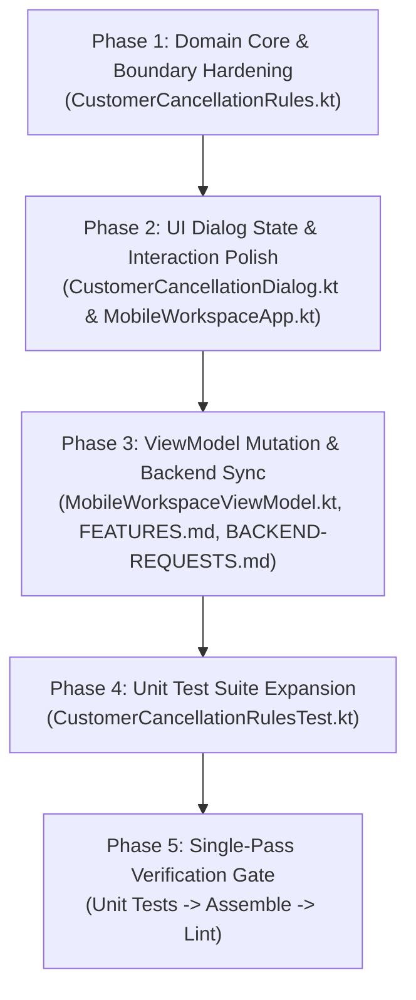

# C10 Bug Fix Implementation Plan: Customer Self-Service Shipment Cancellation

**Target Scope:** Remediation of Audit Findings on Backlog Item C10 (*Customer self-service shipment cancellation / request withdrawal*)  
**Feature Branch:** `JBranch`  
**Active Working Root:** `app/src/main/java/com/tanaw/app/feature/workspace/`  
**Related Docs:** [`BACKLOG.md`](file:///C:/Users/Soriano/AndroidStudioProjects/Tanaw_Mobile/docs/BACKLOG.md) (C10), [`FEATURES.md`](file:///C:/Users/Soriano/AndroidStudioProjects/Tanaw_Mobile/docs/FEATURES.md) (Row 29), [`BACKEND-REQUESTS.md`](file:///C:/Users/Soriano/AndroidStudioProjects/Tanaw_Mobile/docs/BACKEND-REQUESTS.md#L171-L288) (§3)  
**Date:** 2026-11-12  

---

## 1. Executive Summary & Defect Inventory

The **C10** implementation enables customers to cancel or withdraw their pre-transit shipments (`pending`, `booked`, or `assigned` prior to driver route start) directly from the mobile app with a mandatory, validated reason.

A static code audit and architecture review uncovered **8 specific defects and backend risks**:
1. **Bug 1 (Critical / Backend Contract): Missing Customer `UPDATE` RLS Policy & Backend Unverified** — In `live_schema_dump.sql`, `public.shipments` has no `UPDATE` policy for customers. Direct table update will fail with RLS 403 on production Supabase. Status in [`FEATURES.md`](file:///C:/Users/Soriano/AndroidStudioProjects/Tanaw_Mobile/docs/FEATURES.md) must be tagged **⚠ backend unverified** and synced with [`BACKEND-REQUESTS.md`](file:///C:/Users/Soriano/AndroidStudioProjects/Tanaw_Mobile/docs/BACKEND-REQUESTS.md).
2. **Bug 2 (High / Concurrency & Silent Failure): Unbounded Update Filter in `cancelShipment`** — Filter only checks `eq("id", shipmentId)`. It does not check `status in CANCELLABLE_SHIPMENT_STATUSES`. If a status transition occurred concurrently on the server, the update overwrites it. Furthermore, PostgREST returns 200 with 0 rows on un-matched rows, falsely triggering success confirmation.
3. **Bug 3 (High / Phantom Data): Synthesizing Fake Shipment on Missing ID** — If `shipmentId` is not found in memory, the ViewModel defaults to a synthetic `pending` shipment, passes validation, sends a 0-row update, and injects a phantom cancelled shipment into the customer's workspace.
4. **Bug 4 (High / Misleading Error): Conflating Terminal Status with `DRIVER_ALREADY_EN_ROUTE`** — When attempting to cancel an already completed, delivered, or reviewed shipment, the ViewModel throws `DRIVER_ALREADY_EN_ROUTE`, displaying *"Cannot cancel shipment because the driver is already on the way"* instead of `"This shipment can no longer be cancelled"`.
5. **Bug 5 (Medium / Isolation Failure): Blank `shipment_id` Delivery Matching in `canCancelShipment`** — The predicate `dShipmentId.isBlank() || dShipmentId == shipmentId` treats deliveries with blank IDs as matching every shipment, falsely locking cancellation across all shipments if one unlinked delivery has milestones.
6. **Bug 6 (Medium / State Classification): Missing `"delivered"` in `TERMINAL_OR_REVIEW_SHIPMENT_STATUSES`** — Shipments with status `"delivered"` are not recognized as terminal in `CustomerCancellationRules`, producing an erroneous ineligibility lock banner.
7. **Bug 7 (Medium / UI State Leak): Dialog State Keyed by `trackingNumber`** — When `tracking_number` is blank, `rememberSaveable(trackingNumber)` leaks the draft reason and selected preset across different shipments.
8. **Bug 8 (Low / UX Polish): Lingering `state.error` on Dialog Dismissal** — If cancellation fails (e.g. network timeout), dismissing the dialog via *"Keep Shipment"* leaves the error banner visible in the workspace top notices.

---

## 2. Multi-Agent Concurrency & Workflow Rules

To maximize delivery speed while preventing workstation crashes and branch divergence, multiple agents can operate simultaneously under the following strict protocol:

### 2.1 File Partitioning Matrix

| Agent Role | Exclusively Owned Files | Shared Files (Surgical Touchpoints Only) |
|:---|:---|:---|
| **Agent A (Domain Core & Tests)** | [`CustomerCancellationRules.kt`](file:///C:/Users/Soriano/AndroidStudioProjects/Tanaw_Mobile/app/src/main/java/com/tanaw/app/feature/workspace/CustomerCancellationRules.kt)<br>[`CustomerCancellationRulesTest.kt`](file:///C:/Users/Soriano/AndroidStudioProjects/Tanaw_Mobile/app/src/test/java/com/tanaw/app/feature/workspace/CustomerCancellationRulesTest.kt) | None |
| **Agent B (UI & Presentation)** | [`CustomerCancellationDialog.kt`](file:///C:/Users/Soriano/AndroidStudioProjects/Tanaw_Mobile/app/src/main/java/com/tanaw/app/feature/workspace/CustomerCancellationDialog.kt) | [`MobileWorkspaceApp.kt`](file:///C:/Users/Soriano/AndroidStudioProjects/Tanaw_Mobile/app/src/main/java/com/tanaw/app/feature/workspace/MobileWorkspaceApp.kt) (Lines 420–435 only) |
| **Agent C (ViewModel & Backend Sync)** | [`BACKEND-REQUESTS.md`](file:///C:/Users/Soriano/AndroidStudioProjects/Tanaw_Mobile/docs/BACKEND-REQUESTS.md)<br>[`FEATURES.md`](file:///C:/Users/Soriano/AndroidStudioProjects/Tanaw_Mobile/docs/FEATURES.md) | [`MobileWorkspaceViewModel.kt`](file:///C:/Users/Soriano/AndroidStudioProjects/Tanaw_Mobile/app/src/main/java/com/tanaw/app/feature/workspace/MobileWorkspaceViewModel.kt) (Lines 1045–1115 only) |

### 2.2 Strict Safe Concurrency Rules
1. **Single Working Branch (`JBranch`):** All agents commit directly to `JBranch`. Do not create or switch to isolated feature branches.
2. **Domain Isolation First:** Agent A edits only [`CustomerCancellationRules.kt`](file:///C:/Users/Soriano/AndroidStudioProjects/Tanaw_Mobile/app/src/main/java/com/tanaw/app/feature/workspace/CustomerCancellationRules.kt) and test fixtures. Agent B and Agent C will consume these updated rules without altering the rules file.
3. **Surgical Integrations in Shared Files:** When editing [`MobileWorkspaceViewModel.kt`](file:///C:/Users/Soriano/AndroidStudioProjects/Tanaw_Mobile/app/src/main/java/com/tanaw/app/feature/workspace/MobileWorkspaceViewModel.kt) and [`MobileWorkspaceApp.kt`](file:///C:/Users/Soriano/AndroidStudioProjects/Tanaw_Mobile/app/src/main/java/com/tanaw/app/feature/workspace/MobileWorkspaceApp.kt), agents MUST read the file immediately before modifying and apply only narrow, targeted replacements using `replace_file_content`. Never overwrite entire shared files.
4. **Hardware Protection / No Intermediate Builds:**  
   > [!CAUTION]
   > **DO NOT trigger `./gradlew` builds, assemble tasks, or unit test runs during Phases 1, 2, or 3.**  
   > Concurrent Gradle daemon spawns and repetitive compilation saturate CPU and RAM, causing system freezes and crashes. All verification builds and test executions are deferred strictly to **Phase 5 (Verification Gate)** after all code edits are in place.

---

## 3. Phased Implementation Roadmap



---

### Phase 1: Domain Core & Boundary Hardening

**Primary File:** [`CustomerCancellationRules.kt`](file:///C:/Users/Soriano/AndroidStudioProjects/Tanaw_Mobile/app/src/main/java/com/tanaw/app/feature/workspace/CustomerCancellationRules.kt)  
**Assigned To:** Agent A  

#### Objectives & Technical Changes
1. **Fix Bug 5 (Strict Delivery ID Matching):**
   In `canCancelShipment`:
   ```kotlin
   // BEFORE:
   val relevantDeliveries = if (shipmentId.isNotBlank()) {
       deliveries.filter { d ->
           val dShipmentId = d.value("shipment_id").trim()
           dShipmentId.isBlank() || dShipmentId == shipmentId
       }
   } else { deliveries }

   // AFTER:
   val relevantDeliveries = if (shipmentId.isNotBlank()) {
       deliveries.filter { d -> d.value("shipment_id").trim() == shipmentId }
   } else {
       deliveries
   }
   ```
2. **Fix Bug 6 (Terminal Status Set Expansion):**
   Update `TERMINAL_OR_REVIEW_SHIPMENT_STATUSES`:
   ```kotlin
   val TERMINAL_OR_REVIEW_SHIPMENT_STATUSES = setOf("review", "completed", "cancelled", "delivered")
   ```
3. **Fix Bug 4 (Specific Ineligibility Reasons):**
   Provide dedicated validation methods in `CustomerCancellationRules`:
   ```kotlin
   fun isStatusCancellable(status: String): Boolean =
       status.trim().lowercase() in CANCELLABLE_SHIPMENT_STATUSES

   fun checkCancellationEligibility(shipment: JsonObject, deliveries: List<JsonObject>): CancellationEligibility {
       val status = shipment.value("status").trim().lowercase()
       if (!isStatusCancellable(status)) {
           return CancellationEligibility.IneligibleStatus(status)
       }
       val shipmentId = shipment.value("id").trim()
       val relevant = if (shipmentId.isNotBlank()) {
           deliveries.filter { it.value("shipment_id").trim() == shipmentId }
       } else deliveries
       
       return if (areDeliveriesCancellable(relevant)) {
           CancellationEligibility.Eligible
       } else {
           CancellationEligibility.DriverEnRoute
       }
   }
   ```
   Define sealed interface `CancellationEligibility`:
   ```kotlin
   sealed interface CancellationEligibility {
       object Eligible : CancellationEligibility
       object DriverEnRoute : CancellationEligibility
       data class IneligibleStatus(val status: String) : CancellationEligibility
   }
   ```
4. **Fix Optimistic Update Edge Cases:**
   In `optimisticCancelUpdate`:
   - Match delivery status case-insensitively: `d.value("status").trim().equals("assigned", ignoreCase = true)`.
   - In `updatedShipments`, when `fallbackShipment` is provided, maintain descending `created_at` chronological order rather than prepending blindly to index 0:
     ```kotlin
     if (!foundInData && fallbackShipment != null && fallbackShipment.value("id") == shipmentId) {
         (list + markShipmentCancelled(fallbackShipment))
             .sortedWith { a, b -> CustomerPaginationRules.compareTimestampsDesc(a.value("created_at"), b.value("created_at")) }
     } else {
         list
     }
     ```

---

### Phase 2: UI Dialog State & Interaction Polish

**Primary Files:**  
- [`CustomerCancellationDialog.kt`](file:///C:/Users/Soriano/AndroidStudioProjects/Tanaw_Mobile/app/src/main/java/com/tanaw/app/feature/workspace/CustomerCancellationDialog.kt)  
- [`MobileWorkspaceApp.kt`](file:///C:/Users/Soriano/AndroidStudioProjects/Tanaw_Mobile/app/src/main/java/com/tanaw/app/feature/workspace/MobileWorkspaceApp.kt)  
**Assigned To:** Agent B  

#### Objectives & Technical Changes
1. **Fix Bug 7 (Key Saved Dialog State on `shipmentId`):**
   - Update `CustomerCancellationDialog` parameters:
     ```kotlin
     internal fun CustomerCancellationDialog(
         shipmentId: String,
         trackingNumber: String,
         state: MobileState,
         onDismiss: () -> Unit,
         onConfirm: (String) -> Unit
     )
     ```
   - Update `rememberSaveable` keys:
     ```kotlin
     var selectedPreset by rememberSaveable(shipmentId) { mutableStateOf("") }
     var reasonText by rememberSaveable(shipmentId) { mutableStateOf("") }
     ```
2. **Fix Bug 8 (Clear Error on Dialog Dismissal):**
   - In `CustomerCancellationSection`, expose an `onDismiss` callback that resets any active mutation error:
     ```kotlin
     onDismiss = {
         if (!state.busy) {
             showDialog = false
             onClearError()
         }
     }
     ```
   - In `CustomerCancellationDialog`, add focus clearing on submit and disabled border styling:
     ```kotlin
     border = BorderStroke(
         1.dp,
         if (!state.busy && !state.offline) MaterialTheme.colorScheme.error 
         else MaterialTheme.colorScheme.error.copy(alpha = 0.38f)
     )
     ```

---

### Phase 3: ViewModel Mutation & Backend Sync

**Primary Files:**  
- [`MobileWorkspaceViewModel.kt`](file:///C:/Users/Soriano/AndroidStudioProjects/Tanaw_Mobile/app/src/main/java/com/tanaw/app/feature/workspace/MobileWorkspaceViewModel.kt)  
- [`FEATURES.md`](file:///C:/Users/Soriano/AndroidStudioProjects/Tanaw_Mobile/docs/FEATURES.md)  
- [`BACKEND-REQUESTS.md`](file:///C:/Users/Soriano/AndroidStudioProjects/Tanaw_Mobile/docs/BACKEND-REQUESTS.md)  
**Assigned To:** Agent C  

#### Objectives & Technical Changes
1. **Fix Bug 3 & Bug 4 (Strict Target Resolution & Discriminated Errors):**
   In `cancelShipment`:
   ```kotlin
   val currentData = mutable.value.data
   val allShipments = mutable.value.customerShipments.orEmpty() + currentData?.rows("shipments").orEmpty()
   val targetShipment = allShipments.firstOrNull { it.value("id") == shipmentId }
       ?: currentData?.rows("shipments")?.firstOrNull { it.value("id") == shipmentId }
       ?: error("SHIPMENT_NOT_FOUND")

   val relevantDeliveries = currentData?.rows("deliveries")?.filter { it.value("shipment_id") == shipmentId }.orEmpty()

   when (val eligibility = CustomerCancellationRules.checkCancellationEligibility(targetShipment, relevantDeliveries)) {
       is CancellationEligibility.Eligible -> Unit
       is CancellationEligibility.IneligibleStatus -> error("SHIPMENT_NOT_CANCELLABLE")
       is CancellationEligibility.DriverEnRoute -> error("DRIVER_ALREADY_EN_ROUTE")
   }
   ```
2. **Fix Bug 2 (Bounded Update Query & Concurrency Safety):**
   Update the PostgREST mutation to enforce status conditions:
   ```kotlin
   mutate = {
       client.from("shipments").update(
           buildJsonObject {
               put("status", "cancelled")
               put("cancelled_reason", normalizedReason)
               put("cancelled_at", nowIso)
           }
       ) {
           filter {
               eq("id", shipmentId)
               isIn("status", CustomerCancellationRules.CANCELLABLE_SHIPMENT_STATUSES.toList())
           }
       }
   }
   ```
3. **Fix Bug 9 (Synchronous & Controlled Refresh):**
   In `cancelShipment`:
   - Replace redundant asynchronous `loadDetails(shipmentId)` with the existing `reloadWorkspaceAndDetails()`.
   - Add `clearCancellationError()` helper to reset error state on dialog close.
4. **Fix Bug 1 (Docs & Backend Verification Notice):**
   - In [`FEATURES.md`](file:///C:/Users/Soriano/AndroidStudioProjects/Tanaw_Mobile/docs/FEATURES.md) row 29, update notes to explicitly declare **⚠ backend unverified**: Customer self-service cancellation is implemented on client with pre-transit validation, pending production deployment of the proposed Supabase RLS update policy or atomic `mobile_cancel_shipment` RPC documented in `docs/BACKEND-REQUESTS.md` §3.

---

### Phase 4: Unit Test Suite Expansion

**Primary File:** [`CustomerCancellationRulesTest.kt`](file:///C:/Users/Soriano/AndroidStudioProjects/Tanaw_Mobile/app/src/test/java/com/tanaw/app/feature/workspace/CustomerCancellationRulesTest.kt)  
**Assigned To:** Agent A  

#### New Test Cases to Add
1. `deliveredShipmentIsRecognizedAsTerminalAndNotCancellable()` — Asserts `canCancelShipment` is `false` and `ineligibilityReason` is `null` for `"delivered"` status.
2. `deliveriesForOtherShipmentsDoNotBlockCancellation()` — Multi-delivery list with active milestones on an unrelated shipment does not block the target shipment.
3. `deliveryWithBlankShipmentIdDoesNotMatchTargetShipment()` — Verifies fix for Bug 5.
4. `checkCancellationEligibilityDifferentiatesStatusFromDriverMilestones()` — Verifies `IneligibleStatus` vs `DriverEnRoute` discrimination.
5. `whitespaceOnlyReasonRejectedRegardlessOfLength()` — Tests `"   "` and `"\n\t  "`.
6. `optimisticCancelPreservesChronologicalOrderForFallbackShipment()` — Verifies fallback shipment insertion does not violate `created_at DESC` ordering.

---

### Phase 5: Single-Pass Verification Gate (Last Phase)

> [!IMPORTANT]
> **This phase is executed ONLY ONCE after all code changes across Phases 1–4 are fully written.**  
> Do not execute these tasks concurrently. Run them sequentially one at a time.

1. **Targeted Unit Test Verification:**
   ```powershell
   ./gradlew testDebugUnitTest --tests com.tanaw.app.feature.workspace.CustomerCancellationRulesTest
   ```
2. **Full Unit Test Suite:**
   ```powershell
   ./gradlew testDebugUnitTest
   ```
3. **Assembly Build Verification:**
   ```powershell
   ./gradlew assembleDebug
   ```
4. **Lint & Static Hygiene Check:**
   ```powershell
   ./gradlew lintDebug
   ```

---

## 4. Work Tracking & Completion Checklist

- [x] **Phase 1: Domain Core & Boundary Hardening**
  - [x] Strict delivery ID matching (`dShipmentId == shipmentId`)
  - [x] Add `"delivered"` to `TERMINAL_OR_REVIEW_SHIPMENT_STATUSES`
  - [x] Implement `CancellationEligibility` sealed interface
  - [x] Case-insensitive delivery status and sorted fallback insertion in `optimisticCancelUpdate`
- [x] **Phase 2: UI Dialog State & Interaction Polish**
  - [x] Key `rememberSaveable` on `shipmentId`
  - [x] Disabled border alpha adjustment
  - [x] Error reset on dialog dismissal (`onClearError`)
- [x] **Phase 3: ViewModel Mutation & Backend Sync**
  - [x] Fail on missing shipment (`error("SHIPMENT_NOT_FOUND")`)
  - [x] Discriminate `SHIPMENT_NOT_CANCELLABLE` from `DRIVER_ALREADY_EN_ROUTE`
  - [x] Add `isIn("status", ...)` condition to `mutate` filter
  - [x] Tag row 29 in `FEATURES.md` as **⚠ backend unverified**
- [x] **Phase 4: Unit Test Suite Expansion**
  - [x] 6 new unit tests in `CustomerCancellationRulesTest.kt`
- [x] **Phase 5: Single-Pass Quality Gate**
  - [x] `./gradlew testDebugUnitTest --tests com.tanaw.app.feature.workspace.CustomerCancellationRulesTest`
  - [x] `./gradlew testDebugUnitTest`
  - [x] `./gradlew assembleDebug`
  - [x] `./gradlew lintDebug`
