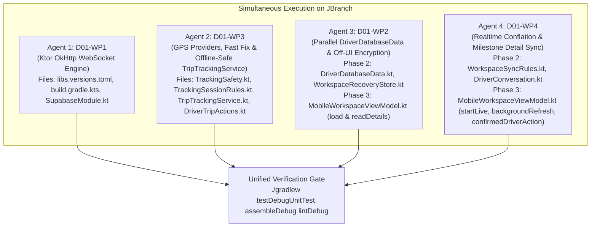

# D01 Bug Findings, Latency Audit & Multi-Agent Implementation Plan

**Backlog Item:** `D01` — Full delivery workflow, screen-off GPS, reconnect, process restart (`docs/BACKLOG.md`, `docs/FEATURES.md` #11, #14, #17, #18, #19, #20, #21, #22, #23, #24, #27, #28)  
**Target Branch:** `JBranch`  
**Active Working Root:** `app/src/main/java/com/tanaw/app/feature/workspace/`  
**Date:** 2026-11-08

---

## 1. Executive Summary

During end-to-end physical workflow testing (`D01`), customer bookings created in the mobile app reflected immediately on the web dashboard, whereas the **driver app exhibited severe latency (30–45+ seconds)** receiving assignments and updating trip state, alongside reliability defects in pickup arrival GPS acquisition, background/offline token expiration, and process restart recovery.

A deep source inspection of the active `feature/workspace/` architecture, Gradle dependency graph, and Ktor/Supabase runtime internals identified **6 root-cause bugs (`D01-B1` through `D01-B6`)**:

| Bug ID | Severity | Summary | Primary Layer |
|:-------|:--------:|:--------|:--------------|
| **D01-B1** | **CRITICAL** | `io.ktor:ktor-client-android` does not support `WebSocketCapability` — Supabase Realtime never connects on Android, forcing the app to rely exclusively on the 30-second fallback poll timer | Gradle / Network Engine (`app/build.gradle.kts`, `gradle/libs.versions.toml`) |
| **D01-B2** | **HIGH** | 8-to-12 sequential network request waterfall in `load()`, `DriverDatabaseData.load()`, and `readDetails()`, plus synchronous Main-thread AndroidKeyStore AES-GCM encryption of up to 2 MB JSON on every refresh | Data Loading & Threading (`DriverDatabaseData.kt`, `MobileWorkspaceViewModel.kt`, `WorkspaceRecoveryStore.kt`) |
| **D01-B3** | **HIGH (RESOLVED)** | Driver milestone actions (`startTrip`, `arrive`, `driver`, `reportIncident`, `addExpense`, `submitProof`) never refresh `state.details` (Live ETA, route status, timeline, evidence) and drop concurrent `backgroundRefresh()` calls while `busy == true` | State Synchronization (`MobileWorkspaceViewModel.kt`, `WorkspaceSyncRules.kt`) |
| **D01-B4** | **HIGH** | Unconflated 13-table Realtime fan-out in `startLive()` triggers concurrent duplicate `backgroundRefresh()` storms (including on the driver's own `tracking_logs` GPS pings every 15s) and tears down/rebuilds the Realtime channel on every manual `refresh()` | Realtime Orchestration (`MobileWorkspaceViewModel.kt`, `DriverConversation.kt`) |
| **D01-B5** | **HIGH** | `TrackingSafety.provider` hardcodes raw satellite `"gps"` ahead of `"fused"`/`"network"`, causing 20-second timeouts on `"I'VE ARRIVED AT PICK-UP"`, plus a 15-second initial upload delay and redundant full `mobile_workspace` RPC calls inside `TripTrackingService` | GPS & Telemetry Service (`TrackingSafety.kt`, `DriverTripActions.kt`, `TripTrackingService.kt`) |
| **D01-B6** | **HIGH** | Offline token expiry (`SessionStatus.RefreshFailure`) and initial ViewModel recreation stop `TripTrackingService`, wipe buffered offline GPS samples from SQLite (`queue.clearOwner`), and fail to auto-resume tracking after process restart | Offline & Process Lifecycle (`TripTrackingService.kt`, `MobileWorkspaceViewModel.kt`) |

---

## 2. Detailed Bug Findings & Technical Root Causes

---

### Bug `D01-B1` (CRITICAL): `io.ktor:ktor-client-android` Does Not Support WebSockets — Supabase Realtime Is 100% Dead

#### Affected Files
- `gradle/libs.versions.toml` (lines 10, 48)
- `app/build.gradle.kts` (line 130)
- `app/src/main/java/com/tanaw/app/di/SupabaseModule.kt` (lines 22–31)
- `app/src/main/java/com/tanaw/app/feature/workspace/MobileWorkspaceViewModel.kt` (`startLive`, lines 119–139)

#### Root Cause Analysis
1. **Engine Capability Mismatch:**
   In `gradle/libs.versions.toml` and `app/build.gradle.kts`, the project declares:
   ```toml
   ktor-client-android = { module = "io.ktor:ktor-client-android", version.ref = "ktorClientAndroid" }
   ```
   Inspection of Ktor's `io.ktor.client.engine.android.AndroidClientEngine` (`ktor-client-android-jvm-3.6.0`) confirms:
   ```kotlin
   override val supportedCapabilities: Set<HttpClientEngineCapability<*>> =
       setOf(HttpTimeoutCapability, SSECapability)
   ```
   `AndroidClientEngine` is backed by legacy `java.net.HttpURLConnection` (HTTP/1.1 only) and **does not support `WebSocketCapability`**.
2. **Silent Failure Loop in `RealtimeImpl` and `startLive()`:**
   - When `MobileWorkspaceViewModel.startLive(uid)` calls `channel.subscribe()`, Supabase's `RealtimeImpl.connect()` invokes `KtorRealtimeWebsocketFactory.create(websocketUrl)`, which attempts `httpClient.webSocketSession(url)`.
   - Ktor immediately throws `IllegalArgumentException: Engine doesn't support WebSocketCapability`.
   - `RealtimeImpl.connect()` catches the exception, logs a warning, waits `config.reconnectDelay` (7 seconds), and calls `reconnect()` in an infinite loop. Meanwhile, `MobileWorkspaceViewModel.startLive(uid)` wraps `channel.subscribe()` in `catch(_: Exception) { delay(10.seconds) }`, silently swallowing any failure.
3. **Why Customer Booking Worked Quickly While Driver App Lagged:**
   - When a customer submits a booking, `MobileWorkspaceViewModel.book()` invokes the `mobile_create_request` PostgREST RPC over standard HTTP POST, and the web dashboard receives the database insert immediately via browser `WebSocket`.
   - When the office assigns the booking to a driver or updates delivery status on the web, the Android app **never receives a single Realtime event**. It only discovers changes when `pollJob` (`while(true) { delay(30.seconds); backgroundRefresh() }`) fires up to **30 seconds later** (plus the 5–10 seconds spent executing `load()`).

#### Follow-Up Fix Recommendation (Requires Dependency Swap)
1. **Replace `io.ktor:ktor-client-android` with `io.ktor:ktor-client-okhttp` (version `3.6.0`):**
   - In `gradle/libs.versions.toml`:
     ```toml
     ktorClientOkhttp = "3.6.0"
     ...
     ktor-client-okhttp = { module = "io.ktor:ktor-client-okhttp", version.ref = "ktorClientOkhttp" }
     ```
   - In `app/build.gradle.kts`:
     Replace `implementation(libs.ktor.client.android)` with `implementation(libs.ktor.client.okhttp)`.
   - **Why `ktor-client-okhttp`:**
     - Full native support for `WebSocketCapability` (required by `io.github.jan-tennert.supabase:realtime-kt` on Android).
     - Supports **HTTP/2 connection multiplexing** and connection pooling, eliminating repeated TLS handshakes across PostgREST, Auth, and Storage requests.
     - Automatically discovered by Ktor's `HttpClient` `ServiceLoader` on Android, or can be explicitly passed as `httpEngine = OkHttp.create()` in `SupabaseModule.kt`.
2. **Reuse `SupabaseClient.httpClient` or Shared `OkHttpClient` for Edge Function Calls:**
   - `readRouteStatus`, `requestRoutePreview`, and `loginWithContactEmail` in `MobileWorkspaceViewModel.kt` currently open raw `java.net.URL(...).openConnection() as HttpURLConnection` instances, bypassing connection pooling. They can either remain or use the pooled client.

---

### Bug `D01-B2` (HIGH): 8-to-12 Sequential Network Request Waterfall + Main-Thread Keystore Encryption in `load()` and `readDetails()`

#### Affected Files
- `app/src/main/java/com/tanaw/app/feature/workspace/DriverDatabaseData.kt` (lines 7–40)
- `app/src/main/java/com/tanaw/app/feature/workspace/MobileWorkspaceViewModel.kt` (`load`, lines 300–372; `readDetails`, lines 1168–1205)
- `app/src/main/java/com/tanaw/app/feature/workspace/WorkspaceRecoveryStore.kt` (`write` / `read`, lines 48–62)

#### Root Cause Analysis
1. **Sequential 8-Call Waterfall in Driver `load()`:**
   Every time `load()` runs for a driver (on login, on manual refresh, on every Realtime event, on every 30s poll, and **after every driver milestone button tap**), it executes **8 separate network requests sequentially**:
   ```
   [1] RPC: mobile_workspace (queries users, customers, vehicle_types, 200 shipments, 200 deliveries, 200 documents, 100 notifications)
    └──> [2] SELECT system_settings
          └──> [3] SELECT drivers (WHERE user_id = id)
                └──> [4] SELECT trucks
                      └──> [5] SELECT compliance_documents (WHERE driver_id = driverId)
                            └──> [6] SELECT deliveries (WHERE driver_id = driverId LIMIT 200)
                                  └──> [7] SELECT delivery_expenses (WHERE driver_id = driverId LIMIT 200)
                                        └──> [8] RPC: delivery_conversation_unread
   ```
   - On a mobile network with 150–300 ms round-trip latency per PostgREST request, running 8 calls strictly in series adds **1.5 to 3.5+ seconds** of pure waiting time on every refresh and after every button press.
   - `ConfirmedMutation.run` in `confirmedDriverAction` awaits `load()` before `operation` sets `busy = false`. Thus, every driver button tap (`START ROUTE`, `I'VE ARRIVED AT PICK-UP`, `CUSTOMER ARRIVED AT PICK-UP`, `CARGO LOADED`, `COMPLETE DELIVERY`) freezes the UI in `busy = true` for the entire 8-request sequential chain.
2. **Sequential 4-Call Waterfall in Driver `readDetails(id)` Blocked by External HGV Routing:**
   In `MobileWorkspaceViewModel.readDetails(id)` (lines 1187–1204):
   ```kotlin
   val details = client.postgrest.rpc("mobile_shipment_details", ...).decodeAs<JsonObject>()
   ...
   val extra = try { client.postgrest.rpc("mobile_driver_fuel_history", ...) } ...
   val evidence = try { client.postgrest.rpc("mobile_driver_evidence", ...) } ...
   val routing = try { readRouteStatus(delivery) } ... // Calls /functions/v1/delivery-routing (OpenRouteService HGV, 10s connect / 20s read timeout!)
   ```
   - `loadDetails(id)` sets `details = null, detailLoading = true` before calling `readDetails(id)`.
   - Because all 4 calls run sequentially, the fast database RPCs (`mobile_shipment_details`, `mobile_driver_fuel_history`, `mobile_driver_evidence`) cannot render in the UI until `readRouteStatus(delivery)` (which calls an external Edge Function + OpenRouteService HGV API) finishes or times out!
   - Furthermore, while `state.details` is `null` during loading, `DriverNavigateOverview.kt` (line 82) passes an empty `buildJsonObject{}` to `DriverRouteStatusCard`, falsely displaying `"Truck route awaiting office confirmation"` and `"ETA unavailable: office-confirmed truck route required"` even for trips whose routes are already confirmed.
3. **Synchronous Main-Thread AndroidKeyStore AES-GCM Encryption & Disk Write:**
   In `MobileWorkspaceViewModel.load()` (lines 344–345):
   ```kotlin
   val snapshot = RecoveryPolicy.workspace(data, id)
   val cached = snapshot == null || recoveryStore.write(id, buildJsonObject { ... })
   ```
   `viewModelScope` runs on `Dispatchers.Main.immediate`. `recoveryStore.write` serializes `data` (containing up to 200 shipments, 200 deliveries, 200 expenses, 100 notifications), initializes an `AndroidKeyStore` `AES/GCM/NoPadding` cipher (hardware/TEE Binder IPC), encrypts the payload, and writes it via `AtomicFile` synchronously on the UI thread!

#### Follow-Up Fix Recommendations
1. **Parallelize `DriverDatabaseData.load()` with `coroutineScope` + `async`:**
   - Run `readSettings()`, `section("drivers", ...)`, and `section("trucks", ...)` (which does not filter by `driverId` as Truck RLS handles it) concurrently.
   - As soon as `drivers` resolves `driverId`, launch `section("compliance_documents", ...)`, `section("deliveries", ...)`, and `section("delivery_expenses", ...)` concurrently via `async`.
   - In `MobileWorkspaceViewModel.load()`, run `delivery_conversation_unread` concurrently alongside `DriverDatabaseData.load(...)`.
   - This collapses the 7 post-workspace sequential round-trips into **2 parallel stages**, cutting driver `load()` latency by ~65–75%.
2. **Parallelize `readDetails(id)` with `coroutineScope` + `async`:**
   - Launch `mobile_shipment_details`, `mobile_driver_fuel_history`, `mobile_driver_evidence`, and `readRouteStatus(delivery)` in parallel using `coroutineScope { async { ... } }`.
   - Preserve previous `state.details` when reloading details for the **same** `shipment_id` (`details = it.details?.takeIf { d -> d.value("shipment_id") == id }`) instead of wiping `details = null` on every reload, preventing UI flicker and false `"Truck route awaiting office confirmation"` flashes.
3. **Move `WorkspaceRecoveryStore.write` / `read` Off the Main Thread:**
   - Wrap disk + AndroidKeyStore operations in `withContext(Dispatchers.IO)` (or add `suspend fun writeAsync` / `readAsync` on `WorkspaceRecoveryStore`), keeping `WorkspaceRecoveryStore`'s synchronous methods intact for existing unit tests.

---

### Bug `D01-B3` (HIGH — RESOLVED): Driver Milestone Actions Leave `state.details` Stale and Drop Concurrent Refreshes

#### Affected Files
- `app/src/main/java/com/tanaw/app/feature/workspace/MobileWorkspaceViewModel.kt` (`backgroundRefresh`, lines 140–158; `confirmedDriverAction`, lines 1084–1108; `reportIncident`, lines 1117–1133; `addExpense`, lines 1134–1165; `submitProof`, lines 1166–1192)
- `app/src/main/java/com/tanaw/app/feature/workspace/DriverWorkspace.kt` (line 175)

#### Root Cause Analysis
1. **`confirmedDriverAction` Never Reloads `state.details`:**
   - In `DriverWorkspaceScreen` (`DriverWorkspace.kt` line 175):
     ```kotlin
     LaunchedEffect(shipment?.value("id"), tab) { if (shipment != null) onDetails(shipment.value("id")) }
     ```
     This `LaunchedEffect` only runs when the selected `shipment.id` or `tab` changes.
   - When the driver is already on the `Navigate` tab (`tab == "Navigate"`) and taps **START ROUTE AND SHARE LOCATION** (`startTrip`), **I'VE ARRIVED AT PICK-UP** (`arrive`), **CUSTOMER ARRIVED AT PICK-UP** (`driver(id, "showed")`), **Report no-show** (`driver(id, "no_show")`), **CARGO LOADED** (`driver(id, "loaded")`), **Report an Issue** (`reportIncident`), **Add Trip Expense** (`addExpense`), or **COMPLETE DELIVERY** (`submitProof`), the ViewModel calls `load()`, which updates `state.data`, **but never refreshes `state.details`**!
   - By contrast, `logFuel` (line 591) explicitly does:
     ```kotlin
     mutable.value.details?.value("shipment_id")?.takeIf(String::isNotBlank)?.let(::loadDetails)
     ```
2. **Concurrent `backgroundRefresh()` Calls Are Dropped While `busy == true`:**
   - Line 141 of `MobileWorkspaceViewModel.kt`:
     ```kotlin
     private suspend fun backgroundRefresh() {
         if (mutable.value.busy || mutable.value.page != "workspace") return
     ```
   - While `operation` is executing a driver mutation and its follow-up `load()`, `mutable.value.busy` is `true`. If a Realtime notification or poll tick fires during that window, `backgroundRefresh()` immediately returns and **discards the refresh** without queuing a pending flag.
3. **User-Visible Impact:**
   - After starting the route, arriving at pickup, loading cargo, or submitting an expense/incident/proof on the `Navigate` screen:
     - `DriverRouteStatusCard` (`state.details.obj("routing")`) still shows the old leg/ETA (e.g. `"ETA to pickup"` even after cargo is loaded and the truck is `in_transit` to `"destination"`).
     - `DriverRecordedTimeline` (`state.details.rows("history")` and `events`) does not show the milestone that was just recorded.
     - `DriverEvidenceRecords` (`state.details.rows("expenses")` and `incidents`) does not show the newly submitted expense or incident until the user manually taps `"Refresh trip records"` or waits 30 seconds!

#### Follow-Up Fix Recommendations
1. **Create `WorkspaceSyncRules.kt` and Refresh Active `details` After Driver Mutations:**
   - Extract a helper method in `MobileWorkspaceViewModel` (e.g., `refreshActiveDetailsIfOpen()`) or include detail refresh inside `confirmedDriverAction`, `reportIncident`, `addExpense`, and `submitProof` so that if `mutable.value.details?.value("shipment_id")` is non-blank, `readDetails(shipmentId)` is refreshed automatically alongside `load()`.
2. **Queue Deferred Refresh When `backgroundRefresh()` Arrives During `busy == true`:**
   - Track a `pendingBackgroundRefresh: Boolean` flag (via `WorkspaceSyncRules`). If `backgroundRefresh()` is invoked while `mutable.value.busy == true`, set `pendingBackgroundRefresh = true`, and trigger `backgroundRefresh()` in `operation`'s `finally` block once `busy` becomes `false`.

---

### Bug `D01-B4` (HIGH): Unconflated 13-Table Realtime Fan-Out Storm & Redundant Channel Rebuilds

#### Affected Files
- `app/src/main/java/com/tanaw/app/feature/workspace/MobileWorkspaceViewModel.kt` (`startLive`, lines 119–139; `refresh`, line 380; `login`, line 620)
- `app/src/main/java/com/tanaw/app/feature/workspace/DriverConversation.kt` (lines 134, 163)

#### Root Cause Analysis
1. **13 Unconflated Coroutines Calling `backgroundRefresh()` Concurrently:**
   In `MobileWorkspaceViewModel.startLive(uid)` (lines 125–131):
   ```kotlin
   listOf("shipments","deliveries","notifications","tracking_logs","shipment_status_history","drivers","trucks","compliance_documents","system_settings","delivery_expenses","delivery_incidents","incident_attachments","delivery_messages").forEach { table ->
       val changes = channel.postgresChangeFlow<PostgresAction>(schema="public") { this.table = table }
       launch { changes.collect { delay(300.milliseconds); backgroundRefresh() } }
   }
   ```
   - Notice that each of the 13 tables has its own independent `launch` coroutine with its own `delay(300.milliseconds)` and **no shared debounce/conflation or Mutex**.
   - When a single delivery milestone occurs, the backend transaction updates `deliveries`, `shipments`, `shipment_status_history`, and `notifications` simultaneously.
   - Once WebSockets are enabled (`D01-B1`), all 4 table flows emit within milliseconds of each other, wait 300ms in parallel, and invoke `backgroundRefresh()` **4 times simultaneously**—firing 32 to 48 concurrent HTTP requests and 4 concurrent Keystore writes!
2. **Driver Subscribes to Own `tracking_logs` Changes:**
   - `supabase_realtime` publishes `public.tracking_logs` (`live_schema_dump.sql` line 2454).
   - While `TripTrackingService` is running, the driver's phone inserts a row into `tracking_logs` every 15 seconds via `driver_record_position`.
   - Subscribing a driver to `tracking_logs` triggers a full `backgroundRefresh()` (`load()` + `readDetails()`) every 15 seconds in response to the driver's own GPS telemetry! (Only customers viewing `ShipmentDetails` need live `tracking_logs` updates for the vehicle pin, or `tracking_logs` events should only refresh `details` when a customer is viewing a shipment, or be coalesced/throttled).
3. **Tearing Down & Rebuilding the Realtime Channel on Every `refresh()`:**
   - `MobileWorkspaceViewModel.refresh()` (line 380) calls `load(); loadedUser?.let(::startLive)`.
   - `startLive` cancels `liveJob` (which unsubscribes and removes the Realtime channel) and creates a brand-new WebSocket channel subscription every single time the user taps `"Refresh"` or sends/marks-read a message in `DriverConversation` (`changed = vm::refresh`)!
   - `startLive` should only be started if `liveJob?.isActive != true` (or when `loadedUser` changes).

#### Follow-Up Fix Recommendations
1. **Conflate & Debounce Realtime Events + Single-Flight Mutex on `backgroundRefresh()`:**
   - Merge all `postgresChangeFlow` table flows in `startLive` using `merge(...).conflate()` (or a `Channel<String>(Channel.CONFLATED)`) with a single `delay(400.milliseconds)` debounce loop and a `Mutex` (`refreshMutex`) so `backgroundRefresh()` never runs concurrently with itself.
   - For `tracking_logs` events when `role == "driver"`, skip full `load()` and at most refresh `details` if throttled (e.g., $\ge 15\text{s}$ since last detail refresh), avoiding a full workspace reload on every own GPS sample.
2. **Do Not Tear Down Active `liveJob` on Manual `refresh()`:**
   - Introduce `ensureLive(uid: String)` that only calls `startLive(uid)` if `liveJob?.isActive != true` or the subscribed `uid` changed.

---

### Bug `D01-B5` (HIGH): `TrackingSafety.provider` Hardcodes `"gps"` First, Causing 20s Pickup Arrival Timeouts & 15s Initial GPS Upload Delay

#### Affected Files
- `app/src/main/java/com/tanaw/app/feature/workspace/TrackingSafety.kt` (lines 3–11)
- `app/src/main/java/com/tanaw/app/feature/workspace/DriverTripActions.kt` (`freshDriverLocation`, lines 28–43)
- `app/src/main/java/com/tanaw/app/feature/workspace/TripTrackingService.kt` (lines 64–106)

#### Root Cause Analysis
1. **`TrackingSafety.provider` Always Selects Raw Satellite `"gps"` Over `"fused"` / `"network"`:**
   In `TrackingSafety.kt`:
   ```kotlin
   fun provider(enabled:(String)->Boolean):String = listOf("gps","network").firstOrNull {
       runCatching {enabled(it)}.getOrDefault(false)
   } ?: error("Location services are disabled or unavailable. Enable location, then Resume location sharing.")
   ```
   - On Android devices with Location enabled, `LocationManager.GPS_PROVIDER` (`"gps"`) is always reported as enabled, even indoors, under warehouse loading bays, or in dense urban streets.
   - Consequently, `TrackingSafety.provider` **always returns `"gps"`** and **never uses `"fused"` (`LocationManager.FUSED_PROVIDER`, standard on Android 12 / API 31+) or `"network"`**.
   - When the driver taps **"I'VE ARRIVED AT PICK-UP"**, `freshDriverLocation` (`DriverTripActions.kt` line 33) calls `LocationManagerCompat.getCurrentLocation(manager, "gps", ...)` with a 20-second timeout. If raw satellite GPS cannot lock indoors or under a roof, the button hangs on `"Getting fresh location…"` for **20 full seconds** and fails with a timeout—even when `"fused"` or `"network"` has an accurate fix ($< 100\text{m}$, $< 60\text{s}$ old) available in $< 1\text{s}$!
   - Similarly, `TripTrackingService` only registers `locations.requestLocationUpdates("gps", 15000, 0f, ...)`, receiving zero location updates whenever satellite line-of-sight is obstructed.
2. **15-Second Initial Upload Latency in `TripTrackingService`:**
   In `TripTrackingService.kt` (lines 72–95):
   - When `onStartCommand` starts the service, `loop` immediately executes its first iteration at $t = 0\text{s}$ **before** `requestLocationUpdates` has delivered a single location fix (`queue` is empty, `lastFix` is `null`), calls the heavy `mobile_workspace` RPC, sets status to `"Waiting for fresh accurate GPS · try outdoors"`, and sleeps for `delay(15.seconds)`.
   - When `onLocationChanged` receives a valid GPS fix at $t = 1\text{s}$, it only writes to SQLite (`queue.add(uid, id, location)`) without updating `TripTrackingStatus` or waking the flush loop. The sample sits in SQLite for up to **15 seconds** before `driver_record_position` is ever called!
3. **Heavy `mobile_workspace` RPC Called Every 15 Seconds Inside `TripTrackingService`:**
   - Inside `TripTrackingService`'s 15-second loop (line 77):
     ```kotlin
     val data = client.postgrest.rpc("mobile_workspace").decodeAs<JsonObject>()
     ```
     Every 15 seconds, the background service downloads the entire `mobile_workspace` payload (up to 200 shipments, 200 deliveries, 200 documents, 100 notifications) just to check the single delivery's `status`!
   - A lightweight single-row query on `public.deliveries` (`select(Columns.raw("id,status")) { filter { eq("id", id) } }`) or flushing the queue immediately before checking status is orders of magnitude faster and lighter on battery/data.

#### Follow-Up Fix Recommendations
1. **Upgrade Provider Selection & Multi-Provider Fallback (`TrackingSafety.kt`, `DriverTripActions.kt`, `TripTrackingService.kt`):**
   - Add `providers(enabled: (String) -> Boolean): List<String>` to `TrackingSafety` prioritizing `"fused"` (API 31+), `"gps"`, and `"network"` (while keeping `TrackingSafety.provider` backward-compatible for existing unit tests).
   - In `freshDriverLocation(context)`:
     - Query available providers (`"fused"`, `"gps"`, `"network"`) concurrently or fall back from `"gps"`/`"fused"` to `"network"` (and check `getLastKnownLocation` if it is already valid and $< 30\text{s}$ old and $\le 100\text{m}$ accuracy!) so pickup arrival resolves in $< 1\text{s}$ instead of hanging 20 seconds.
   - In `TripTrackingService`:
     - Register `requestLocationUpdates` on both enabled `"gps"` and `"network"` (or `"fused"` on API 31+) so tracking works seamlessly across outdoor highways and covered loading bays, deduplicating fixes via `TrackingSafety`.
2. **Immediate Flush on First Fix & Lightweight Status Check in `TripTrackingService`:**
   - Use a `Channel<Unit>(Channel.CONFLATED)` wake signal in `TripTrackingService` so when `onLocationChanged` enqueues a valid fix (especially the first fix!), it immediately updates `TripTrackingStatus` to `"Sharing trip location"` and wakes the flush loop to call `driver_record_position` right away instead of waiting 15 seconds.

---

### Bug `D01-B6` (HIGH): Offline Token Expiry (`RefreshFailure`) & ViewModel Recreation Stop `TripTrackingService` and Wipe Queued GPS Samples

#### Affected Files
- `app/src/main/java/com/tanaw/app/feature/workspace/TripTrackingService.kt` (lines 74, 101)
- `app/src/main/java/com/tanaw/app/feature/workspace/MobileWorkspaceViewModel.kt` (`stopLive`, line 118; `sessionStatus.collect`, lines 217–247; `load`, line 370)

#### Root Cause Analysis
1. **Offline Token Expiry (`SessionStatus.RefreshFailure`) Kills Tracking & Deletes Buffered SQLite Samples:**
   - As documented at `MobileWorkspaceViewModel.kt` line 240:
     > `// Expired sessions expose no currentUser in Auth 3.8.`
   - When the driver is driving through an area with no mobile data (or during the `D01` offline/reconnect test) and the Supabase JWT expires, `client.auth.currentUserOrNull()` returns `null` and `client.auth.sessionStatus` emits `SessionStatus.RefreshFailure`.
   - **Defect A (`MobileWorkspaceViewModel.kt` line 234):**
     The `is SessionStatus.RefreshFailure` branch immediately calls `stopLive()`, which calls `TripTrackingService.stop(context)`! This **kills the foreground GPS tracking service** while the driver is offline.
   - **Defect B (`TripTrackingService.kt` lines 74 & 101):**
     Inside `TripTrackingService`'s loop:
     ```kotlin
     if (client.auth.currentUserOrNull()?.id != uid) { queue.clearOwner(uid); stopSelf(); break }
     ```
     And in `onLocationChanged`:
     ```kotlin
     if (client.auth.currentUserOrNull()?.id != uid || ...) return
     ```
     Because `currentUserOrNull()` returns `null` when the session token expires offline, `client.auth.currentUserOrNull()?.id != uid` evaluates to `true` (`null != uid`). `TripTrackingService` mistakes an offline expired token for an account switch/logout, **deletes all buffered offline GPS samples (`queue.clearOwner(uid)`)**, and stops itself (`stopSelf()`)!
2. **ViewModel Recreation / Process Restart Stops Running Service Instead of Resuming It:**
   - **Defect C (`MobileWorkspaceViewModel.kt` line 224):**
     When `MobileWorkspaceViewModel` initializes on a fresh start or Activity recreation, `loadedUser` is initially `null`. When `SessionStatus.Authenticated` is collected, `if (id != loadedUser)` runs `stopLive()`, which calls `TripTrackingService.stop(context)` — **stopping `TripTrackingService` even if it was already running in the foreground for this exact user!**
   - **Defect D (`TripTrackingService` `START_NOT_STICKY` + No Auto-Resume in `load()`):**
     If Android kills the app process in the background or the device restarts during an active trip (`status in listOf("assigned", "loading", "in_transit")` with `route_started_at` non-blank), reopening the app loads the workspace (`load()`), which checks if it should **stop** `TripTrackingService` (line 370), but never auto-resumes `TripTrackingService.start(context, id, activeDeliveryId)` when location permission is already granted!

#### Follow-Up Fix Recommendations
1. **Create `TrackingSessionRules.kt` to Distinguish Explicit Logout / Account Switch from Offline Token Expiry:**
   - Check `client.auth.sessionStatus.value` and fallback `client.auth.sessionManager.loadSession()?.user?.id`:
     - If `currentUserOrNull()?.id == uid`: authenticated and valid.
     - If `currentUserOrNull() == null` AND (`sessionStatus.value is SessionStatus.RefreshFailure` or `sessionManager.loadSession()?.user?.id == uid`): the same driver is still signed in, but the token is awaiting network refresh. **Keep recording GPS fixes to SQLite (`queue.add`)** and show `"Offline or reconnecting · samples queued"`, skipping network RPC calls until the session refreshes!
     - Only call `queue.clearOwner(uid)` and `stopSelf()` when `sessionStatus.value is SessionStatus.NotAuthenticated` (explicit sign-out) or when the authenticated user ID belongs to a **different** user (`actualUid != null && actualUid != uid`).
2. **Separate `stopRealtimeAndPolling()` from `TripTrackingService.stop(context)` in `MobileWorkspaceViewModel.kt`:**
   - In `SessionStatus.RefreshFailure`, stop Realtime/polling jobs (`liveJob`, `pollJob`), **not** `TripTrackingService`.
   - In `SessionStatus.Authenticated`, only stop `TripTrackingService` when switching from a *different* non-null `loadedUser` (`loadedUser != null && loadedUser != id`).
3. **Auto-Resume Active Trip Tracking on Workspace Load (`load()`) & Reconnect Flush:**
   - In `MobileWorkspaceViewModel.load()`, if the user is a `driver` and has an active delivery (`status in listOf("assigned", "loading", "in_transit")` and `route_started_at.isNotBlank()`), and `ACCESS_FINE_LOCATION` is granted while `TripTrackingStatus.state.value.delivery != activeDeliveryId`, automatically start `TripTrackingService.start(context, id, activeDeliveryId)` (wrapped in `runCatching` for background start restrictions).

---

## 3. Multi-Agent Concurrency Workflow (Working Simultaneously on `JBranch`)

To allow multiple agents across separate conversation threads to fix `D01-B1` through `D01-B6` **at the same time** on `JBranch` without merge conflicts or overwriting each other's edits, work is partitioned into **4 independent work packages (`D01-WP1` to `D01-WP4`)**.

---

### 3.1 Work Package Partitioning & File Ownership Matrix

| Work Package | Bugs Covered | Exclusively Owned Files (Zero Collision Risk) | Shared Files (Phase 3 Surgical Touchpoints Only) | Safe Simultaneous Pairings |
|:-------------|:------------:|:----------------------------------------------|:-------------------------------------------------|:---------------------------|
| **D01-WP1**<br>*(Ktor OkHttp WebSocket Engine)* | **D01-B1** | `gradle/libs.versions.toml`<br>`app/build.gradle.kts`<br>`app/src/main/java/com/tanaw/app/di/SupabaseModule.kt` | None (100% disjoint from `feature/workspace/`) | Safe to run in parallel with **ALL** (`WP2`, `WP3`, `WP4`) |
| **D01-WP2**<br>*(Parallel Driver Loading & Off-UI Cache)* | **D01-B2** | `feature/workspace/DriverDatabaseData.kt`<br>`feature/workspace/WorkspaceRecoveryStore.kt`<br>`test/.../DriverDatabaseDataTest.kt` | `MobileWorkspaceViewModel.kt` (`load` lines 312–347 & `readDetails` lines 1168–1205 only) | Safe to run in parallel with **WP1**, **WP3**, and Phase 2 of **WP4** |
| **D01-WP3**<br>*(GPS Provider Selection, Fast Fix & Offline-Safe Service)* | **D01-B5**, **D01-B6** *(Service side)* | `feature/workspace/TrackingSafety.kt`<br>`feature/workspace/TrackingSessionRules.kt` *(new)*<br>`feature/workspace/TripTrackingService.kt`<br>`feature/workspace/DriverTripActions.kt`<br>`test/.../TrackingSafetyTest.kt`<br>`test/.../TrackingSessionRulesTest.kt` *(new)* | None (does not need to edit `MobileWorkspaceViewModel.kt`!) | Safe to run in parallel with **ALL** (`WP1`, `WP2`, `WP4`) |
| **D01-WP4**<br>*(Realtime Conflation, Detail Sync & Lifecycle Guards)* | **D01-B3**, **D01-B4**, **D01-B6** *(VM side)* | `feature/workspace/WorkspaceSyncRules.kt` *(new)*<br>`test/.../WorkspaceSyncRulesTest.kt` *(new)*<br>`feature/workspace/DriverConversation.kt` | `MobileWorkspaceViewModel.kt` (`startLive`/`backgroundRefresh` lines 118–189, `sessionStatus` lines 217–247, `confirmedDriverAction` lines 1084–1192) | Safe to run in parallel with **WP1**, **WP3**, and Phase 2 of **WP2** |

---

### 3.2 Recommended Multi-Agent Execution Waves

Because **WP1** and **WP3** have **zero shared files** with any other work package, and **WP2** and **WP4** only share `MobileWorkspaceViewModel.kt` in different line ranges, up to **4 agents** can work simultaneously:



---

### 3.3 Step-by-Step Implementation Specs per Work Package

#### Work Package `D01-WP1`: Replace `ktor-client-android` with `ktor-client-okhttp` (`D01-B1`)
1. **Edit `gradle/libs.versions.toml`:**
   - Add `ktor-client-okhttp = { module = "io.ktor:ktor-client-okhttp", version.ref = "ktorClientAndroid" }` under `[libraries]`.
2. **Edit `app/build.gradle.kts`:**
   - Replace `implementation(libs.ktor.client.android)` (line 130) with `implementation(libs.ktor.client.okhttp)`.
3. **Verify `SupabaseModule.kt`:**
   - Optionally configure `httpEngine = io.ktor.client.engine.okhttp.OkHttp.create()` inside `createSupabaseClient` so the OkHttp engine (with `WebSocketCapability` and HTTP/2) is explicitly bound.
4. **Verify:**
   - Run `./gradlew testDebugUnitTest assembleDebug`.

---

#### Work Package `D01-WP2`: Parallelize Driver Data Loading & Off-UI-Thread Recovery Cache (`D01-B2`)
1. **Update `DriverDatabaseData.kt`:**
   - Use `kotlinx.coroutines.coroutineScope` and `async` inside `DriverDatabaseData.load`:
     - Launch `readSettings()`, `section("drivers", "driver_roster", "driver profile")`, and `section("trucks", "driver_trucks", "assigned vehicle", ...)` concurrently (note: wait for `driver_roster` to extract `driverId`, then if `driverId != null`, launch `trucks`, `compliance_documents`, `deliveries`, and `delivery_expenses` in parallel via `async` + `awaitAll`, preserving the exact `failed` list order and `driver_sections` map keys).
2. **Update `WorkspaceRecoveryStore.kt`:**
   - Add `suspend fun writeAsync(scope: String, data: JsonObject): Boolean = withContext(Dispatchers.IO) { write(scope, data) }` and `suspend fun readAsync(scope: String, maxAge: Long): JsonObject? = withContext(Dispatchers.IO) { read(scope, maxAge) }`.
3. **Surgical Edit in `MobileWorkspaceViewModel.kt` (`load` & `readDetails`):**
   - In `load()`:
     - Run `DriverDatabaseData.load(...)` and `client.postgrest.rpc("delivery_conversation_unread")` concurrently inside `coroutineScope { async { ... } }`.
     - Replace `recoveryStore.write(...)` with `recoveryStore.writeAsync(...)`.
   - In `readDetails(id)` (driver branch):
     - Run `mobile_shipment_details`, `mobile_driver_fuel_history`, `mobile_driver_evidence`, and `readRouteStatus(delivery)` concurrently via `coroutineScope { async { ... } }`.
   - In `loadDetails(id)`:
     - Preserve existing `details` if `it.details?.value("shipment_id") == id` while `detailLoading = true` so the route status card and timeline do not blank out during reload.
4. **Unit Tests (`DriverDatabaseDataTest.kt`):**
   - Verify concurrent execution of sections, partial section failure isolation, and deterministic `driver_read_error` formatting.

---

#### Work Package `D01-WP3`: Multi-Provider Fast GPS Fix, Immediate Telemetry Flush & Offline-Resilient Service (`D01-B5`, `D01-B6`)
1. **Create `TrackingSessionRules.kt` (`feature/workspace/TrackingSessionRules.kt`):**
   - Pure-Kotlin helper that determines whether `TripTrackingService` should continue buffering, flush to server, or stop/clear queue:
     ```kotlin
     enum class TrackingOwnerState { ACTIVE_AUTHENTICATED, OFFLINE_TOKEN_EXPIRED, DIFFERENT_OR_LOGGED_OUT }
     ```
     - `evaluateOwner(expectedUid: String, currentAuthUid: String?, storedSessionUid: String?, isExplicitlyLoggedOut: Boolean): TrackingOwnerState`:
       - If `currentAuthUid == expectedUid` $\rightarrow$ `ACTIVE_AUTHENTICATED`
       - If `currentAuthUid != null && currentAuthUid != expectedUid` $\rightarrow$ `DIFFERENT_OR_LOGGED_OUT`
       - If `isExplicitlyLoggedOut` $\rightarrow$ `DIFFERENT_OR_LOGGED_OUT`
       - If `currentAuthUid == null && storedSessionUid == expectedUid` $\rightarrow$ `OFFLINE_TOKEN_EXPIRED` (retain SQLite queue and keep capturing GPS fixes!)
       - Otherwise $\rightarrow$ `DIFFERENT_OR_LOGGED_OUT`
2. **Update `TrackingSafety.kt`:**
   - Add `fun providers(enabled: (String) -> Boolean): List<String>`:
     - Checks `listOf("fused", "gps", "network").filter { runCatching { enabled(it) }.getOrDefault(false) }` (throwing the existing error if empty).
     - Keep `fun provider(enabled: (String) -> Boolean): String` for backward compatibility with existing unit tests.
   - Add `fun chooseBestFix(candidates: List<Location>, nowMs: Long): Location?` that filters valid fixes (`valid(lat, lng, accuracy, nowMs - time)`) and picks the most accurate / freshest fix.
3. **Update `freshDriverLocation` in `DriverTripActions.kt`:**
   - First check `manager.getLastKnownLocation(p)` across enabled providers (`"fused"`, `"gps"`, `"network"`): if a valid fix exists that is $\le 15\text{s}$ old and accurate within $100\text{m}$, return it immediately ($0\text{ms}$ latency!).
   - Otherwise, request current location across all enabled providers (`"fused"`, `"gps"`, `"network"`) in parallel using `coroutineScope`, returning the first valid fix (accurate within $100\text{m}$) without waiting 20 seconds for a blocked satellite `"gps"` lock.
4. **Update `TripTrackingService.kt`:**
   - Register `locations.requestLocationUpdates` on all enabled providers from `TrackingSafety.providers(locations::isProviderEnabled)` (or `"gps"` + `"network"` / `"fused"`).
   - Add a `wakeSignal = Channel<Unit>(Channel.CONFLATED)`:
     - In `onLocationChanged`: validate the fix, update `lastFix = location.time`, add to `queue`, immediately update `TripTrackingStatus` to `"Sharing trip location"`, and call `wakeSignal.trySend(Unit)` so the first fix is flushed immediately instead of waiting 15 seconds.
   - In `loop`:
     - Use `TrackingSessionRules.evaluateOwner(...)`: when `OFFLINE_TOKEN_EXPIRED`, do **not** call `queue.clearOwner(uid)` or `stopSelf()`; instead update status to `"Offline or reconnecting · samples queued"` (`queue.pending(uid, id).size`) and wait for the next cycle or reconnect.
     - Flush pending samples (`flush(uid, id)`) **before** or alongside a lightweight delivery status check, and wait with `withTimeoutOrNull(15.seconds) { wakeSignal.receive() }`.
5. **Unit Tests (`TrackingSafetyTest.kt`, `TrackingSessionRulesTest.kt`):**
   - Test `providers()` ordering, `chooseBestFix()`, and `TrackingSessionRules.evaluateOwner()` across active, offline-expired, and logged-out states.

---

#### Work Package `D01-WP4`: Conflated Realtime, Post-Mutation Detail Sync & Service Lifecycle Guards (`D01-B3`, `D01-B4`, `D01-B6`)
1. **Create `WorkspaceSyncRules.kt` (`feature/workspace/WorkspaceSyncRules.kt`):**
   - Pure-Kotlin rules for:
     - Determining whether a Realtime table change requires a full workspace `load()` vs. a lightweight `details` refresh (e.g., `shouldReloadWorkspace(table: String, role: String): Boolean` — for a `driver`, `tracking_logs` does not need a full 8-query workspace `load()`).
     - Determining whether an active driver delivery should auto-resume `TripTrackingService` (`activeTrackingDeliveryId(data: JsonObject): String?` — returns the delivery ID if `role == "driver"` and there is a delivery with `status in listOf("assigned", "loading", "in_transit")` and `route_started_at.isNotBlank()`).
2. **Surgical Edit in `MobileWorkspaceViewModel.kt`:**
   - **Separate `stopLive(stopTracking: Boolean = false)`:**
     - Only stop `TripTrackingService` on explicit `logout()`, `SessionStatus.NotAuthenticated`, or when switching from a *different* non-null `loadedUser`.
     - Do **not** stop `TripTrackingService` on `SessionStatus.RefreshFailure` or initial `loadedUser == null -> id` transition.
   - **Conflate `startLive(uid)` & Single-Flight `backgroundRefresh()`:**
     - Add `private val refreshMutex = kotlinx.coroutines.sync.Mutex()` and `private var pendingRefresh = false`.
     - If `backgroundRefresh()` is called while `mutable.value.busy == true`, set `pendingRefresh = true` and return; in `operation`'s `finally` block, if `pendingRefresh` is true, launch `backgroundRefresh()`.
     - Inside `startLive(uid)`, funnel all table `postgresChangeFlow` emissions into a single `Channel<String>(Channel.CONFLATED)` consumer loop with a `350.milliseconds` debounce so simultaneous updates to `deliveries`, `shipments`, `shipment_status_history`, and `notifications` coalesce into **one** `backgroundRefresh()` call.
     - In `refresh()` and `login()`, only call `startLive(uid)` if `liveJob?.isActive != true`.
   - **Refresh `state.details` After Driver Actions:**
     - In `confirmedDriverAction`, `reportIncident`, `addExpense`, and `submitProof`, after `load()` succeeds, if `mutable.value.details?.value("shipment_id")` is non-blank, refresh `readDetails(shipmentId)` so the `Navigate` screen's route ETA, timeline, and evidence update immediately.
   - **Auto-Resume Tracking After Process Restart:**
     - At the end of `load()`, check `WorkspaceSyncRules.activeTrackingDeliveryId(data)`: if non-null and `ACCESS_FINE_LOCATION` is granted and `TripTrackingStatus.state.value.delivery != activeDeliveryId`, invoke `runCatching { TripTrackingService.start(context, id, activeDeliveryId) }`.
3. **Update `DriverConversation.kt` / `DriverWorkspace.kt`:**
   - Ensure sending or marking messages read refreshes unread counts without tearing down the Realtime WebSocket channel.
4. **Unit Tests (`WorkspaceSyncRulesTest.kt`):**
   - Verify table-change filtering, deferred refresh flags, and `activeTrackingDeliveryId` detection across delivery statuses.

---

## 4. Standard 5-Phase Protocol for Concurrent Agents on `JBranch`

All agents working on `D01-WP1` through `D01-WP4` must follow these rules:

1. **Phase 1 — Branch & Context Check:**
   - Work directly on `JBranch`. Never create or switch to a new branch.
2. **Phase 2 — Isolated Rules & Unit Tests First:**
   - Create/edit the work package's exclusively owned files (`*Rules.kt`, `*Test.kt`, `DriverDatabaseData.kt`, `TripTrackingService.kt`, etc.) and run targeted unit tests first:
     ```bash
     ./gradlew testDebugUnitTest --tests "com.tanaw.app.feature.workspace.<TestName>"
     ```
3. **Phase 3 — Surgical Shared-File Edits (`MobileWorkspaceViewModel.kt`):**
   - Only `D01-WP2` and `D01-WP4` touch `MobileWorkspaceViewModel.kt`, and they touch different methods (`load`/`readDetails` vs. `startLive`/`backgroundRefresh`/`confirmedDriverAction`).
   - **Mandatory Rule:** Call `studio_read_file` on the target line range of `MobileWorkspaceViewModel.kt` immediately before calling `studio_replace_file_content` or `studio_multi_replace_file_content`. Never use `write_file` on `MobileWorkspaceViewModel.kt`.
   - If the IDE reports a concurrent modification conflict, re-read the affected lines with `studio_read_file` and re-apply the surgical replacement. Never use shell commands (`sed`, `python`, `echo >`) to edit files.
4. **Phase 4 — Verification Gate:**
   - Run the full verification gate before committing:
     ```bash
     ./gradlew testDebugUnitTest
     ./gradlew assembleDebug
     ./gradlew lintDebug
     ```
5. **Phase 5 — Atomic Commit & Doc Sync:**
   - Commit using conventional format: `git commit -m "fix(D01-WP<N>): <summary>"`
   - Update `docs/BACKLOG.md`, `docs/FEATURES.md`, and `docs/TEST-LOG.md` once all D01 work packages are verified.
