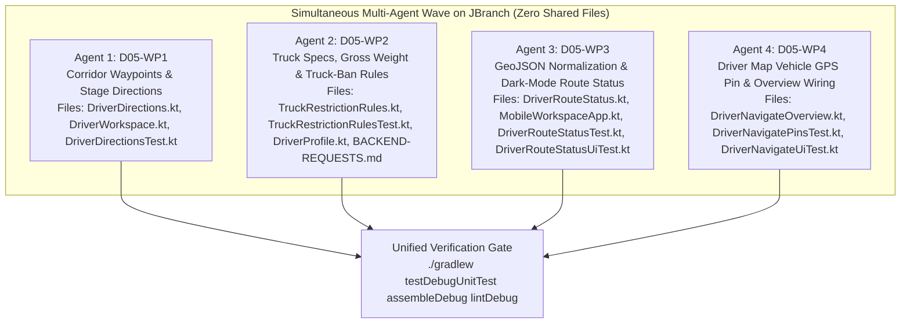

# D05 Bug Findings, Truck Restriction Gap Audit & Multi-Agent Implementation Plan

**Backlog Item:** `D05` — Truck routes and moving ETA with confirmed truck measurements (`docs/BACKLOG.md`, `docs/FEATURES.md` #11, #17, #26)  
**Target Branch:** `JBranch`  
**Active Working Root:** `app/src/main/java/com/tanaw/app/feature/workspace/`  
**Date:** 2026-11-11

---

## 1. Executive Summary

Backlog item `D05` validates **truck routes and moving ETA with confirmed truck measurements**. While the backend (`delivery-routing` and `calculate-route` Edge Functions in `mabutol-trucking-react`) computes Heavy Goods Vehicle (HGV) routes using OpenRouteService, the mobile app delegates turn-by-turn navigation to **external Google Maps URLs** (`https://www.google.com/maps/dir/?api=1&...&travelmode=driving`).

A deep code and domain inspection of `feature/workspace/` identified **5 concrete client-side bugs (`D05-B1` through `D05-B5`)** and **4 truck-routing implementation gaps (`D05-G1` through `D05-G4`)** that cause drivers to lose the office-confirmed HGV route corridor when opening Google Maps, hide the driver's live GPS position on the in-app route map, fail to render string-encoded GeoJSON polylines, and omit critical truck configuration and Philippine truck-ban advisories (height/width/gross weight limits, UVVRP plate number coding, and peak truck-ban windows).

### 1.1 Summary of Bugs Found

| Bug ID | Severity | Summary | Primary Files |
|:-------|:--------:|:--------|:--------------|
| **D05-B1** | **HIGH** | **GeoJSON String Serialization & Verified Plan Fallback Defect:** `s["route_geometry"]?.toString()` wraps `JsonPrimitive` string GeoJSON in escaped quotes (`"\"{\\\"type\\\":...}\""`), crashing `GeoJsonSource` in `ShipmentMap.kt`. Additionally, `DriverNavigateOverview.kt` ignores `routing.obj("plan")["geometry"]` when `s["route_geometry"]` is missing on the workspace shipment row. | `DriverNavigateOverview.kt`<br>`DriverRouteStatus.kt`<br>`MobileWorkspaceApp.kt` |
| **D05-B2** | **HIGH** | **Driver's Own Live GPS Pin Missing on In-App Route Map:** `DriverNavigateOverview.kt` only passes `driverStopPins(s)` (Pickup + Destination) to `ShipmentMap`, omitting `state.details.obj("position")`. Unlike customers, drivers cannot see their own truck pin moving along the office-confirmed blue HGV polyline to verify they are still on the approved truck route. | `DriverNavigateOverview.kt`<br>`ShipmentMap.kt` |
| **D05-B3** | **MEDIUM** | **Google Maps URL Drops Office-Confirmed HGV Corridor Waypoints:** `DriverDirections.kt` only passes `origin` and `destination` with `travelmode=driving`. Google Maps immediately recalculates a passenger-car shortcut, ignoring the office-confirmed HGV `LineString` corridor (`route_geometry`). | `DriverDirections.kt` |
| **D05-B4** | **MEDIUM** | **Stage-Blind Navigation Buttons:** `DriverDirectionsButtons` in `DriverWorkspace.kt` always highlights `"View pickup-to-destination route"` as the primary filled button and buries `"Directions to pickup"` / `"Directions to destination"` as secondary outlined buttons, regardless of whether the driver is heading to pickup (Stages 0–1) or in transit to destination (Stage 4). | `DriverWorkspace.kt`<br>`DriverNavigateOverview.kt` |
| **D05-B5** | **LOW/MED** | **Dark-Mode Contrast Defect in `DriverRouteStatusCard`:** `DriverRouteStatus.kt` hardcodes `DriverNavy` (`0xFF002D54`) and `DriverMuted` on text inside a dark surface card, making the route verification status and HGV caveats illegible in dark theme. | `DriverRouteStatus.kt` |

### 1.2 Summary of Truck Configuration & Routing Gaps

| Gap ID | Category | Summary | Client / Backend Scope |
|:-------|:--------:|:--------|:-----------------------|
| **D05-G1** | **Corridor Anchoring** | External Google Maps has no HGV mode. To prevent Google Maps from routing a truck onto restricted car shortcuts, `DriverDirections` must sample up to 8 intermediate corridor waypoints (`&waypoints=lat,lng|...`) from the office-confirmed HGV GeoJSON `LineString`. | **Client** (`DriverDirections.kt`) |
| **D05-G2** | **Truck Specs & Gross Weight** | `public.trucks` only exposes `capacity_kg`, `plate_number`, and `model` in base migrations. Drivers are not shown their truck's physical dimensions (`height_m`, `width_m`, `length_m`, `axle_count`), payload utilization (`shipment.weight_kg / truck.capacity_kg`), or estimated gross vehicle weight (`tare_weight_kg + shipment.weight_kg`). | **Client** (`TruckRestrictionRules.kt`, `DriverNavigateOverview.kt`, `DriverProfile.kt`) + **Backend Request** (`docs/BACKEND-REQUESTS.md`) |
| **D05-G3** | **Truck Bans & Number Coding** | OpenRouteService HGV uses static OSM tags and does not model Philippine time-window truck bans (e.g., `06:00–10:00` and `17:00–21:00` PHT peak truck ban windows) or UVVRP plate number coding (last digit of `plate_number`: `1–2` Mon, `3–4` Tue, `5–6` Wed, `7–8` Thu, `9–0` Fri). | **Client** (`TruckRestrictionRules.kt`, `DriverRouteStatus.kt`) + **Backend Request** (`docs/BACKEND-REQUESTS.md`) |
| **D05-G4** | **Visual Route Verification** | When navigating via Google Maps, drivers need a one-glance in-app check showing their live `"Vehicle"` GPS pin (with freshness guard) against the office-confirmed HGV route line and stop pins. | **Client** (`DriverNavigateOverview.kt`) |

---

## 2. Detailed Technical Analysis & Root Causes

---

### 2.1 Bug `D05-B1`: GeoJSON Serialization & Verified Plan Fallback Defect

#### Affected Files
- `app/src/main/java/com/tanaw/app/feature/workspace/DriverNavigateOverview.kt` (line 45)
- `app/src/main/java/com/tanaw/app/feature/workspace/MobileWorkspaceApp.kt` (line 466)
- `app/src/main/java/com/tanaw/app/feature/workspace/DriverRouteStatus.kt` (lines 16–19)

#### Root Cause
1. In `DriverNavigateOverview.kt` (line 45) and `MobileWorkspaceApp.kt` (line 466):
   ```kotlin
   val savedGeometry = s["route_geometry"]?.takeUnless { it == JsonNull }?.toString()
   ```
   In `kotlinx.serialization.json`, if `s["route_geometry"]` is a `JsonObject` (raw JSON object), `.toString()` returns valid JSON `{"type":"FeatureCollection",...}`. However, if `s["route_geometry"]` is a `JsonPrimitive` containing a serialized JSON string, `.toString()` returns a quoted, backslash-escaped string literal (`"\"{\\\"type\\\":...}\""`), whereas `jsonPrimitive.content` holds the actual GeoJSON! Passing the quoted literal to `GeoJsonSource("shipment-route", road)` in `ShipmentMap.kt` throws a native parse exception and displays `"Route line could not be displayed"`.
2. Furthermore, `mobile_workspace()` (`20261024155504_mobile_workable_system.sql` line 32) does not include `route_geometry` in its base `shipments` projection unless upgraded, whereas `state.details?.obj("routing")?.obj("plan")?.get("geometry")` is returned directly by the `delivery-routing` Edge Function. `DriverNavigateOverview.kt` never falls back to the verified `routing.obj("plan")["geometry"]` when `s["route_geometry"]` is null!
3. Similarly, in `DriverRouteStatus.forAssignment` (line 17):
   ```kotlin
   plan["geometry"] == shipment["route_geometry"]
   ```
   If `shipment["route_geometry"]` is null/absent on the summary row or represented as a string vs. object, `plan["geometry"] == shipment["route_geometry"]` evaluates to `false`, falsely rejecting a valid `route_verified = true` response with `"Assignment or confirmed route changed. Refresh to recalculate."`!

#### Fix Specification
- Add `DriverRouteStatus.extractGeoJson(element: JsonElement?): String?`:
  - Returns `null` if `element == null || element is JsonNull`.
  - If `element is JsonPrimitive`, returns `element.contentOrNull?.trim()?.takeIf { it.startsWith("{") }`.
  - If `element is JsonObject`, returns `element.toString()`.
- Add `DriverRouteStatus.resolvedGeometry(shipment: JsonObject, routing: JsonObject?): String?`:
  - Returns `extractGeoJson(shipment["route_geometry"]) ?: routing?.takeIf { it["route_verified"] == JsonPrimitive(true) }?.obj("plan")?.let { extractGeoJson(it["geometry"]) }`.
- In `DriverRouteStatus.forAssignment`:
  - Compare normalized geometries if **both** `plan["geometry"]` and `shipment["route_geometry"]` are present and non-null (`val sGeom = extractGeoJson(shipment["route_geometry"]); val pGeom = extractGeoJson(plan["geometry"]); val geomMatches = sGeom == null || sGeom == pGeom`).

---

### 2.2 Bug `D05-B2` & Gap `D05-G4`: Driver's Live Vehicle GPS Pin Missing on Route Map

#### Affected Files
- `app/src/main/java/com/tanaw/app/feature/workspace/DriverNavigateOverview.kt` (lines 31–35, 42, 110–111)

#### Root Cause
- `driverStopPins(s)` only extracts `"Pickup"` and `"Destination"`.
- The comment at line 30 states: `/** Saved stop pins only. A stale/unrelated GPS sample must not zoom this preview out to the world. */`
- Because it never checks `state.details?.obj("position")` with a freshness/bounds guard, even a fresh, accurate in-transit GPS fix (`< 300s` old, finite coordinates within Luzon/reasonable distance of stops) is hidden from the driver.

#### Fix Specification
- Add `driverMapPins(shipment: JsonObject, details: JsonObject?, now: Instant = Instant.now()): List<Pair<String, LatLng>>` in `DriverNavigateOverview.kt`:
  - Starts with `driverStopPins(shipment)`.
  - Reads `position = details?.takeIf { it.value("shipment_id") == shipment.value("id") }?.obj("position")`.
  - Validates that `position` has finite `latitude` (`-90.0..90.0`) and `longitude` (`-180.0..180.0`), that `TrackingFreshnessRules.evaluatePositionFreshness(position.value("recorded_at"), position.value("accuracy_m"), now).status` is `FRESH` or `RECENT` ($\le 300\text{s}$ old), and that the coordinate is within $5.0^\circ$ ($\approx 550\text{ km}$) of the stop pins (so a bogus `(0,0)` or foreign emulator coordinate never zooms the map out to the world!).
  - When valid, appends `"Vehicle" to LatLng(lat, lng)`.
- Update the map caption in `DriverNavigateOverview.kt` dynamically:
  - When `"Vehicle"` is present: `"Saved pickup, destination, and your latest recorded truck GPS position."`
  - When absent: `"Saved pickup and destination locations. Fresh vehicle GPS is not yet recorded on this preview."`

---

### 2.3 Bug `D05-B3`, `D05-B4` & Gap `D05-G1`: Corridor-Anchored & Stage-Aware External Google Maps Navigation

#### Affected Files
- `app/src/main/java/com/tanaw/app/feature/workspace/DriverDirections.kt`
- `app/src/main/java/com/tanaw/app/feature/workspace/DriverWorkspace.kt` (`DriverDirectionsButtons`, lines 506–525)

#### Root Cause
1. `DriverDirections.url` and `DriverDirections.tripUrl` ignore the office-confirmed HGV GeoJSON geometry.
2. Google Maps URL API (`https://www.google.com/maps/dir/?api=1`) supports `&waypoints=lat1,lng1|lat2,lng2|...` (up to 9 waypoints on mobile). By sampling intermediate points along the office-confirmed HGV `LineString`, Google Maps is forced to route along the same highway/truck corridor verified by OpenRouteService HGV!
3. `DriverDirectionsButtons` does not adapt button emphasis to the current trip stage (`stage = DriverUiRules.stage(delivery)`).

#### Fix Specification
1. In `DriverDirections.kt`:
   - Add `extractWaypoints(routeGeoJson: String?, maxWaypoints: Int = 6): List<Pair<Double, Double>>`:
     - Parses GeoJSON (`FeatureCollection`, `Feature`, or raw `LineString`).
     - Extracts all `[lng, lat]` coordinates from `LineString` geometries.
     - Excludes the first and last coordinate (which correspond to origin and destination) and any points within $0.002^\circ$ ($\approx 200\text{m}$) of the endpoints.
     - Downsamples evenly to at most `maxWaypoints` (default `6`) intermediate `(lat, lng)` pairs rounded to 5 decimal places.
   - Add `corridorWaypointsParam(routeGeoJson: String?, maxWaypoints: Int = 6): String?`:
     - Formats sampled waypoints as `"lat1,lng1|lat2,lng2|..."`.
   - Overload / extend `url(shipment: JsonObject, destination: Boolean, confirmedGeoJson: String? = null): String?` and `tripUrl(shipment: JsonObject, confirmedGeoJson: String? = null): String?`:
     - When `confirmedGeoJson` is non-blank and `destination == true` (for `tripUrl`, always; for `url`, when `destination == true` and stage is in-transit from pickup), appends `&waypoints=${URLEncoder.encode(waypoints, "UTF-8")}`.
     - Keep single-arg/two-arg signatures via default parameters (`confirmedGeoJson: String? = null`) so all existing callers and tests remain 100% source-compatible!
2. In `DriverWorkspace.kt` (`DriverDirectionsButtons`):
   - Accept optional parameters `stage: Int = 0, confirmedGeoJson: String? = null`.
   - Make the primary `Button` match the active leg:
     - Stages `0..3` (before departure from pickup): Primary `Button` is `"Directions to pickup"`, secondary `OutlinedButton`s are `"Directions to destination"` and `"View pickup-to-destination route"`.
     - Stage `4` (`Heading to Destination` / `in_transit`): Primary `Button` is `"Directions to destination (HGV corridor)"` (when `confirmedGeoJson != null`) or `"Directions to destination"`, secondary `OutlinedButton`s are `"Directions to pickup"` and `"View pickup-to-destination route"`.
   - Show a clear indicator when corridor waypoints are anchored: `"Includes office-confirmed HGV corridor waypoints. Google Maps still does not enforce bridge height, weight, or local truck-ban hours—obey road signs."`

---

### 2.4 Gaps `D05-G2`, `D05-G3` & Bug `D05-B5`: Truck Configuration, Gross Weight, Number Coding & Truck-Ban Advisory

#### Affected Files
- `app/src/main/java/com/tanaw/app/feature/workspace/TruckRestrictionRules.kt` *(new)*
- `app/src/main/java/com/tanaw/app/feature/workspace/DriverRouteStatus.kt`
- `app/src/main/java/com/tanaw/app/feature/workspace/DriverProfile.kt`
- `docs/BACKEND-REQUESTS.md`

#### Root Cause & Specification
1. **Create `TruckRestrictionRules.kt` (`feature/workspace/TruckRestrictionRules.kt`):**
   - Pure-Kotlin domain object with zero Android UI dependencies:
   - `data class TruckSpecSummary(val vehicleLabel: String, val plateNumber: String, val capacityKg: Double?, val cargoWeightKg: Double?, val tareWeightKg: Double?, val grossWeightKg: Double?, val heightMeters: Double?, val widthMeters: Double?, val lengthMeters: Double?, val axleCount: Int?, val isOverCapacity: Boolean, val dimensionsVerified: Boolean)`
   - `data class TruckBanAdvisory(val codingDayLabel: String?, val isCodingDayToday: Boolean, val activeBanWindowLabel: String?, val departureInBanWindow: Boolean, val etaInBanWindow: Boolean, val warnings: List<String>)`
   - `evaluateTruckSpecs(truck: JsonObject?, shipment: JsonObject?, routingPlan: JsonObject? = null): TruckSpecSummary`:
     - Reads `capacity_kg` from `truck` or `routingPlan`.
     - Reads `weight_kg` from `shipment` or `routingPlan.value("cargo_weight_kg")`.
     - Reads optional HGV physical measurements (`height_m`, `width_m`, `length_m`, `tare_weight_kg`, `gross_weight_kg`, `axle_count`) from `truck` or `routingPlan` (`plan`).
     - Computes `grossWeightKg = gross_weight_kg ?: (if (tare != null && cargo != null) tare + cargo else null)`.
     - Sets `isOverCapacity = capacityKg != null && cargoWeightKg != null && cargoWeightKg > capacityKg`.
     - Sets `dimensionsVerified = heightMeters != null && widthMeters != null && (grossWeightKg != null || capacityKg != null)`.
   - `evaluateBanAdvisory(plateNumber: String, scheduledDepartureIso: String, etaIso: String?, now: Instant = Instant.now()): TruckBanAdvisory`:
     - **Philippine UVVRP Number Coding:** Extracts the last numeric digit (`0–9`) of `plateNumber`:
       - `1, 2` $\rightarrow$ `"Monday"`
       - `3, 4` $\rightarrow$ `"Tuesday"`
       - `5, 6` $\rightarrow$ `"Wednesday"`
       - `7, 8` $\rightarrow$ `"Thursday"`
       - `9, 0` $\rightarrow$ `"Friday"`
       - Checks if `now.atZone(ZoneId.of("Asia/Manila")).dayOfWeek` matches the plate's coding day.
     - **Peak Truck Ban Windows (`Asia/Manila`):**
       - Morning peak window: `06:00–10:00 PHT` (Mon–Sat).
       - Evening peak window: `17:00–21:00 PHT` (Mon–Sat).
       - Checks whether `now`, `scheduledDepartureIso`, or `etaIso` falls inside a peak truck-ban window and generates clear, actionable driver advisories (e.g., `"Plate ends in 2 (Monday coding) — verify MMDA/local truck exemption"`, `"Scheduled departure falls within peak truck ban hours (06:00–10:00 PHT)"`).
2. **Update `DriverRouteStatus.kt` (`D05-B5` + Advisory Rendering):**
   - Replace hardcoded `DriverNavy` and `DriverMuted` in `DriverRouteStatusCard` with `MaterialTheme.colorScheme.onSurface` and `MaterialTheme.colorScheme.onSurfaceVariant`.
   - Add `@Composable internal fun DriverTruckRestrictionCard(spec: TruckSpecSummary, ban: TruckBanAdvisory)` in `DriverRouteStatus.kt` to display:
     - Vehicle & plate, cargo weight vs. max capacity (`"Cargo: 6,000 kg / 10,000 kg capacity"`), and gross weight/dimensions (`"Height: 3.8 m · Width: 2.5 m · Gross: 14,500 kg"` or `"Physical height/width/axle measurements not recorded on truck profile — verify bridge & wire clearances with office"`).
     - Any active `ban.warnings` (number coding or peak truck-ban window overlap).

---

## 3. Multi-Agent Concurrency Workflow (4 Agents Working Simultaneously on `JBranch`)

To allow **up to 4 agents** (including high-speed models like **Gemini Flash**) to work **at the exact same time** on `JBranch` with **zero merge conflicts**, `D05` is partitioned into **4 strictly disjoint Work Packages (`D05-WP1` through `D05-WP4`)**.

---

### 3.1 File Ownership & Zero-Collision Partitioning Matrix

> [!IMPORTANT]
> **100% Disjoint File Ownership:** Every work package below owns a completely separate set of files! No two work packages edit the same file. All 4 agents can execute Phases 1–4 simultaneously in parallel sessions.

| Work Package | Bugs & Gaps Covered | Exclusively Owned Source & Test Files (Zero Overlap) | Shared Files | Safe Simultaneous Execution |
|:-------------|:-------------------:|:-----------------------------------------------------|:-------------|:----------------------------|
| **D05-WP1**<br>*(Corridor Waypoints & Stage-Aware Directions)* | **D05-B3**<br>**D05-B4**<br>**D05-G1** | `app/src/main/java/com/tanaw/app/feature/workspace/DriverDirections.kt`<br>`app/src/main/java/com/tanaw/app/feature/workspace/DriverWorkspace.kt` *(lines 500–530 only)*<br>`app/src/test/java/com/tanaw/app/feature/workspace/DriverDirectionsTest.kt` *(new)* | **None** | Can run 100% simultaneously with **WP2, WP3, WP4** |
| **D05-WP2**<br>*(Truck Specs, Gross Weight & Truck-Ban Rules + Profile & Backend Spec)* | **D05-G2**<br>**D05-G3** | `app/src/main/java/com/tanaw/app/feature/workspace/TruckRestrictionRules.kt` *(new)*<br>`app/src/test/java/com/tanaw/app/feature/workspace/TruckRestrictionRulesTest.kt` *(new)*<br>`app/src/main/java/com/tanaw/app/feature/workspace/DriverProfile.kt` *(lines 125–148 only)*<br>`docs/BACKEND-REQUESTS.md` | **None** | Can run 100% simultaneously with **WP1, WP3, WP4** |
| **D05-WP3**<br>*(GeoJSON Normalization, Verified Plan Matching & Dark-Mode Status Card)* | **D05-B1** *(helper)*<br>**D05-B5** | `app/src/main/java/com/tanaw/app/feature/workspace/DriverRouteStatus.kt`<br>`app/src/main/java/com/tanaw/app/feature/workspace/MobileWorkspaceApp.kt` *(line 466 only)*<br>`app/src/test/java/com/tanaw/app/feature/workspace/DriverRouteStatusTest.kt`<br>`app/src/androidTest/java/com/tanaw/app/DriverRouteStatusUiTest.kt` | **None** | Can run 100% simultaneously with **WP1, WP2, WP4** |
| **D05-WP4**<br>*(Driver Map Live Vehicle GPS Pin & Navigate Overview Integration)* | **D05-B1** *(overview)*<br>**D05-B2**<br>**D05-G4** | `app/src/main/java/com/tanaw/app/feature/workspace/DriverNavigateOverview.kt`<br>`app/src/test/java/com/tanaw/app/feature/workspace/DriverNavigatePinsTest.kt` *(new)*<br>`app/src/androidTest/java/com/tanaw/app/DriverNavigateUiTest.kt` | **None** | Can run 100% simultaneously with **WP1, WP2, WP3** *(run final integration after WP1–WP3 or use self-contained call sites)* |



---

### 3.2 Cross-Agent Contract Lock (So Agents Do Not Break Compilation)

To guarantee that `D05-WP1`, `D05-WP2`, `D05-WP3`, and `D05-WP4` compile cleanly whether run together or in any order:

1. **Backward-Compatible Default Parameters:**
   - In `D05-WP1`, `DriverDirections.url(shipment: JsonObject, destination: Boolean, confirmedGeoJson: String? = null)` and `DriverDirections.tripUrl(shipment: JsonObject, confirmedGeoJson: String? = null)` and `DriverDirectionsButtons(shipment: JsonObject, stage: Int = 0, confirmedGeoJson: String? = null)` **MUST** provide default values for new parameters so existing 1-arg / 2-arg call sites in `DriverNavigateOverview.kt` continue to compile even before `D05-WP4` finishes!
2. **Self-Contained Helpers Where Needed:**
   - In `D05-WP3`, `DriverRouteStatus` adds `fun extractGeoJson(element: JsonElement?): String?` and `fun resolvedGeometry(shipment: JsonObject, routing: JsonObject? = null): String?`.
   - In `D05-WP4`, `DriverNavigateOverview.kt` can either call `DriverRouteStatus.resolvedGeometry` (if `WP3` is already applied) or include a local private helper if `WP3` has not yet run.

---

## 4. Structured Multi-Part Agent Prompts (Optimized for Gemini Flash)

The prompts below use the **5-part structured framework (`ROLE`, `CONTEXT`, `TASK`, `FORMAT`, `RULES`)** specifically tuned for **Gemini Flash** and similar fast coding agents:
- Exact method signatures, parameter names, and imports are locked so the model never guesses or hallucinates symbols.
- Step-by-step instructions follow a linear `Read -> Write Test -> Edit Source -> Run Gradle` pipeline.
- Strict negative guardrails prevent shell-based file corruption, legacy screen edits, or branch switching.

---

### Prompt 1: `D05-WP1` — HGV Corridor Waypoint Sampling & Stage-Aware Google Maps Directions

Copy and paste this prompt into **Agent Session 1**:

```markdown
### ROLE
You are a Senior Android Kotlin Developer working inside Android Studio on the `Tanaw` mobile app (`:app` module, Kotlin + Jetpack Compose). You write concise, deterministic, production-grade Kotlin and JUnit4 tests.

### CONTEXT
- **Active Branch:** `JBranch` (do NOT create or switch branches).
- **Problem (`D05-B3`, `D05-B4`, `D05-G1`):**
  1. `DriverDirections.kt` constructs external Google Maps URLs (`https://www.google.com/maps/dir/?api=1&...&travelmode=driving`) with only `origin` and `destination`. When an office-confirmed HGV GeoJSON route (`LineString`) exists, Google Maps ignores it and recalculates a car shortcut. Passing sampled intermediate waypoints (`&waypoints=lat1,lng1|lat2,lng2`) from the confirmed GeoJSON anchors Google Maps to the office-approved truck corridor.
  2. `DriverDirectionsButtons` in `DriverWorkspace.kt` (lines 506–525) always renders `"View pickup-to-destination route"` as the primary `Button` and `"Directions to pickup"` / `"Directions to destination"` as secondary `OutlinedButton`s, even when the driver is actively heading to pickup (stages 0–3) or in transit to destination (stage 4).
- **Exclusively Owned Files for Your Task:**
  1. `app/src/main/java/com/tanaw/app/feature/workspace/DriverDirections.kt`
  2. `app/src/main/java/com/tanaw/app/feature/workspace/DriverWorkspace.kt` ( ONLY `DriverDirectionsButtons` around lines 506–525)
  3. `app/src/test/java/com/tanaw/app/feature/workspace/DriverDirectionsTest.kt` (new file)

### TASK
Execute the following steps in order:

#### Step 1: Read Existing Files
Use `studio_read_file` to read:
- `C:/Users/Soriano/AndroidStudioProjects/Tanaw_Mobile/app/src/main/java/com/tanaw/app/feature/workspace/DriverDirections.kt`
- `C:/Users/Soriano/AndroidStudioProjects/Tanaw_Mobile/app/src/main/java/com/tanaw/app/feature/workspace/DriverWorkspace.kt` (startLine = 495, endLine = 535)

#### Step 2: Update `DriverDirections.kt`
Use `studio_replace_file_content` on `DriverDirections.kt` to implement:
1. `fun extractWaypoints(routeGeoJson: String?, maxWaypoints: Int = 6): List<Pair<Double, Double>>`:
   - If `routeGeoJson.isNullOrBlank()` or `maxWaypoints <= 0`, return `emptyList()`.
   - Parse `routeGeoJson` safely using `runCatching { Json.parseToJsonElement(routeGeoJson) }`:
     - If the root element is a `JsonPrimitive` (e.g. a JSON-encoded string), parse its `.content` as JSON.
     - Collect all coordinates from GeoJSON `FeatureCollection` (features with `geometry.type == "LineString"`), single `Feature` (`geometry.type == "LineString"`), or direct `LineString` (`type == "LineString"`).
     - Remember GeoJSON coordinates are `[longitude, latitude]`. Convert each valid finite coordinate (`lat in -90.0..90.0`, `lng in -180.0..180.0`) to `Pair(lat, lng)`.
     - Filter out the first and last coordinate and any intermediate coordinate within `0.002` degrees (approx. 200m) of the first or last coordinate.
     - If the remaining list has `<= maxWaypoints` points, return it; otherwise sample `maxWaypoints` evenly spaced indices: `(1..maxWaypoints).map { i -> candidates[(i * candidates.size) / (maxWaypoints + 1)] }`.
2. `fun corridorWaypointsParam(routeGeoJson: String?, maxWaypoints: Int = 6): String?`:
   - Calls `extractWaypoints(routeGeoJson, maxWaypoints)`. If empty, returns `null`.
   - Formats each pair as `String.format(java.util.Locale.US, "%.5f,%.5f", lat, lng)` joined by `"|"`.
3. Update `url` and `tripUrl` with default parameters so all existing 1-arg and 2-arg callers remain 100% source-compatible:
   - `fun url(shipment: JsonObject, destination: Boolean, confirmedGeoJson: String? = null): String?`
     - Builds the base URL `"https://www.google.com/maps/dir/?api=1&destination=${URLEncoder.encode(it, "UTF-8")}&travelmode=driving"`.
     - If `destination == true`, appends `&waypoints=${URLEncoder.encode(wp, "UTF-8")}` when `corridorWaypointsParam(confirmedGeoJson)` returns a non-null `wp`.
   - `fun tripUrl(shipment: JsonObject, confirmedGeoJson: String? = null): String?`
     - Builds the base origin-to-destination URL.
     - Appends `&waypoints=${URLEncoder.encode(wp, "UTF-8")}` when `corridorWaypointsParam(confirmedGeoJson)` returns a non-null `wp`.

#### Step 3: Update `DriverDirectionsButtons` in `DriverWorkspace.kt`
Use `studio_replace_file_content` on `DriverWorkspace.kt` (around lines 506–525) to update `DriverDirectionsButtons`:
- Signature (with defaults for backward compatibility):
  `@Composable internal fun DriverDirectionsButtons(shipment: JsonObject, stage: Int = 0, confirmedGeoJson: String? = null)`
- Extract `val effectiveGeoJson = confirmedGeoJson ?: shipment["route_geometry"]?.takeUnless { it == kotlinx.serialization.json.JsonNull }?.let { if (it is kotlinx.serialization.json.JsonPrimitive) it.contentOrNull else it.toString() }`
- Keep the exact button labels `"Directions to pickup"`, `"Directions to destination"`, and `"View pickup-to-destination route"` so existing UI tests (`DriverNavigateUiTest`) continue to find them by text!
- Use `Button` for the active stage's target (`"Directions to pickup"` when `stage < 4`, `"Directions to destination"` when `stage >= 4`) and `OutlinedButton` for the other two buttons.
- Pass `effectiveGeoJson` to `DriverDirections.url(shipment, destination, effectiveGeoJson)` and `DriverDirections.tripUrl(shipment, effectiveGeoJson)`.
- Keep the existing warning text `"Opens external driving directions. Confirm truck restrictions with the office."` and when `!effectiveGeoJson.isNullOrBlank()`, also show a supporting line: `"Includes office-confirmed HGV corridor waypoints."`

#### Step 4: Create Unit Tests in `DriverDirectionsTest.kt`
Use `studio_write_file` to create `C:/Users/Soriano/AndroidStudioProjects/Tanaw_Mobile/app/src/test/java/com/tanaw/app/feature/workspace/DriverDirectionsTest.kt`:
- Test `extractWaypoints` with a `FeatureCollection` `LineString` containing 10 coordinates (verifying `[lng, lat]` -> `(lat, lng)` conversion, endpoint exclusion, and downsampling to `maxWaypoints`).
- Test `extractWaypoints` with string-wrapped GeoJSON, malformed JSON, and 2-point lines (returns empty list).
- Test `url` and `tripUrl` with and without `confirmedGeoJson` (verifying URL-encoded `waypoints=` is included for destination and trip URLs, and omitted for pickup URLs or null geometry).

#### Step 5: Verify via Gradle
Run `studio_gradle_build` with `commandLine = "testDebugUnitTest --tests com.tanaw.app.feature.workspace.DriverDirectionsTest"`.

### FORMAT
Provide a concise final report containing:
1. **Files Modified / Created** (with clickable markdown links).
2. **Test Verification Output** (pass/fail summary from Gradle).
3. **Backward-Compatibility Confirmation** (confirming default parameters preserve existing call sites).

### RULES
- **STRICT TOOL GUARDRAILS:** NEVER use `studio_run_shell_command` with `sed`, `awk`, `python`, `echo`, or `cat` to read or edit files. Always use `studio_read_file`, `studio_replace_file_content`, and `studio_write_file`.
- **DO NOT** edit any files outside the 3 files listed in `CONTEXT`.
- **DO NOT** change the existing button text strings `"Directions to pickup"`, `"Directions to destination"`, or `"View pickup-to-destination route"` (instrumented tests assert these exact strings).
- **DO NOT** create or switch Git branches; stay on `JBranch`.
```

---

### Prompt 2: `D05-WP2` — Truck Configuration, Gross Weight, Number Coding & Truck-Ban Advisory Rules

Copy and paste this prompt into **Agent Session 2**:

```markdown
### ROLE
You are a Senior Android Kotlin Developer working inside Android Studio on the `Tanaw` mobile app (`:app` module, Kotlin + Jetpack Compose). You specialize in domain modeling, logistics compliance rules, and pure-Kotlin unit testing.

### CONTEXT
- **Active Branch:** `JBranch` (do NOT create or switch branches).
- **Problem (`D05-G2`, `D05-G3`):**
  1. Drivers need visibility into their assigned truck's configuration (`capacity_kg`, cargo `weight_kg`, payload utilization, and physical HGV dimensions `height_m`, `width_m`, `length_m`, `tare_weight_kg`, `gross_weight_kg`, `axle_count` when present on `driver_trucks` or `routing.plan`, with a clear unverified-dimensions warning when absent).
  2. In the Philippines (Luzon / Metro Manila), trucks are subject to **UVVRP Number Coding** based on the last digit of `plate_number` (`1,2` Mon; `3,4` Tue; `5,6` Wed; `7,8` Thu; `9,0` Fri) and **peak truck-ban windows** (`06:00–10:00 PHT` and `17:00–21:00 PHT`, Monday–Saturday). Neither is currently evaluated on the client.
  3. Because the backend lives in `mabutol-trucking-react`, we also need to document the schema & Edge Function enhancement request in `docs/BACKEND-REQUESTS.md`.
- **Exclusively Owned Files for Your Task:**
  1. `app/src/main/java/com/tanaw/app/feature/workspace/TruckRestrictionRules.kt` (new file)
  2. `app/src/test/java/com/tanaw/app/feature/workspace/TruckRestrictionRulesTest.kt` (new file)
  3. `app/src/main/java/com/tanaw/app/feature/workspace/DriverProfile.kt` (lines 120–150 only, `Assigned vehicle` card)
  4. `docs/BACKEND-REQUESTS.md`

### TASK
Execute the following steps in order:

#### Step 1: Read Existing Files
Use `studio_read_file` to read:
- `C:/Users/Soriano/AndroidStudioProjects/Tanaw_Mobile/app/src/main/java/com/tanaw/app/feature/workspace/DriverProfile.kt` (startLine = 115, endLine = 155)
- `C:/Users/Soriano/AndroidStudioProjects/Tanaw_Mobile/docs/BACKEND-REQUESTS.md`

#### Step 2: Create `TruckRestrictionRules.kt`
Use `studio_write_file` to create `C:/Users/Soriano/AndroidStudioProjects/Tanaw_Mobile/app/src/main/java/com/tanaw/app/feature/workspace/TruckRestrictionRules.kt` with package `com.tanaw.app.feature.workspace`:
1. Define data classes:
   ```kotlin
   data class TruckSpecSummary(
       val model: String,
       val plateNumber: String,
       val capacityKg: Double?,
       val cargoWeightKg: Double?,
       val tareWeightKg: Double?,
       val grossWeightKg: Double?,
       val heightMeters: Double?,
       val widthMeters: Double?,
       val lengthMeters: Double?,
       val axleCount: Int?,
       val isOverCapacity: Boolean,
       val dimensionsVerified: Boolean
   )

   data class TruckBanAdvisory(
       val codingDayName: String?,
       val lastPlateDigit: Int?,
       val isCodingDayOnReferenceDate: Boolean,
       val departureInPeakBanWindow: Boolean,
       val etaInPeakBanWindow: Boolean,
       val warnings: List<String>
   )
   
2. Implement `object TruckRestrictionRules`:
   - `private val MANILA_ZONE = java.time.ZoneId.of("Asia/Manila")`
   - `fun evaluateTruckSpecs(truck: JsonObject?, shipment: JsonObject? = null, routingPlan: JsonObject? = null): TruckSpecSummary`:
     - Extract `model = truck?.value("model").orEmpty()`, `plateNumber = truck?.value("plate_number").orEmpty()`.
     - Extract positive finite `capacityKg` from `truck?.value("capacity_kg")` or `routingPlan?.value("capacity_kg")` or `routingPlan?.value("max_weight_kg")`.
     - Extract positive finite `cargoWeightKg` from `shipment?.value("weight_kg")` or `routingPlan?.value("cargo_weight_kg")`.
     - Extract positive finite `tareWeightKg` from `truck?.value("tare_weight_kg")` or `routingPlan?.value("tare_weight_kg")`.
     - Extract positive finite `explicitGross` from `truck?.value("gross_weight_kg")` or `routingPlan?.value("gross_weight_kg")`; compute `grossWeightKg = explicitGross ?: if (tareWeightKg != null && cargoWeightKg != null) tareWeightKg + cargoWeightKg else null`.
     - Extract positive finite `heightMeters` (`height_m`), `widthMeters` (`width_m`), `lengthMeters` (`length_m`), and `axleCount` (`axle_count` > 0) from `truck` or `routingPlan`.
     - `isOverCapacity = capacityKg != null && cargoWeightKg != null && cargoWeightKg > capacityKg`
     - `dimensionsVerified = heightMeters != null && widthMeters != null`
   - `fun codingDayForPlate(plateNumber: String): Pair<Int, java.time.DayOfWeek>?`:
     - Finds the last ASCII digit (`'0'..'9'`) in `plateNumber`. Returns `null` if no digit exists.
     - Maps `1, 2 -> MONDAY`, `3, 4 -> TUESDAY`, `5, 6 -> WEDNESDAY`, `7, 8 -> THURSDAY`, `9, 0 -> FRIDAY`.
   - `fun isWithinPeakTruckBanWindow(instant: java.time.Instant): Boolean`:
     - Converts `instant` to `ZonedDateTime` in `Asia/Manila`.
     - Returns `false` on `SUNDAY`.
     - Returns `true` if local time is in `06:00..09:59:59` (`hour in 6..9`) or `17:00..20:59:59` (`hour in 17..20`).
   - `fun evaluateBanAdvisory(plateNumber: String, scheduledDepartureIso: String = "", etaIso: String? = null, referenceNow: java.time.Instant = java.time.Instant.now()): TruckBanAdvisory`:
     - Evaluates `codingDayForPlate(plateNumber)`.
     - Checks if `referenceNow` (or `scheduledDepartureIso` if parseable) in `Asia/Manila` falls on that `DayOfWeek`.
     - Checks if `scheduledDepartureIso` and `etaIso` (when parseable as `Instant`) fall inside `isWithinPeakTruckBanWindow`.
     - Builds human-readable `warnings: List<String>`:
       - If coding day matches: `"UVVRP Number Coding: Plate ends in $digit ($dayName). Verify MMDA/municipal truck coding exemption."`
       - If departure in peak ban window: `"Scheduled departure falls in peak truck-ban window (06:00–10:00 or 17:00–21:00 PHT). Confirm route ordinance."`
       - If ETA in peak ban window: `"Estimated arrival falls in peak truck-ban window (06:00–10:00 or 17:00–21:00 PHT). Confirm route ordinance."`
   - `fun formatSpecLine(spec: TruckSpecSummary): String`:
     - Returns a concise summary string, e.g., `"Capacity: 10,000 kg · Cargo: 6,000 kg"` (or `"Capacity not recorded"`), plus `"Height: 3.8m · Width: 2.5m"` when `dimensionsVerified` is true, or `"Height/width/axle limits not recorded on vehicle profile"` when false.

#### Step 3: Enhance `Assigned vehicle` Card in `DriverProfile.kt`
Use `studio_replace_file_content` on `DriverProfile.kt` (around lines 125–145) so that when `truck != null`, below `plate_number` and `model`, it also displays:
- Capacity & dimensions summary via `TruckRestrictionRules.evaluateTruckSpecs(truck)` (`capacity_kg` if present, and height/width if present).
- Number coding day label if `TruckRestrictionRules.codingDayForPlate(truck.value("plate_number"))` is non-null (e.g. `"Number coding day: Monday (plate ends in 2)"`).

#### Step 4: Document Backend Request in `docs/BACKEND-REQUESTS.md`
Use `studio_replace_file_content` on `docs/BACKEND-REQUESTS.md` to append **Section 2: Request D05 — HGV Physical Truck Measurements, Tare Weight & Truck-Ban Metadata in `public.trucks`, `mobile_workspace`, and `delivery-routing`**, containing:
- Proposed SQL migration adding `height_m numeric(4,2)`, `width_m numeric(4,2)`, `length_m numeric(5,2)`, `tare_weight_kg numeric(10,2)`, `axle_count smallint` to `public.trucks` and `default_height_m`, `default_width_m`, `default_length_m` to `public.vehicle_types`.
- Updating `mobile_workspace()` to include `pickup_lat, pickup_lng, dropoff_lat, dropoff_lng, distance_km, route_duration_minutes, route_geometry` in its `shipments` subquery and `truck_id` in its `deliveries` subquery.

#### Step 5: Create Unit Tests in `TruckRestrictionRulesTest.kt`
Use `studio_write_file` to create `C:/Users/Soriano/AndroidStudioProjects/Tanaw_Mobile/app/src/test/java/com/tanaw/app/feature/workspace/TruckRestrictionRulesTest.kt` testing:
- All 10 plate ending digits (`0..9`) mapping to Monday–Friday.
- Morning (`06:00–09:59 PHT`) and evening (`17:00–20:59 PHT`) peak truck ban detection vs. midday (`13:00 PHT`) and Sunday (`SUNDAY` is exempt).
- `evaluateTruckSpecs` with and without physical dimensions, gross weight calculation (`tare + cargo`), and over-capacity detection (`cargo > capacity`).

#### Step 6: Verify via Gradle
Run `studio_gradle_build` with `commandLine = "testDebugUnitTest --tests com.tanaw.app.feature.workspace.TruckRestrictionRulesTest"`.

### FORMAT
Provide a concise final report containing:
1. **Files Modified / Created** (with clickable markdown links).
2. **Unit Test Summary** (`TruckRestrictionRulesTest` results).
3. **Backend Request Summary** added to `docs/BACKEND-REQUESTS.md`.

### RULES
- **STRICT TOOL GUARDRAILS:** NEVER use `studio_run_shell_command` to read or modify files. Only use `studio_read_file`, `studio_write_file`, and `studio_replace_file_content`.
- **DO NOT** edit any files outside the 4 files listed in `CONTEXT`.
- **DO NOT** create or switch Git branches; stay on `JBranch`.
```

---

### Prompt 3: `D05-WP3` — GeoJSON Normalization, Verified Plan Matching & Dark-Mode `DriverRouteStatusCard`

Copy and paste this prompt into **Agent Session 3**:

```markdown
### ROLE
You are a Senior Android Kotlin & Jetpack Compose Developer working inside Android Studio on the `Tanaw` mobile app (`:app` module). You write resilient JSON parsing logic and accessible Material 3 UI components.

### CONTEXT
- **Active Branch:** `JBranch` (do NOT create or switch branches).
- **Problem (`D05-B1`, `D05-B5`):**
  1. `s["route_geometry"]?.toString()` on a `JsonPrimitive` string produces a quoted, backslash-escaped string (`"\"{\\\"type\\\":...}\""`) that fails MapLibre's `GeoJsonSource`. Furthermore, when `shipment["route_geometry"]` is absent on the workspace summary row, `DriverRouteStatus.forAssignment` rejects a valid verified `routing.plan` because `plan["geometry"] == shipment["route_geometry"]` is `false`, and the map fails to use `routing.obj("plan")["geometry"]`.
  2. `DriverRouteStatusCard` in `DriverRouteStatus.kt` hardcodes `color = DriverNavy` and `color = DriverMuted`, causing poor legibility in dark mode.
- **Exclusively Owned Files for Your Task:**
  1. `app/src/main/java/com/tanaw/app/feature/workspace/DriverRouteStatus.kt`
  2. `app/src/main/java/com/tanaw/app/feature/workspace/MobileWorkspaceApp.kt` (line 466 only)
  3. `app/src/test/java/com/tanaw/app/feature/workspace/DriverRouteStatusTest.kt`
  4. `app/src/androidTest/java/com/tanaw/app/DriverRouteStatusUiTest.kt`

### TASK
Execute the following steps in order:

#### Step 1: Read Existing Files
Use `studio_read_file` to read:
- `C:/Users/Soriano/AndroidStudioProjects/Tanaw_Mobile/app/src/main/java/com/tanaw/app/feature/workspace/DriverRouteStatus.kt`
- `C:/Users/Soriano/AndroidStudioProjects/Tanaw_Mobile/app/src/main/java/com/tanaw/app/feature/workspace/MobileWorkspaceApp.kt` (startLine = 455, endLine = 475)
- `C:/Users/Soriano/AndroidStudioProjects/Tanaw_Mobile/app/src/test/java/com/tanaw/app/feature/workspace/DriverRouteStatusTest.kt`
- `C:/Users/Soriano/AndroidStudioProjects/Tanaw_Mobile/app/src/androidTest/java/com/tanaw/app/DriverRouteStatusUiTest.kt`

#### Step 2: Update `DriverRouteStatus.kt`
Use `studio_replace_file_content` on `DriverRouteStatus.kt` to:
1. Add `fun extractGeoJson(element: JsonElement?): String?`:
   - If `element == null || element is JsonNull`, return `null`.
   - If `element is JsonPrimitive`:
     - Take `val raw = element.contentOrNull?.trim() ?: return null`.
     - Return `raw.takeIf { it.startsWith("{") && it.endsWith("}") }`.
   - If `element is JsonObject`:
     - Return `element.takeIf { it.isNotEmpty() }?.toString()`.
   - Otherwise return `null`.
2. Add `fun resolvedGeometry(shipment: JsonObject, routing: JsonObject? = null): String?`:
   - First check `extractGeoJson(shipment["route_geometry"])`.
   - If null and `routing != null && routing["route_verified"] == JsonPrimitive(true)`, return `extractGeoJson(routing.obj("plan")["geometry"])`.
   - Otherwise return `null`.
3. Update `forAssignment(routing: JsonObject, shipment: JsonObject, delivery: JsonObject): JsonObject`:
   - Keep all existing checks (`truck_id`, `pickup_lat/lng`, `dropoff_lat/lng`, `cargo_weight_kg` vs `weight_kg`).
   - For geometry comparison:
     - `val sGeomElement = shipment["route_geometry"]?.takeUnless { it is JsonNull }`
     - `val pGeomElement = plan["geometry"]?.takeUnless { it is JsonNull }`
     - Compare `val geomMatches = if (sGeomElement == null) true else (sGeomElement == pGeomElement || extractGeoJson(sGeomElement) == extractGeoJson(pGeomElement))`
     - This ensures that:
       (a) Existing unit tests passing empty `buildJsonObject{}` for both `route_geometry` and `geometry` still match (`sGeomElement == pGeomElement`),
       (b) A string-encoded `route_geometry` matches an object-encoded `plan["geometry"]` with identical JSON, and
       (c) If the summary `shipment` row omitted `route_geometry` (`null`), a verified `plan` whose coordinates, truck, and weight match the assignment is accepted!
4. Fix Dark-Mode colors in `DriverRouteStatusCard`:
   - Replace `color = DriverNavy` with `color = androidx.compose.material3.MaterialTheme.colorScheme.onSurface`.
   - Replace `color = DriverMuted` with `color = androidx.compose.material3.MaterialTheme.colorScheme.onSurfaceVariant`.
   - Set `color = androidx.compose.material3.MaterialTheme.colorScheme.onSurface` on the ETA `Text`.
   - Preserve all existing text strings (`"Checking office-confirmed truck route…"`, `"Office-confirmed truck route"`, `"Truck route awaiting office confirmation"`, `"OpenRouteService HGV · vehicle limits applied · no live traffic"`, `"Google Maps may recalculate..."`) so `DriverRouteStatusUiTest` passes without regression.

#### Step 3: Update GeoJSON Extraction in `MobileWorkspaceApp.kt` (Line 466)
Use `studio_replace_file_content` on `MobileWorkspaceApp.kt` around line 466:
- Replace `ShipmentMap(points,s["route_geometry"]?.toString())` with:
  `ShipmentMap(points,DriverRouteStatus.resolvedGeometry(s,detail.obj("routing")))`

#### Step 4: Expand Unit Tests in `DriverRouteStatusTest.kt`
Use `studio_replace_file_content` on `DriverRouteStatusTest.kt` to add tests for:
- `extractGeoJson` handling `JsonObject`, `JsonPrimitive` string GeoJSON, `JsonNull`, and blank strings.
- `resolvedGeometry` returning `shipment["route_geometry"]` when present, and falling back to verified `routing.obj("plan")["geometry"]` when `shipment["route_geometry"]` is missing.
- `forAssignment` matching when `shipment["route_geometry"]` is a JSON string and `plan["geometry"]` is a `JsonObject` (and when `shipment["route_geometry"]` is omitted on the summary row, while still rejecting when `shipment["route_geometry"]` differs from `plan["geometry"]`).

#### Step 5: Verify via Gradle
Run `studio_gradle_build` with `commandLine = "testDebugUnitTest --tests com.tanaw.app.feature.workspace.DriverRouteStatusTest"`.

### FORMAT
Provide a concise final report containing:
1. **Files Modified** (with clickable markdown links).
2. **Test Verification Output** (`DriverRouteStatusTest` results).
3. **Summary of `extractGeoJson` & `resolvedGeometry` Behavior**.

### RULES
- **STRICT TOOL GUARDRAILS:** NEVER use `studio_run_shell_command` to read or edit files. Always use `studio_read_file` and `studio_replace_file_content`.
- **DO NOT** edit any files outside the 4 files listed in `CONTEXT`.
- **DO NOT** alter the existing text labels in `DriverRouteStatusCard`.
- **DO NOT** create or switch Git branches; stay on `JBranch`.
```

---

### Prompt 4: `D05-WP4` — Driver Route Map Live Vehicle GPS Pin & `DriverNavigateOverview` Integration

Copy and paste this prompt into **Agent Session 4**:

```markdown
### ROLE
You are a Senior Android Kotlin & Jetpack Compose Developer working inside Android Studio on the `Tanaw` mobile app (`:app` module). You specialize in geospatial UI state, MapLibre pin filtering, and Compose UI testing.

### CONTEXT
- **Active Branch:** `JBranch` (do NOT create or switch branches).
- **Problem (`D05-B1`, `D05-B2`, `D05-G4`):**
  1. `DriverNavigateOverview.kt` only passes `driverStopPins(s)` (Pickup + Destination) to `ShipmentMap`. Even when the driver has a fresh GPS position in `state.details.obj("position")`, their `"Vehicle"` pin is not shown on the route map.
  2. A stale or bogus GPS sample (e.g., `(0.0, 0.0)`, `> 300s` old, or `> 5.0` degrees away from the trip stops) must still be excluded so it never zooms the map out to the world.
  3. `DriverNavigateOverview.kt` reads `s["route_geometry"]?.takeUnless{it==JsonNull}?.toString()` directly instead of normalizing `JsonPrimitive` string GeoJSON and falling back to verified `routing.obj("plan")["geometry"]`.
- **Exclusively Owned Files for Your Task:**
  1. `app/src/main/java/com/tanaw/app/feature/workspace/DriverNavigateOverview.kt`
  2. `app/src/test/java/com/tanaw/app/feature/workspace/DriverNavigatePinsTest.kt` (new file)
  3. `app/src/androidTest/java/com/tanaw/app/DriverNavigateUiTest.kt`

### TASK
Execute the following steps in order:

#### Step 1: Read Existing Files
Use `studio_read_file` to read:
- `C:/Users/Soriano/AndroidStudioProjects/Tanaw_Mobile/app/src/main/java/com/tanaw/app/feature/workspace/DriverNavigateOverview.kt`
- `C:/Users/Soriano/AndroidStudioProjects/Tanaw_Mobile/app/src/main/java/com/tanaw/app/feature/workspace/TrackingFreshnessRules.kt`
- `C:/Users/Soriano/AndroidStudioProjects/Tanaw_Mobile/app/src/androidTest/java/com/tanaw/app/DriverNavigateUiTest.kt`

#### Step 2: Add `driverMapPins` & Safe GeoJSON Resolution in `DriverNavigateOverview.kt`
Use `studio_replace_file_content` on `DriverNavigateOverview.kt` to:
1. Keep `internal fun driverStopPins(s: JsonObject): List<Pair<String, LatLng>>` intact for backward compatibility.
2. Add `internal fun driverMapPins(s: JsonObject, details: JsonObject?, now: Instant = Instant.now()): List<Pair<String, LatLng>>`:
   - Start with `val stops = driverStopPins(s)`.
   - Extract `val matchDetails = details?.takeIf { it.value("shipment_id").isBlank() || it.value("shipment_id") == s.value("id") }`.
   - Extract `val pos = matchDetails?.obj("position") ?: return stops`.
   - Parse `val lat = pos.value("latitude").toDoubleOrNull()` and `val lng = pos.value("longitude").toDoubleOrNull()`.
   - Verify `lat != null && lng != null && lat.isFinite() && lng.isFinite() && lat in -90.0..90.0 && lng in -180.0..180.0`.
   - Verify freshness using `TrackingFreshnessRules.evaluatePositionFreshness(pos.value("recorded_at"), pos.value("accuracy_m"), now).status in listOf(PositionFreshnessStatus.FRESH, PositionFreshnessStatus.RECENT)`.
   - Verify proximity to stops (if `stops.isNotEmpty()`): `stops.any { (_, stop) -> kotlin.math.abs(stop.latitude - lat) <= 5.0 && kotlin.math.abs(stop.longitude - lng) <= 5.0 }` so an unrelated continent/ocean coordinate never zooms the map out to the world.
   - If all checks pass, return `stops + ("Vehicle" to LatLng(lat, lng))`; otherwise return `stops`.
3. Add a normalized GeoJSON extractor in `DriverNavigateOverview.kt`:
   ```kotlin
   internal fun normalizeRouteGeoJson(element: JsonElement?): String? = when (element) {
       null, is JsonNull -> null
       is JsonPrimitive -> element.contentOrNull?.trim()?.takeIf { it.startsWith("{") && it.endsWith("}") }
       is JsonObject -> element.takeIf { it.isNotEmpty() }?.toString()
       else -> null
   }

4. Inside `DriverNavigateOverview`:
   - Compute `val verifiedRouting = state.details?.takeIf { it.value("shipment_id") == s.value("id") }?.obj("routing")?.let { DriverRouteStatus.forAssignment(it, s, d) }`.
   - Compute `val savedGeometry = normalizeRouteGeoJson(s["route_geometry"]) ?: verifiedRouting?.takeIf { it["route_verified"] == JsonPrimitive(true) }?.obj("plan")?.let { normalizeRouteGeoJson(it["geometry"]) }`.
   - Keep `val points = driverStopPins(s)` for the 2-stop road preview trigger (`points.size != 2`), and compute `val mapPoints = driverMapPins(s, state.details)` to pass into `ShipmentMap(mapPoints, savedGeometry ?: preview?.geometry)`.
   - If `TruckRestrictionRules` and/or updated `DriverDirectionsButtons` are present, keep clean compatibility; also display a concise truck capacity & cargo weight line in the `Directions & route` section (`"Cargo weight: ${MobilePresentation.number(s.value("weight_kg"), "kg")}"` when `s.value("weight_kg")` is non-blank).
   - Keep the existing map caption `"Saved pickup and destination locations. Vehicle GPS is not shown on this preview."` when `mapPoints.none { it.first == "Vehicle" }`, and when `mapPoints.any { it.first == "Vehicle" }` display `"Saved pickup, destination, and your fresh vehicle GPS position."`

#### Step 3: Create Unit Tests in `DriverNavigatePinsTest.kt`
Use `studio_write_file` to create `C:/Users/Soriano/AndroidStudioProjects/Tanaw_Mobile/app/src/test/java/com/tanaw/app/feature/workspace/DriverNavigatePinsTest.kt`:
- Test `driverMapPins` appends `"Vehicle"` when `position` has valid coordinates near Luzon stops and `recorded_at` is `< 120s` old.
- Test `driverMapPins` excludes `"Vehicle"` when `recorded_at` is stale (`> 300s` old), missing, or when coordinates are far outside the stop bounding region (e.g., `(37.42, -122.08)` in California while stops are in Manila `14.6, 120.98`).
- Test `normalizeRouteGeoJson` with `JsonObject`, string-wrapped `JsonPrimitive`, and `JsonNull`.

#### Step 4: Verify via Gradle
Run `studio_gradle_build` with `commandLine = "testDebugUnitTest --tests com.tanaw.app.feature.workspace.DriverNavigatePinsTest"`.

### FORMAT
Provide a concise final report containing:
1. **Files Modified / Created** (with clickable markdown links).
2. **Test Verification Output** (`DriverNavigatePinsTest` results).
3. **Summary of `driverMapPins` Safety Guards** (freshness + 5-degree bounding box guard).

### RULES
- **STRICT TOOL GUARDRAILS:** NEVER use `studio_run_shell_command` to read or modify files. Only use `studio_read_file`, `studio_write_file`, and `studio_replace_file_content`.
- **DO NOT** edit any files outside the 3 files listed in `CONTEXT`.
- **DO NOT** break any assertions in `DriverNavigateUiTest.kt`.
- **DO NOT** create or switch Git branches; stay on `JBranch`.
```

---

## 5. Standard 5-Phase Protocol & Final Verification Gate

Once all 4 agents complete their respective work packages (`D05-WP1` through `D05-WP4`) on `JBranch`:

1. **Optional Final Wiring Pass (2-Line Glue in `DriverNavigateOverview.kt`):**
   - Pass `stage = stage, confirmedGeoJson = savedGeometry` into `DriverDirectionsButtons(s, stage, savedGeometry)`.
   - Render `TruckRestrictionRules` advisories inside `DriverNavigateOverview` using `DriverUiRules.truck( state.data ?: buildJsonObject{} )`.
2. **Unified Gradle Verification Gate:**
   ```bash
   ./gradlew testDebugUnitTest
   ./gradlew assembleDebug
   ./gradlew lintDebug
   ```
3. **Physical / Emulator Acceptance Checklist (`D05` in `docs/BACKLOG.md`):**
   - [ ] Office-confirmed HGV route renders on `ShipmentMap` whether `route_geometry` comes from `shipments.route_geometry` or `delivery-routing` `plan.geometry`.
   - [ ] Opening external Google Maps (`Directions to destination` / `View pickup-to-destination route`) includes sampled HGV corridor `&waypoints=...`.
   - [ ] Driver's fresh `"Vehicle"` GPS pin renders on the in-app route map when `< 5` minutes old and within the Luzon corridor.
   - [ ] Truck capacity, cargo weight, plate number coding day, and peak truck-ban window advisories (`06:00–10:00` and `17:00–21:00 PHT`) display clearly in light and dark mode.
   - [ ] Live ETA updates when `route_verified == true` and GPS is `< 120s` old, and expires cleanly when offline or stale.
