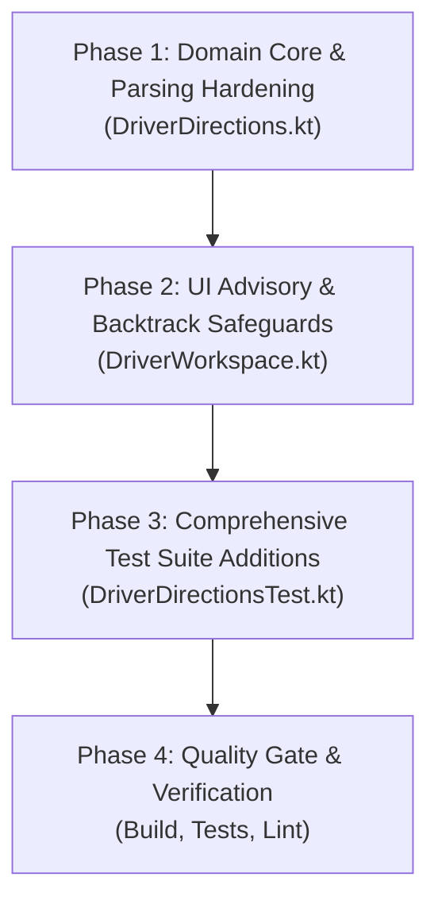

# D05-WP1 Bug Fix Implementation Plan: HGV Corridor Waypoints & Stage Directions

**Target Scope:** Remediation of SET Audit Findings on `D05-WP1` Implementation  
**Feature Branch:** `JBranch`  
**Active Working Root:** `app/src/main/java/com/tanaw/app/feature/workspace/`  
**Related Audit:** [D05_BUG_FINDINGS_AND_PLAN.md](file:///C:/Users/Soriano/AndroidStudioProjects/Tanaw_Mobile/docs/D05_BUG_FINDINGS_AND_PLAN.md)  
**Date:** 2026-11-12

---

## 1. Executive Summary & Problem Statement

The `D05-WP1` implementation introduced intermediate waypoints from confirmed HGV GeoJSON to anchor external Google Maps routes (`D05-B3`, `D05-G1`) and stage-aware directions button hierarchies (`D05-B4`). 

The SET code audit uncovered **5 actionable defects and logistics risks**:
1. **Bug 1 (High): False Assurance UI Notice** — Displays *"Includes office-confirmed HGV corridor waypoints"* even when GeoJSON yields zero intermediate waypoints (e.g., empty collection, 2-point straight line, or invalid coordinates).
2. **Bug 2 (Medium): Mid-Route Inversion / Backtrack Hazard** — Passing all trip waypoints when in-transit (`stage == 4`) causes Google Maps to route drivers backward through previously passed waypoints if resumed mid-trip.
3. **Bug 3 (Medium): Missing `MultiLineString` GeoJSON Support** — Multi-segment routes (bridges, divided highways, multi-leg corridors) are silently skipped.
4. **Bug 4 (Low): Null Island `(0.0, 0.0)` Coordinates** — Uninitialized `(0, 0)` coordinates pass bounds checks and route the driver off the coast of Africa instead of falling back to the text address.
5. **Bug 5 (Low): Uncapped `maxWaypoints`** — Parameter allows `> 9` waypoints, risking Google Maps URL truncation or rejection on mobile.

This plan details a **4-phase implementation** to resolve these defects safely, ensure test coverage, and uphold strict backward compatibility.

---

## 2. Multi-Phase Implementation Plan



---

### Phase 1: Domain Core & Parsing Hardening (`DriverDirections.kt`)

**Primary File:** [`DriverDirections.kt`](file:///C:/Users/Soriano/AndroidStudioProjects/Tanaw_Mobile/app/src/main/java/com/tanaw/app/feature/workspace/DriverDirections.kt)

#### Objectives
1. **Fix Bug 4 (Null Island Protection):** Update `target(shipment, destination)` coordinate validation to explicitly reject `lat == 0.0 && lng == 0.0`.
2. **Fix Bug 5 (Google Maps Waypoint Capping):** Constrain `effectiveMax = maxWaypoints.coerceIn(1, 9)` in `extractWaypoints`.
3. **Fix Bug 3 (`MultiLineString` Support):** Refactor coordinate extraction to support `MultiLineString` alongside `LineString`, `Feature`, and `FeatureCollection`.

#### Technical Specification
- In `DriverDirections.target`:
  ```kotlin
  val isValidCoord = lat != null && lng != null &&
      lat.isFinite() && lng.isFinite() &&
      lat in -90.0..90.0 && lng in -180.0..180.0 &&
      !(lat == 0.0 && lng == 0.0)
  ```
- In `DriverDirections.extractWaypoints`:
  - Enforce bounds: `if (routeGeoJson.isNullOrBlank() || maxWaypoints <= 0) return emptyList()`
  - Coerce limit: `val clampedMax = maxWaypoints.coerceIn(1, 9)`
  - Handle `MultiLineString`:
    ```kotlin
    if (type.equals("MultiLineString", ignoreCase = true)) {
        val lineArrays = geom["coordinates"]?.jsonArray ?: return
        for (line in lineArrays) {
            val coords = (line as? JsonArray) ?: continue
            for (coord in coords) {
                // extract [lng, lat] safely
            }
        }
    }
    ```
- Use `clampedMax` for sampling candidates.

---

### Phase 2: UI Advisory & Backtrack Safeguards (`DriverWorkspace.kt`)

**Primary File:** [`DriverWorkspace.kt`](file:///C:/Users/Soriano/AndroidStudioProjects/Tanaw_Mobile/app/src/main/java/com/tanaw/app/feature/workspace/DriverWorkspace.kt#L506-L545)

#### Objectives
1. **Fix Bug 1 (False Assurance UI):** Only display *"Includes office-confirmed HGV corridor waypoints."* when `DriverDirections.corridorWaypointsParam(effectiveGeoJson)` actually yields a non-null string.
2. **Fix Bug 2 (Mid-Route Backtrack Advisory):** When in transit (`stage >= 4`) and corridor waypoints are active, display an advisory notice informing the driver to skip passed waypoints in Google Maps if resuming navigation mid-route.

#### Technical Specification
- In `DriverDirectionsButtons`:
  ```kotlin
  val hasWaypoints = remember(effectiveGeoJson) {
      !DriverDirections.corridorWaypointsParam(effectiveGeoJson).isNullOrBlank()
  }

  Text(
      "Opens external driving directions. Confirm truck restrictions with the office.",
      fontSize = 11.sp,
      color = MaterialTheme.colorScheme.onSurfaceVariant
  )
  if (hasWaypoints) {
      Text(
          "Includes office-confirmed HGV corridor waypoints.",
          fontSize = 11.sp,
          color = MaterialTheme.colorScheme.onSurfaceVariant
      )
      if (stage >= 4) {
          Text(
              "If resuming navigation midway, remove past waypoints in Google Maps to avoid backtracking.",
              fontSize = 11.sp,
              color = MaterialTheme.colorScheme.onSurfaceVariant
          )
      }
  }
  ```

---

### Phase 3: Comprehensive Test Suite Additions (`DriverDirectionsTest.kt`)

**Primary File:** [`DriverDirectionsTest.kt`](file:///C:/Users/Soriano/AndroidStudioProjects/Tanaw_Mobile/app/src/test/java/com/tanaw/app/feature/workspace/DriverDirectionsTest.kt)

#### Objectives
Implement unit tests covering all 5 audit findings and edge cases:
1. **Null Island Fallback Test:** Verify `(0.0, 0.0)` falls back to text address.
2. **Empty / 2-Point Line Test:** Verify `corridorWaypointsParam` returns `null` for a 2-point line, guaranteeing the UI advisory is omitted.
3. **`MultiLineString` GeoJSON Parsing Test:** Verify extraction from a valid `MultiLineString`.
4. **Waypoint Capping Test:** Verify `maxWaypoints = 20` is clamped to at most 9 waypoints.
5. **Stage Directions Button URL Test:** Verify URL outputs for destination and trip with clamped waypoints.

---

### Phase 4: Quality Gate & Verification

#### Verification Steps
1. **Unit Tests:** Run `./gradlew testDebugUnitTest --tests com.tanaw.app.feature.workspace.DriverDirectionsTest` to verify 100% pass rate.
2. **Full Workspace Unit Tests:** Run `./gradlew testDebugUnitTest` to ensure zero regressions across all workspace features.
3. **Compilation:** Run `./gradlew assembleDebug` to verify build integrity.
4. **Lint / Analysis:** Run `studio_analyze_file` on modified files.
5. **Documentation Sync:** Confirm compatibility with `D05-WP2`, `D05-WP3`, and `D05-WP4` integration points.

---

## 3. Risk Assessment & Mitigations

| Risk | Severity | Mitigation |
|:-----|:--------:|:-----------|
| **Breaking UI Test Matchers** | Medium | Maintain existing button text strings (`"Directions to pickup"`, `"Directions to destination"`, `"View pickup-to-destination route"`). |
| **Malformed GeoJSON Crashes** | Low | Retain top-level `runCatching` blocks and safe Kotlin JSON casts (`as? JsonArray`, `as? JsonObject`). |
| **Cross-Package Signature Conflicts** | Low | Keep default parameters on `url()` and `tripUrl()` so existing callers in `DriverNavigateOverview.kt` require no changes. |
