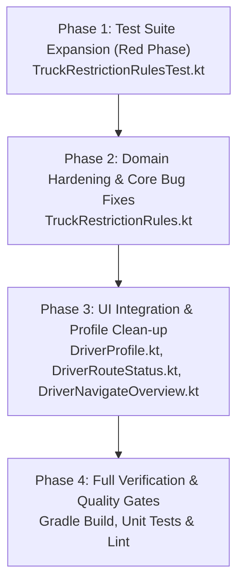

# D05-WP2 Bug Fix Implementation Plan (By Phases)

**Target Scope:** `D05-WP2` Bug Fixes & Hardening for Truck Specs, Gross Weight, Number Coding & Truck-Ban Advisories  
**Source Audit:** SET Bug Scan Report on `D05-WP2` (`TruckRestrictionRules.kt`, `TruckRestrictionRulesTest.kt`, `DriverProfile.kt`, `docs/BACKEND-REQUESTS.md`)  
**Target Branch:** `JBranch`  
**Active Working Root:** `app/src/main/java/com/tanaw/app/feature/workspace/`  
**Related Documents:** [D05_BUG_FINDINGS_AND_PLAN.md](file:///C:/Users/Soriano/AndroidStudioProjects/Tanaw_Mobile/docs/D05_BUG_FINDINGS_AND_PLAN.md), [D05_WP1_BUG_FIX_PLAN.md](file:///C:/Users/Soriano/AndroidStudioProjects/Tanaw_Mobile/docs/D05_WP1_BUG_FIX_PLAN.md), [D05_WP3_BUG_FIX_PLAN.md](file:///C:/Users/Soriano/AndroidStudioProjects/Tanaw_Mobile/docs/D05_WP3_BUG_FIX_PLAN.md), [D05_WP4_BUG_FIX_PLAN.md](file:///C:/Users/Soriano/AndroidStudioProjects/Tanaw_Mobile/docs/D05_WP4_BUG_FIX_PLAN.md)  
**Date:** 2026-11-12  

---

## 1. Executive Summary & Problem Statement

The `D05-WP2` implementation established client-side domain rules for truck physical dimensions, payload utilization, tare/gross vehicle weights, Philippine UVVRP plate number coding, and peak-hour truck-ban windows. 

A thorough Software Engineer in Testing (SET) audit identified **5 concrete defects and integration gaps** in the WP2 deliverables:

| Defect ID | Severity | Summary | Primary Files Affected |
|:---|:---:|:---|:---|
| **WP2-B1** | **HIGH** | **Orphaned Advisory Logic & Missing Composable:** `evaluateBanAdvisory()` has 0 production call sites. The planned `DriverTruckRestrictionCard` was dropped across prompt handoffs, leaving drivers with zero in-app warning on active routes. | `TruckRestrictionRules.kt`<br>`DriverRouteStatus.kt`<br>`DriverNavigateOverview.kt` |
| **WP2-B2** | **HIGH** | **Active Trip Coding Suppression:** `refInstant = depInstant ?: referenceNow` prioritizes past scheduled departures over today's date, hiding active UVVRP number coding during transit or midnight rollovers. | `TruckRestrictionRules.kt` |
| **WP2-B3** | **MEDIUM** | **Unzoned ISO Timestamp Parsing Failure:** `parseIsoInstant` throws `DateTimeParseException` on local timestamps lacking zone offsets (e.g. `"2026-11-10T07:30:00"`), silently returning `null` and disabling ban checks. | `TruckRestrictionRules.kt` |
| **WP2-B4** | **MEDIUM** | **Deadhead / Zero-Cargo Weight Dropped:** `extractDouble` strictly enforces `parsed > 0.0`, discarding valid `0.0 kg` cargo weights on empty runs and preventing `grossWeightKg = tareWeightKg` calculation. | `TruckRestrictionRules.kt` |
| **WP2-B5** | **LOW/MED** | **Dead Code & Display Defect in `DriverProfile.kt`:** `TruckRestrictionRules.formatSpecLine()` is dead code; `DriverProfile.kt` reimplements formatting with an ad-hoc `buildString` that drops unrecorded capacity warnings. | `DriverProfile.kt`<br>`TruckRestrictionRules.kt` |

This plan outlines a **4-phase implementation** to harden domain parsing, resolve timing and timezone logic flaws, eliminate dead code, and wire advisory UI components cleanly into the active driver navigation workflow.

---

## 2. Phase-by-Phase Implementation Plan



---

### Phase 1: Test Suite Expansion (Red Phase)

**Goal:** Establish reproducible failing unit tests for `WP2-B2`, `WP2-B3`, `WP2-B4`, and `WP2-B5` before modifying production code.

**Primary File:** [`TruckRestrictionRulesTest.kt`](file:///C:/Users/Soriano/AndroidStudioProjects/Tanaw_Mobile/app/src/test/java/com/tanaw/app/feature/workspace/TruckRestrictionRulesTest.kt)

#### Tasks & Test Cases to Add
1. **Unzoned ISO Timestamp Fallback Test (`WP2-B3`):**
   - Provide local ISO timestamps without offsets (e.g., `"2026-11-10T07:30:00"`).
   - Assert that `evaluateBanAdvisory` correctly parses the timestamp in Philippine time (`Asia/Manila`) and identifies the peak morning truck-ban window.
2. **Active Trip Coding Day Evaluation Test (`WP2-B2`):**
   - Scenario A (Trip started yesterday): `scheduledDepartureIso = "2026-11-09T22:00:00+08:00"` (Monday), `referenceNow = "2026-11-10T08:00:00+08:00"` (Tuesday morning). Assert plate ending in `4` triggers Tuesday number coding warning today.
   - Scenario B (Trip arriving on coding day): `scheduledDepartureIso = "2026-11-09T14:00:00+08:00"` (Monday), `etaIso = "2026-11-10T09:00:00+08:00"` (Tuesday morning). Assert Tuesday number coding warning is triggered.
3. **Empty / Deadhead 0.0 kg Cargo Weight Test (`WP2-B4`):**
   - Provide `truck` with `tare_weight_kg = 5000` and `shipment` with `weight_kg = 0`.
   - Assert `spec.cargoWeightKg == 0.0`.
   - Assert `spec.grossWeightKg == 5000.0` (tare + 0.0 cargo).
   - Assert `isOverCapacity == false`.
4. **Format Specification Completeness Test (`WP2-B5`):**
   - Test when `capacityKg == null` but physical dimensions are verified (`height = 3.8m, width = 2.5m`).
   - Assert formatted line contains both `"Capacity not recorded"` and `"Height: 3.8m · Width: 2.5m"`.

---

### Phase 2: Domain Hardening & Core Bug Fixes

**Goal:** Fix time-parsing resilience, gross weight calculation on zero cargo, and multi-instant coding day evaluation.

**Primary File:** [`TruckRestrictionRules.kt`](file:///C:/Users/Soriano/AndroidStudioProjects/Tanaw_Mobile/app/src/main/java/com/tanaw/app/feature/workspace/TruckRestrictionRules.kt)

#### Technical Specifications

1. **Fix `parseIsoInstant` for Unzoned Timestamps (`WP2-B3`):**
   Add fallback to `LocalDateTime.parse(iso).atZone(MANILA_ZONE).toInstant()`:
   ```kotlin
   private fun parseIsoInstant(iso: String): Instant? {
       if (iso.isBlank()) return null
       return try {
           Instant.parse(iso)
       } catch (_: Exception) {
           try {
               OffsetDateTime.parse(iso).toInstant()
           } catch (_: Exception) {
               try {
                   ZonedDateTime.parse(iso).toInstant()
               } catch (_: Exception) {
                   try {
                       LocalDateTime.parse(iso).atZone(MANILA_ZONE).toInstant()
                   } catch (_: Exception) {
                       null
                   }
               }
           }
       }
   }
   ```

2. **Fix `extractDouble` for Zero Cargo Weight (`WP2-B4`):**
   Parameterize `allowZero: Boolean = false` to accept `parsed >= 0.0` when zero is semantically valid:
   ```kotlin
   private fun extractDouble(vararg candidates: String?, allowZero: Boolean = false): Double? {
       for (candidate in candidates) {
           val parsed = candidate?.trim()?.toDoubleOrNull()
           if (parsed != null && parsed.isFinite() && (if (allowZero) parsed >= 0.0 else parsed > 0.0)) {
               return parsed
           }
       }
       return null
   }
   ```
   In `evaluateTruckSpecs`:
   ```kotlin
   val cargoWeightKg = extractDouble(
       shipment?.value("weight_kg"),
       routingPlan?.value("cargo_weight_kg"),
       allowZero = true
   )
   ```

3. **Fix Multi-Instant Coding Day Evaluation (`WP2-B2`):**
   Evaluate whether today (`referenceNow`), scheduled departure (`depInstant`), or estimated arrival (`etaInstant`) intersects with the truck's coding day:
   ```kotlin
   val nowDay = referenceNow.atZone(MANILA_ZONE).dayOfWeek
   val depDay = depInstant?.atZone(MANILA_ZONE)?.dayOfWeek
   val etaDay = etaInstant?.atZone(MANILA_ZONE)?.dayOfWeek

   val isCodingToday = coding != null && nowDay == coding.second
   val isCodingOnDep = coding != null && depDay != null && depDay == coding.second
   val isCodingOnEta = coding != null && etaDay != null && etaDay == coding.second
   val isCodingDayActive = isCodingToday || isCodingOnDep || isCodingOnEta

   val warnings = mutableListOf<String>()
   if (isCodingDayActive && lastPlateDigit != null && codingDayName != null) {
       val contextMsg = when {
           isCodingToday -> "today"
           isCodingOnDep -> "on scheduled departure"
           else -> "at estimated arrival"
       }
       warnings.add("UVVRP Number Coding: Plate ends in $lastPlateDigit ($codingDayName, active $contextMsg). Verify MMDA/municipal truck coding exemption.")
   }
   ```

4. **Enhance `formatSpecLine` Fallback Logic (`WP2-B5`):**
   Ensure unrecorded capacity is never suppressed when dimensions are present:
   ```kotlin
   fun formatSpecLine(spec: TruckSpecSummary): String {
       val weightPart = when {
           spec.capacityKg != null && spec.cargoWeightKg != null ->
               "Capacity: %,.0f kg · Cargo: %,.0f kg".format(Locale.US, spec.capacityKg, spec.cargoWeightKg)
           spec.capacityKg != null ->
               "Capacity: %,.0f kg".format(Locale.US, spec.capacityKg)
           spec.cargoWeightKg != null ->
               "Capacity not recorded · Cargo: %,.0f kg".format(Locale.US, spec.cargoWeightKg)
           else ->
               "Capacity not recorded"
       }
       val dimPart = if (spec.dimensionsVerified) {
           val h = "%.1fm".format(Locale.US, spec.heightMeters)
           val w = "%.1fm".format(Locale.US, spec.widthMeters)
           if (spec.lengthMeters != null) {
               "Height: $h · Width: $w · Length: ${"%.1fm".format(Locale.US, spec.lengthMeters)}"
           } else {
               "Height: $h · Width: $w"
           }
       } else {
           "Height/width/axle limits not recorded on vehicle profile"
       }
       return "$weightPart · $dimPart"
   }
   ```

---

### Phase 3: UI Integration & Profile Clean-up

**Goal:** Eliminate dead formatting code in `DriverProfile.kt`, implement `DriverTruckRestrictionCard`, and wire it into the active driver navigation screen.

**Primary Files:**
- [`DriverProfile.kt`](file:///C:/Users/Soriano/AndroidStudioProjects/Tanaw_Mobile/app/src/main/java/com/tanaw/app/feature/workspace/DriverProfile.kt#L135-L150)
- [`DriverRouteStatus.kt`](file:///C:/Users/Soriano/AndroidStudioProjects/Tanaw_Mobile/app/src/main/java/com/tanaw/app/feature/workspace/DriverRouteStatus.kt)
- [`DriverNavigateOverview.kt`](file:///C:/Users/Soriano/AndroidStudioProjects/Tanaw_Mobile/app/src/main/java/com/tanaw/app/feature/workspace/DriverNavigateOverview.kt)

#### Technical Specifications

1. **Clean up `DriverProfile.kt` (`WP2-B5`):**
   Replace custom `buildString` with `TruckRestrictionRules.formatSpecLine(spec)`:
   ```kotlin
   val spec = TruckRestrictionRules.evaluateTruckSpecs(truck)
   Text(
       TruckRestrictionRules.formatSpecLine(spec),
       style = MaterialTheme.typography.bodySmall,
       color = MaterialTheme.colorScheme.onSurfaceVariant
   )
   val coding = TruckRestrictionRules.codingDayForPlate(truck.value("plate_number"))
   if (coding != null) {
       val dayName = coding.second.name.lowercase(java.util.Locale.US).replaceFirstChar { it.titlecase(java.util.Locale.US) }
       Text("Number coding day: $dayName (plate ends in ${coding.first})", style = MaterialTheme.typography.bodySmall, color = MaterialTheme.colorScheme.onSurfaceVariant)
   }
   ```

2. **Implement `DriverTruckRestrictionCard` in `DriverRouteStatus.kt` (`WP2-B1`):**
   Add composable function rendering truck physical limits, payload status, and any active ban warnings:
   ```kotlin
   @Composable
   internal fun DriverTruckRestrictionCard(
       spec: TruckSpecSummary,
       ban: TruckBanAdvisory
   ) {
       Surface(
           color = MaterialTheme.colorScheme.surfaceContainerHighest,
           shape = RoundedCornerShape(12.dp)
       ) {
           Column(
               modifier = Modifier.fillMaxWidth().padding(12.dp),
               verticalArrangement = Arrangement.spacedBy(6.dp)
           ) {
               Text(
                   "Vehicle & Route Restrictions",
                   fontWeight = FontWeight.SemiBold,
                   fontSize = 13.sp,
                   color = MaterialTheme.colorScheme.onSurface
               )
               Text(
                   TruckRestrictionRules.formatSpecLine(spec),
                   fontSize = 12.sp,
                   color = MaterialTheme.colorScheme.onSurfaceVariant
               )
               if (spec.isOverCapacity) {
                   Text(
                       "WARNING: Cargo weight exceeds vehicle rated capacity!",
                       fontSize = 12.sp,
                       fontWeight = FontWeight.Bold,
                       color = MaterialTheme.colorScheme.error
                   )
               }
               for (warning in ban.warnings) {
                   Text(
                       warning,
                       fontSize = 12.sp,
                       color = MaterialTheme.colorScheme.error
                   )
               }
           }
       }
   }
   ```

3. **Wire into `DriverNavigateOverview.kt` (`WP2-B1`):**
   Under `"Directions & route"`, evaluate `spec` and `ban` using the active shipment, assigned truck, and routing plan, and display `DriverTruckRestrictionCard`:
   ```kotlin
   val truck = DriverUiRules.truck(state.data)
   val spec = TruckRestrictionRules.evaluateTruckSpecs(truck, s, routing.obj("plan"))
   val ban = TruckRestrictionRules.evaluateBanAdvisory(
       plateNumber = truck?.value("plate_number") ?: s.value("plate_number"),
       scheduledDepartureIso = s.value("scheduled_departure"),
       etaIso = routing.value("eta_at").ifBlank { null }
   )
   DriverTruckRestrictionCard(spec, ban)
   ```

---

### Phase 4: Full Verification & Quality Gates

**Goal:** Ensure all unit tests pass, no lint regressions occur, and the APK builds cleanly.

#### Verification Steps
1. **Targeted Unit Tests:**
   ```bash
   ./gradlew testDebugUnitTest --tests com.tanaw.app.feature.workspace.TruckRestrictionRulesTest
   ```
2. **Complete Unit Test Suite:**
   ```bash
   ./gradlew testDebugUnitTest
   ```
3. **Debug APK Build:**
   ```bash
   ./gradlew assembleDebug
   ```
4. **Lint Inspection:**
   ```bash
   ./gradlew lintDebug
   ```

---

## 3. Risk Mitigation & Compliance Matrix

| Rule / Risk | Mitigation Strategy |
|:---|:---|
| **Zero Shell Edits** | All file modifications strictly performed via `studio_replace_file_content` and `studio_write_file`. |
| **Backward Compatibility** | Signatures maintain default parameters (`allowZero = false`, `referenceNow = Instant.now()`). |
| **No Backend Mutations** | Backend requests remain documented exclusively in `docs/BACKEND-REQUESTS.md`; all client code uses safe offline/fallback defaults. |
| **Dark Theme Accessibility** | UI uses semantic tokens (`MaterialTheme.colorScheme.surfaceContainerHighest`, `onSurface`, `onSurfaceVariant`, `error`) instead of hardcoded colors. |
| **No Branch Switches** | All work restricted to `JBranch`. |

---

## 4. Acceptance Criteria Checklist

- [x] `parseIsoInstant` parses local timestamps without zone offsets without throwing exceptions.
- [x] `extractDouble(..., allowZero = true)` retains `0.0 kg` cargo weight on empty shipments.
- [x] `evaluateBanAdvisory` detects number coding conflicts across today's date, departure, and arrival instants.
- [x] `TruckRestrictionRules.formatSpecLine` is utilized in `DriverProfile.kt`, eliminating dead code and display inconsistencies.
- [x] `DriverTruckRestrictionCard` renders on `DriverNavigateOverview.kt` with live truck specifications and truck-ban warnings.
- [x] `./gradlew testDebugUnitTest` passes 100% with zero regressions.
- [x] `./gradlew assembleDebug` builds successfully.
