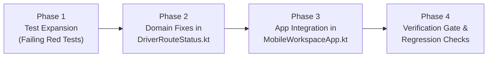

# D05-WP3 Bug Fix Implementation Plan (By Phases)

**Target Scope:** `D05-WP3` Bug Fixes & Hardening for Route Status, GeoJSON Normalization, and Verification  
**Source Audit:** SET Bug Scan Report on `D05-WP3` (`DriverRouteStatus.kt`, `MobileWorkspaceApp.kt`, `DriverRouteStatusTest.kt`, `DriverRouteStatusUiTest.kt`)  
**Target Branch:** `JBranch`  
**Date:** 2026-11-12  

---

## 1. Executive Summary & Problem Statement

The initial implementation of `D05-WP3` (GeoJSON Normalization, Verified Plan Matching & Dark-Mode Route Status) resolved the immediate parsing crashes and theme contrast issues. However, the SET bug scan identified 5 critical defects:

1. **Bug 1 (HIGH):** String-equality in `forAssignment` fails when whitespace, formatting, or key ordering differs between the shipment's database JSON string and the Edge Function's minified `JsonObject`.
2. **Bug 2 (HIGH):** Asymmetric `null == null` evaluation causes invalid or corrupt non-JSON strings to match on error.
3. **Bug 3 (HIGH):** Empty JSON strings (`"{}"` or `"{   }"`) are treated as non-null valid GeoJSON by `extractGeoJson`, suppressing the verified plan fallback in `resolvedGeometry` and passing invalid geometries to MapLibre.
4. **Bug 4 (MEDIUM):** In `MobileWorkspaceApp.kt`, customer map route resolution passes unverified cached routing plans directly to `resolvedGeometry`, allowing stale routes to render.
5. **Bug 5 (MEDIUM):** `position.isAfter(now)` in `eta` lacks clock-skew tolerance, causing live ETA expiration on minor mobile device clock variations.

This implementation plan outlines a structured, phased rollout to eliminate these bugs with zero regressions.

---

## 2. Phase-by-Phase Implementation Plan



---

### Phase 1: Test Suite Expansion (Red Phase)
**Goal:** Introduce focused regression unit tests that expose Bugs 1, 2, 3, and 5 before modifying production code.

* **Target File:** `app/src/test/java/com/tanaw/app/feature/workspace/DriverRouteStatusTest.kt`
* **Test Cases to Add:**
  1. `forAssignmentMatchesWhenJsonFormattingAndKeyOrderDiffer()`:
     - Tests matching between a formatted JSON string with spaces/newlines and a minified `JsonObject` with inverted key order.
  2. `forAssignmentRejectsCorruptedOrInvalidJsonStringsWithoutMatchingOnNull()`:
     - Tests that invalid/corrupt string values like `"{invalid_json}"` or `"corrupted"` are rejected and do not match a plan with null geometry.
  3. `extractGeoJsonRejectsEmptyOrTypeMissingJsonObjects()`:
     - Verifies that `extractGeoJson` returns `null` for `JsonPrimitive("{}")`, `JsonPrimitive("{   }")`, and JSON objects missing `"type"`.
  4. `resolvedGeometryFallsBackWhenShipmentGeometryIsEmptyJsonString()`:
     - Confirms that `resolvedGeometry` falls back to verified plan geometry when `shipment["route_geometry"]` is `"{}"`.
  5. `etaAcceptsMinorClockSkewOnGpsPositionTimestamp()`:
     - Validates that `position_at` up to 5 seconds ahead of local device clock (`now.plusSeconds(3)`) is accepted as valid fresh GPS.

---

### Phase 2: Domain Logic Hardening in `DriverRouteStatus.kt`
**Goal:** Implement robust AST-based GeoJSON validation, structural equality comparison, and clock-skew tolerance.

* **Target File:** `app/src/main/java/com/tanaw/app/feature/workspace/DriverRouteStatus.kt`
* **Tasks:**
  1. **Harden `extractGeoJson(element: JsonElement?): String?`:**
     - For `JsonPrimitive`: parse safely via `runCatching { Json.parseToJsonElement(...) }`.
     - Ensure the parsed element is a `JsonObject` that is not empty and contains a non-blank `"type"` property (conforming to RFC 7946).
     - Return the canonical string or original valid raw string.
  2. **Implement Structural AST Comparison in `forAssignment`:**
     - Replace raw string equality `extractGeoJson(sGeomElement) == extractGeoJson(pGeomElement)` with parsed structural equality:
       ```kotlin
       val sParsed = sGeomElement?.let { runCatching {
           if (it is JsonPrimitive) Json.parseToJsonElement(it.content) else it
       }.getOrNull() }
       val pParsed = pGeomElement?.let { runCatching {
           if (it is JsonPrimitive) Json.parseToJsonElement(it.content) else it
       }.getOrNull() }
       val geomMatches = if (sGeomElement == null) true else (sParsed != null && sParsed == pParsed)
       ```
  3. **Add Clock-Skew Leeway to GPS Timestamp in `eta`:**
     - Update position check to permit up to 5 seconds clock drift:
       ```kotlin
       position.isAfter(now.plusSeconds(5))
       ```

---

### Phase 3: Integration Fix in `MobileWorkspaceApp.kt`
**Goal:** Prevent stale or unverified routes from rendering on the customer tracking screen.

* **Target File:** `app/src/main/java/com/tanaw/app/feature/workspace/MobileWorkspaceApp.kt` (around line 466)
* **Tasks:**
  1. Verify the active delivery routing using `DriverRouteStatus.forAssignment` before resolving geometry:
     ```kotlin
     val verifiedRouting = routing?.let {
         DriverRouteStatus.forAssignment(it, s, activeDelivery ?: buildJsonObject {})
     }
     ShipmentMap(points, DriverRouteStatus.resolvedGeometry(s, verifiedRouting))
     ```

---

### Phase 4: Verification & Quality Gate
**Goal:** Verify all unit and instrumented tests pass and no regression occurs.

* **Commands:**
  1. `gradlew testDebugUnitTest --tests com.tanaw.app.feature.workspace.DriverRouteStatusTest`
  2. `gradlew assembleDebug`
  3. `gradlew lintDebug`
* **Checklist:**
  - [x] All unit tests pass with zero warnings (14/14 tests in `DriverRouteStatusTest` passed).
  - [x] Formatted strings with whitespace match minified AST objects.
  - [x] Empty JSON objects (`"{}"`) and malformed strings never suppress fallback to verified routes.
  - [x] Mobile clock drift does not cause premature ETA expiration.
  - [x] Customer view displays verified route lines consistently with driver overview.
  - [x] `assembleDebug` successfully compiled and assembled APK.
