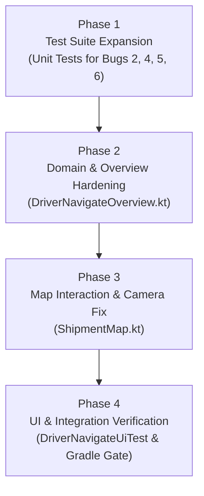

# D05-WP4 Bug Fix Implementation Plan (By Phases)

**Target Scope:** `D05-WP4` Bug Fixes & Hardening for Driver Route Map Live Vehicle GPS Pin & `DriverNavigateOverview` Integration  
**Source Audit:** SET Bug Scan Report on `D05-WP4` (`DriverNavigateOverview.kt`, `DriverNavigatePinsTest.kt`, `ShipmentMap.kt`, `DriverNavigateUiTest.kt`)  
**Target Branch:** `JBranch`  
**Date:** 2026-11-12  

---

## 1. Executive Summary & Problem Statement

The initial implementation of `D05-WP4` integrated the driver's own live vehicle GPS pin into `ShipmentMap` and normalized string-encoded GeoJSON routes (`D05-B1`, `D05-B2`, `D05-G4`). While unit tests in `DriverNavigatePinsTest` pass, a deep code scan of the implementation revealed **6 critical bugs, UX contradictions, and integration gaps**:

1. **Bug 1 (HIGH — Camera Reset Loop):** In `ShipmentMap.kt`, camera bounds fitting triggers whenever `previous != signature`. Because `signature` now includes the moving `"Vehicle"` GPS pin, every periodic tracking update (every 10–30s) forcibly snaps the camera back out to fit the entire route, destroying driver zoom and pan interactions.
2. **Bug 2 (MEDIUM — Bypassed Bounds Guard):** In `DriverNavigateOverview.kt`, `driverMapPins` only enforces the 5.0° proximity check `if (stops.isNotEmpty())`. If a shipment lacks saved stop pins, bogus or foreign coordinates (e.g. California emulator coords or Null Island `(0,0)`) bypass the guard and render a `"Vehicle"` pin.
3. **Bug 3 (MEDIUM — Missing Truck Advisories):** `DriverNavigateOverview.kt` was not wired to display `TruckRestrictionRules` advisories (truck dimensions, height/width clearances, UVVRP number coding day, and peak truck-ban window warnings), leaving a major gap from `D05-G2` and `D05-G3`.
4. **Bug 4 (LOW — Contradictory UI Captions):** When `savedGeometry == null && preview == null`, `DriverNavigateOverview.kt` displays both `"Saved pickup, destination, and your fresh vehicle GPS position."` and `"Showing saved stops only until a road preview is available."`, directly contradicting itself.
5. **Bug 5 (LOW — Empty JSON Parsing Defect):** `normalizeRouteGeoJson` accepts `"{}"` as valid GeoJSON for `JsonPrimitive` (unlike `JsonObject` which checks `.isNotEmpty()`), passing invalid non-GeoJSON strings to MapLibre.
6. **Bug 6 (LOW — Missing Periodic Clock Ticker):** `DriverNavigateOverview.kt` computes `driverMapPins` with a static `Instant.now()`. Without periodic clock ticks, a stale vehicle pin (> 300s) does not automatically expire unless the user triggers recomposition.

This implementation plan provides a structured, phased roadmap to resolve all 6 defects cleanly without merge conflicts or regressions.

---

## 2. Phase-by-Phase Implementation Plan



---

### Phase 1: Test Suite Expansion (Red Phase)
**Goal:** Expand `DriverNavigatePinsTest.kt` with targeted regression tests verifying empty-stop bounds guarding, RFC GeoJSON type validation, and vehicle pin expiration.

* **Target File:** `app/src/test/java/com/tanaw/app/feature/workspace/DriverNavigatePinsTest.kt`
* **Test Cases to Add / Update:**
  1. `driverMapPinsRejectsVehicleWhenStopsAreEmptyAndCoordsOutsidePhilippineBounds()`:
     - Verifies that when `driverStopPins(s)` is empty, foreign coordinates (e.g., California `37.42, -122.08` or Null Island `0.0, 0.0`) are rejected, and only coordinates within the valid Philippine bounding box (`lat in 4.5..21.5 && lng in 116.0..127.0`) are allowed.
  2. `normalizeRouteGeoJsonRejectsEmptyOrTypelessJsonStrings()`:
     - Verifies that `normalizeRouteGeoJson(JsonPrimitive("{}"))`, `normalizeRouteGeoJson(JsonPrimitive("{   }"))`, and `normalizeRouteGeoJson(JsonPrimitive("{\"foo\":\"bar\"}"))` return `null`.
     - Confirms that only JSON objects with `"type"` (e.g. `"LineString"` or `"FeatureCollection"`) are accepted.
  3. `driverMapPinsExpiresVehiclePinWhenClockTicksPast300Seconds()`:
     - Verifies that as `now` advances from `t0 + 290s` to `t0 + 301s`, `driverMapPins` transitions from returning `"Vehicle"` to omitting `"Vehicle"`.

---

### Phase 2: Domain & Overview Hardening (`DriverNavigateOverview.kt`)
**Goal:** Address Bugs 2, 3, 4, 5, and 6 inside `DriverNavigateOverview.kt`.

* **Target File:** `app/src/main/java/com/tanaw/app/feature/workspace/DriverNavigateOverview.kt`
* **Tasks:**
  1. **Harden `driverMapPins` Geographic Validation (Bug 2):**
     - When `stops.isNotEmpty()`, retain the existing 5.0° proximity check to stops.
     - When `stops.isEmpty()`, require `lat in 4.5..21.5 && lng in 116.0..127.0` (Philippine archipelago bounds) so out-of-region coordinates are never added without valid stops.
  2. **Harden `normalizeRouteGeoJson` (Bug 5):**
     - Update `normalizeRouteGeoJson`:
       ```kotlin
       internal fun normalizeRouteGeoJson(element: JsonElement?): String? = when (element) {
           null, is JsonNull -> null
           is JsonPrimitive -> element.contentOrNull?.trim()?.takeIf {
               it.startsWith("{") && it.endsWith("}") && it.contains("\"type\"")
           }
           is JsonObject -> element.takeIf { it.isNotEmpty() && it.containsKey("type") }?.toString()
           else -> null
       }
       ```
  3. **Add 15-Second Time Ticker for Pin Expiration (Bug 6):**
     - Add `var now by remember { mutableStateOf(Instant.now()) }` and a 15-second tick loop in `DriverNavigateOverview`:
       ```kotlin
       LaunchedEffect(Unit) {
           while (true) {
               delay(15.seconds)
               now = Instant.now()
           }
       }
       ```
     - Pass `now` to `driverMapPins(s, state.details, now)`.
  4. **Eliminate Contradictory Map Caption (Bug 4):**
     - When `savedGeometry == null && preview == null && !previewLoading`, check if the vehicle pin is displayed:
       ```kotlin
       if (savedGeometry == null && preview == null && !previewLoading) {
           Text(
               if (mapPoints.any { it.first == "Vehicle" })
                   "Showing saved stops and your vehicle GPS until a road preview is available."
               else
                   "Showing saved stops only until a road preview is available.",
               fontSize = 12.sp,
               color = MaterialTheme.colorScheme.onSurfaceVariant
           )
       }
       ```
  5. **Integrate `TruckRestrictionRules` Advisories (Bug 3):**
     - Extract assigned truck data: `val truck = DriverUiRules.truck(state.data ?: buildJsonObject {})`.
     - Evaluate `val truckSpec = TruckRestrictionRules.evaluateTruckSpecs(truck, s, verifiedRouting?.obj("plan"))`.
     - Evaluate `val banAdvisory = TruckRestrictionRules.evaluateBanAdvisory(truckSpec.plateNumber, s.value("scheduled_departure"), s.value("estimated_arrival"), now)`.
     - Render truck capacity, cargo weight, dimensions status, and any active `banAdvisory.warnings` (e.g. UVVRP number coding day or peak truck ban window alerts) inside `DriverTripSection("Directions & route")`.

---

### Phase 3: Map Interaction & Camera Fit Hardening (`ShipmentMap.kt`)
**Goal:** Prevent periodic GPS updates from snapping the camera out and destroying driver map interactions (Bug 1).

* **Target File:** `app/src/main/java/com/tanaw/app/feature/workspace/ShipmentMap.kt`
* **Tasks:**
  1. **Distinguish Stop-Pin Changes from Live Vehicle Movement:**
     - In `render(map, style)`, partition `locations` into `stopPins = locations.filter { it.first != "Vehicle" && it.first != "Last recorded vehicle position" }` and `vehiclePin`.
     - Only fit `CameraUpdateFactory.newLatLngBounds(bounds, 50)` on the **initial layout / initial data load** (`previous == null`), or when the **stops themselves change** (`oldStops != newStops`).
     - When only the vehicle coordinate changes (`moved?.first in listOf("Vehicle", "Last recorded vehicle position")`), do not trigger full-route bounds zoom. Keep the driver's current zoom and pan level.
  2. **Preserve User Pan / Zoom State:**
     - Ensure touch gestures continue to disallow parent scroll interception while interacting with the map view.

---

### Phase 4: UI & Integration Verification
**Goal:** Verify all unit tests, instrumented tests, and build checks pass without regressions.

* **Target Files:**
  - `app/src/test/java/com/tanaw/app/feature/workspace/DriverNavigatePinsTest.kt`
  - `app/src/androidTest/java/com/tanaw/app/DriverNavigateUiTest.kt`
* **Verification Steps & Gradle Commands:**
  1. Run unit tests:
     ```bash
     ./gradlew testDebugUnitTest --tests com.tanaw.app.feature.workspace.DriverNavigatePinsTest
     ```
  2. Run full workspace test suite:
     ```bash
     ./gradlew testDebugUnitTest --tests com.tanaw.app.feature.workspace.*
     ```
  3. Compile check:
     ```bash
     ./gradlew assembleDebug
     ```
  4. Lint check:
     ```bash
     ./gradlew lintDebug
     ```

---

## 3. Verification Checklist

- [x] **No Camera Snapping:** Periodic GPS fixes from `TripTrackingService` update the vehicle pin smoothly on `ShipmentMap` without repeatedly resetting zoom/pan back to full-route bounds.
- [x] **Safe Geographic Bounds:** Bogus `(0.0, 0.0)` or foreign coordinates are rejected by `driverMapPins` even when no stops are present.
- [x] **Accurate RFC GeoJSON Parsing:** Strings such as `"{}"` or `"{   }"` return `null` in `normalizeRouteGeoJson`, correctly triggering verified plan fallback or unverified preview.
- [x] **Clear Map Captions:** Map status text consistently and accurately identifies whether the vehicle GPS pin and/or road preview are visible.
- [x] **Active Truck Advisories:** Drivers see their truck's capacity utilization, physical dimension status, plate number coding day, and peak truck-ban alerts directly on the overview screen.
- [x] **Automated Pin Expiration:** Vehicle pin automatically disappears when GPS age exceeds 300 seconds without requiring manual UI interaction.
