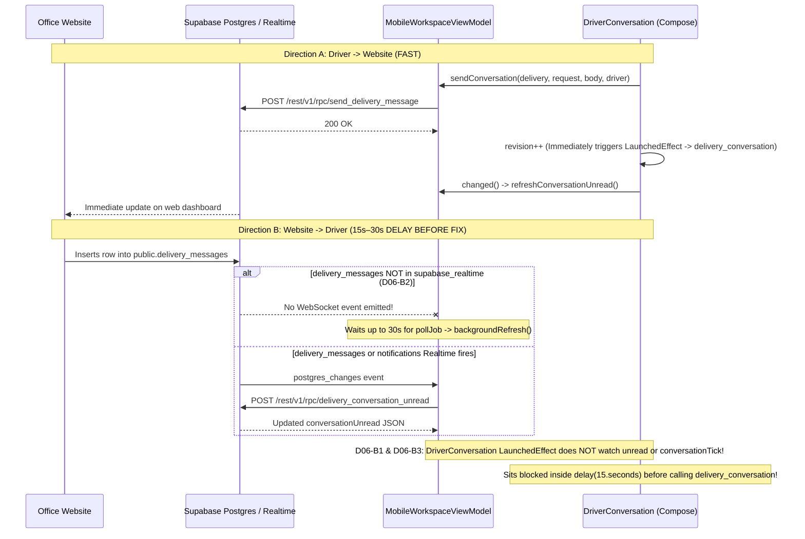
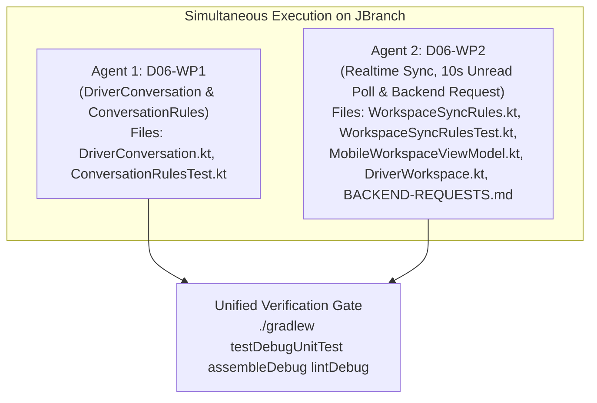

# D06 Bug Findings, Messaging Latency Audit & Multi-Agent Implementation Plan

**Backlog Item:** `D06` — Website-to-driver messaging, unread/read sync (`docs/BACKLOG.md`, `docs/FEATURES.md` #24)  
**Target Branch:** `JBranch`  
**Active Working Root:** `app/src/main/java/com/tanaw/app/feature/workspace/`  
**Date:** 2026-11-11

---

## 1. Executive Summary

During physical and live backend testing of backlog item `D06` (*Website-to-driver messaging, unread/read sync*), **driver-to-website messages appeared immediately** on the office dashboard (unless cellular signal was poor), whereas **website-to-driver messages exhibited significant latency (15–30 seconds)** before appearing in the driver's conversation view or updating the `Messages (N)` unread badge.

A deep source and schema audit of the active `feature/workspace/` messaging pipeline (`DriverConversation.kt`, `DriverWorkspace.kt`, `MobileWorkspaceViewModel.kt`, `WorkspaceSyncRules.kt`) and the Supabase Realtime publication (`supabase/migrations/live_schema_dump.sql`, `supabase/tests/active_driver_contract.sql`) identified **6 root-cause bugs (`D06-B1` through `D06-B6`)**:

| Bug ID | Severity | Summary | Delay / Impact | Primary Layer & Files |
|:-------|:--------:|:--------|:--------------:|:----------------------|
| **D06-B1** | **CRITICAL** | **Open `DriverConversation` Ignores Realtime & Unread State Changes — Relies Solely on a 15s Poll Loop:** `LaunchedEffect(delivery, expectedDriver, open, before, revision, offline, owner)` in `DriverConversation.kt` does not observe `unread` or any `conversationTick` from `MobileWorkspaceViewModel`. Even when the ViewModel receives an update, the open chat thread sits idle inside `delay(15.seconds)` before calling `delivery_conversation`. | **Up to 15s delay** (even when Realtime fires) | Client (`DriverConversation.kt`, `DriverWorkspace.kt`, `MobileWorkspaceViewModel.kt`) |
| **D06-B2** | **CRITICAL** | **`public.delivery_messages` Missing from `supabase_realtime` Publication:** `live_schema_dump.sql` only adds `deliveries`, `messages` (legacy table), `notifications`, `shipments`, and `tracking_logs` to `supabase_realtime`. Unless `public.delivery_messages` is added to `supabase_realtime` with a `SELECT` RLS policy for the driver, Postgres never broadcasts `delivery_messages` inserts over WebSockets, forcing the app to wait for `pollJob` (`delay(30.seconds)`). | **Up to 30s delay** (for `Messages (N)` badge & closed inbox) | Backend (`docs/BACKEND-REQUESTS.md`) + Client (`MobileWorkspaceViewModel.kt`, `WorkspaceSyncRules.kt`) |
| **D06-B3** | **HIGH** | **Workspace Reload Path (`reloadWorkspace = true`) Does Not Trigger Open `DriverConversation` Refresh:** When a message arrives alongside a `notifications` or `deliveries` Realtime event, `WorkspaceSyncRules.evaluateRealtimeBatch` routes to `backgroundRefresh()` (`load()`), which updates `conversationUnread` but does not bump a `conversationTick`. If `unread` was already non-zero or unchanged, `DriverConversation` never reloads. | **15–30s delay** | Client (`MobileWorkspaceViewModel.kt`, `WorkspaceSyncRules.kt`) |
| **D06-B4** | **MEDIUM** | **Messages Tab `"Refresh message inbox"` Triggers Heavy 8-Query `vm.refresh()` Without Bumping Open Thread Revision:** Tapping `"Refresh message inbox"` in `DriverWorkspace.kt` runs the full 8-query workspace reload (`state.busy = true`) and does not trigger `DriverConversation` to re-fetch `delivery_conversation`. | **2–4s UI freeze** & stale open thread on manual refresh | Client (`DriverWorkspace.kt`, `MobileWorkspaceViewModel.kt`) |
| **D06-B5** | **MEDIUM** | **Unread/Read Sync & Silent Background Reload UX:** Clicking `"Mark displayed messages read"` calls `changed()` (`refreshConversationUnread`) to update the parent badge, but does not increment `revision` to refresh the thread's own state. Additionally, background/tick reloads must preserve the current `page` so the conversation does not flash `"Loading messages…"` on every sync tick. | Stale read state / UI flicker risk | Client (`DriverConversation.kt`) |
| **D06-B6** | **LOW/MED** | **Unicode Code-Point vs. UTF-16 Length Mismatch in Draft Validation:** `ConversationRules.valid(body)` validates `codePointCount(0, ...) in 1..2000`, whereas `DriverConversation.kt` line 148 checks `draft.trim().length > 2000` (UTF-16 code units). Surrogate-pair emojis (e.g., `🚚`) count as 2 UTF-16 units in the UI error state while `ConversationRules.valid` counts them as 1 code point. | False inline error state with emojis | Client (`DriverConversation.kt`, `ConversationRulesTest.kt`) |

---

## 2. Why Driver $\rightarrow$ Website Is Fast While Website $\rightarrow$ Driver Is Delayed



---

## 3. Detailed Technical Root Causes & Fix Specifications

---

### 3.1 Bug `D06-B1` (CRITICAL): Open `DriverConversation` Ignores Realtime & Unread State Changes

#### Affected Files
- `app/src/main/java/com/tanaw/app/feature/workspace/DriverConversation.kt` (lines 43–78)
- `app/src/main/java/com/tanaw/app/feature/workspace/DriverWorkspace.kt` (lines 143–149)
- `app/src/main/java/com/tanaw/app/feature/workspace/MobileWorkspaceViewModel.kt` (`MobileState`, lines 74–90)

#### Root Cause Analysis
1. In `DriverConversation.kt` (lines 64–78):
   ```kotlin
   LaunchedEffect(delivery, expectedDriver, open, before, revision, offline, owner) {
       if (!open || offline) return@LaunchedEffect
       owner.lifecycle.repeatOnLifecycle(Lifecycle.State.RESUMED) {
           while (true) {
               try {
                   val result = currentLoad(before)
                   check(expectedDriver == null || result.value("driver_id") == expectedDriver) { "ASSIGNMENT_CHANGED_RELOAD" }
                   page = result; error = null
               }
               catch (cancelled: CancellationException) { throw cancelled }
               catch (_: Exception) { page = null; error = "Messages unavailable. Check your connection and delivery access, then retry." }
               delay(15.seconds)
           }
       }
   }
   ```
2. Notice the keys of `LaunchedEffect`: `(delivery, expectedDriver, open, before, revision, offline, owner)`.
   - `unread` is passed into `DriverConversation`, **but is only rendered as text** (`"$it unread · Delivery updates"` at line 106). It is never used to trigger a reload of `currentLoad(before)`!
   - Furthermore, there is no `syncTick: Int` parameter connecting `MobileWorkspaceViewModel`'s Realtime/unread updates to `DriverConversation`.
   - Consequently, even when `MobileWorkspaceViewModel` receives a Realtime event and updates `state.conversationUnread`, an open `DriverConversation` composable **never wakes up** from `delay(15.seconds)`.

#### Fix Specification
1. **Add `syncTick: Int = 0` to `DriverConversation` and `conversationTick: Int = 0` to `MobileState`:**
   - Give `syncTick: Int = 0` a default value in `DriverConversation` so all existing callers and instrumented tests (`DriverConversationUiTest.kt`) compile without modification.
   - Pass `syncTick = state.conversationTick` from `DriverWorkspace.kt`.
2. **Add Pure-Kotlin Sync Decision Helpers in `ConversationRules` (`DriverConversation.kt`):**
   - `const val ACTIVE_POLL_INTERVAL_SECONDS = 5L` (faster 5-second active poll when conversation is open on the latest page `before == null`, vs. 15 seconds when viewing older history pages `before != null`).
   - `fun pollIntervalSeconds(before: String?): Long = if (before == null) ACTIVE_POLL_INTERVAL_SECONDS else 15L`
   - `fun shouldReloadOnExternalSync(open: Boolean, offline: Boolean, before: String?, previousTick: Int, currentTick: Int, previousUnread: Int?, currentUnread: Int?): Boolean`:
     - Returns `true` when `open && !offline && before == null && (currentTick != previousTick || (currentUnread != null && currentUnread != previousUnread))`.
3. **Trigger Immediate Non-Flickering Reload in `DriverConversation`:**
   - When `syncTick` or `unread` changes while `open && !offline && before == null`, wake the fetch loop (or restart the `LaunchedEffect` keyed on `syncTick` and `unread` when `before == null`) to call `currentLoad(null)` immediately while retaining the existing `page` during the network call so the UI never flashes `"Loading messages…"` on background syncs.
   - If a background sync poll encounters a transient network error while `page != null` (messages are already displayed), retain the displayed `page` and only clear `page = null` on initial load failure or `ASSIGNMENT_CHANGED_RELOAD`, ensuring previously loaded messages do not vanish during a brief signal drop.

---

### 3.2 Bug `D06-B2` (CRITICAL): `public.delivery_messages` Missing from `supabase_realtime` Publication & Fast Unread Polling

#### Affected Files
- `docs/BACKEND-REQUESTS.md`
- `app/src/main/java/com/tanaw/app/feature/workspace/MobileWorkspaceViewModel.kt` (`startLive`, lines 163–220; `pollJob`, line 164)
- `app/src/main/java/com/tanaw/app/feature/workspace/WorkspaceSyncRules.kt` (lines 36–51)

#### Root Cause Analysis
1. **Missing Realtime Publication Entry in Supabase:**
   In `supabase/migrations/live_schema_dump.sql` (lines 2442–2458):
   ```sql
   ALTER PUBLICATION "supabase_realtime" ADD TABLE ONLY "public"."deliveries";
   ALTER PUBLICATION "supabase_realtime" ADD TABLE ONLY "public"."messages";
   ALTER PUBLICATION "supabase_realtime" ADD TABLE ONLY "public"."notifications";
   ALTER PUBLICATION "supabase_realtime" ADD TABLE ONLY "public"."shipments";
   ALTER PUBLICATION "supabase_realtime" ADD TABLE ONLY "public"."tracking_logs";
   ```
   The table `public.delivery_messages` is **not** in `supabase_realtime` in the schema dump (only the legacy `public.messages` table is).
2. **Impact When Driver Is on Home / Navigate / Trips Tab:**
   - When the office sends a message on the website, it inserts a row into `public.delivery_messages`.
   - Because `public.delivery_messages` is not published by `supabase_realtime` (unless the external repo added it), the Android app receives **zero WebSocket events** for the message insert.
   - The driver's top-bar `Messages (N)` unread badge only updates when `pollJob` runs `backgroundRefresh()` every **30 seconds**!

#### Fix Specification
1. **Document Backend Migration Request in `docs/BACKEND-REQUESTS.md` (Section 3 — Request D06):**
   - Per `AGENTS.md` and `docs/BACKLOG.md` rules (*"Backend lives in a separate repo owned by someone else. Do not modify it from this repo’s sessions. If a feature needs a backend change, write the proposed change (SQL, RPC signature, affected columns) in docs/BACKEND-REQUESTS.md"*), add a complete SQL migration specification to `docs/BACKEND-REQUESTS.md` to:
     1. Add `public.delivery_messages` to `supabase_realtime` (`ALTER PUBLICATION supabase_realtime ADD TABLE ONLY public.delivery_messages;`).
     2. Ensure `REPLICA IDENTITY DEFAULT` (or `FULL`) and an authenticated `SELECT` RLS policy exist on `public.delivery_messages` for the assigned driver (`driver_id` matching `public.drivers.user_id = auth.uid()`) so Supabase Realtime WALrus delivers `INSERT` and `UPDATE` events over WebSockets.
2. **Client-Side Fast Unread Sync & Dual-Table Subscription (`MobileWorkspaceViewModel.kt`, `WorkspaceSyncRules.kt`):**
   - In `WorkspaceSyncRules.kt`: treat both `"delivery_messages"` and `"messages"` identically in `shouldReloadWorkspaceForTable` and `shouldRefreshConversationUnreadForTables`.
   - In `MobileWorkspaceViewModel.startLive(uid)`:
     - Include `"messages"` alongside `"delivery_messages"` in the subscribed `tables` list.
     - Replace the coarse 30-second-only `pollJob` (`while(true) { delay(30.seconds); backgroundRefresh() }`) with a **10-second tick loop**:
       - Every **10 seconds** (ticks 1, 2): if the current user is an online `driver` on `page == "workspace"` and `!busy`, call `refreshConversationUnread()` (a single, lightweight RPC call returning only unread counts and incrementing `conversationTick` if unread counts changed).
       - Every **30 seconds** (tick 3): run the full `backgroundRefresh()`.
     - This cuts worst-case unread badge latency by **3x** (from 30s to $\le 10\text{s}$) even before the backend `supabase_realtime` publication is updated, and achieves **$< 0.5\text{s}$ (instant)** latency once `delivery_messages` is in `supabase_realtime`!

---

### 3.3 Bug `D06-B3` (HIGH): Full Workspace Reloads & Unread Refreshes Must Increment `conversationTick`

#### Affected Files
- `app/src/main/java/com/tanaw/app/feature/workspace/MobileWorkspaceViewModel.kt` (`load`, lines 481–490; `refreshConversationUnread`, lines 1209–1221)
- `app/src/main/java/com/tanaw/app/feature/workspace/WorkspaceSyncRules.kt`

#### Root Cause Analysis
- When a `delivery_messages` Realtime event arrives alone, `WorkspaceSyncRules.evaluateRealtimeBatch` sets `refreshConversationUnreadOnly = true`, calling `refreshConversationUnread()`.
- When a `delivery_messages` Realtime event arrives in the same 350ms batch as `notifications` or `deliveries` (e.g., when the office website both inserts a delivery message and creates a notification), `evaluateRealtimeBatch` sets `reloadWorkspace = true` and `refreshConversationUnreadOnly = false`.
- In both cases, `state.conversationUnread` is updated, **but if `DriverConversation` only watched `unread` and the unread count was unavailable or unchanged (e.g. a read-receipt update or a simultaneous read/send), `DriverConversation` would not know a sync occurred.**

#### Fix Specification
- Add `ConversationRules.hasUnreadChanged(previous: JsonArray?, current: JsonArray?): Boolean` to compare unread payloads.
- In `MobileWorkspaceViewModel.refreshConversationUnread()`:
  - Always increment `conversationTick = it.conversationTick + 1` when called from a Realtime `delivery_messages`/`messages` event (via `refreshConversationUnread(forceTick = true)`), and when called from the 10-second poll tick (`forceTick = false`), increment `conversationTick` whenever `ConversationRules.hasUnreadChanged(it.conversationUnread, unread)` is `true`!
  - Why this distinction matters:
    - When `forceTick = true` (Realtime `delivery_messages` event or manual refresh), `conversationTick` **always** increments so an open `DriverConversation` immediately fetches the new/updated message.
    - When `forceTick = false` (periodic 10s background unread poll), `conversationTick` **only** increments if the unread counts actually changed (`hasUnreadChanged == true`), avoiding redundant `delivery_conversation` calls every 10s when nothing changed (since `DriverConversation` already has its own 5s active poll when open).
- In `MobileWorkspaceViewModel.load()` (driver branch):
  - Increment `conversationTick = state.conversationTick + 1` whenever `load()` completes for a driver so any full workspace refresh (`vm.refresh()` or `backgroundRefresh()`) also refreshes an open `DriverConversation`.

---

### 3.4 Bug `D06-B4` & `D06-B5` (MEDIUM): Unread/Read Sync & Manual Refresh Responsiveness

#### Affected Files
- `app/src/main/java/com/tanaw/app/feature/workspace/DriverConversation.kt` (lines 71, 141, 173)
- `app/src/main/java/com/tanaw/app/feature/workspace/DriverWorkspace.kt` (lines 143–149, 295–302)

#### Root Cause Analysis
1. **Marking Displayed Messages Read (`DriverConversation.kt` line 141):**
   ```kotlin
   TextButton(onClick={action {read(messages.map{it.value("id")});notice="Displayed messages marked read.";changed()}},enabled=!busy && messages.isNotEmpty()) {Text("Mark displayed messages read",fontSize=12.sp)}
   ```
   - When the driver clicks `"Mark displayed messages read"`, `read(...)` (`read_delivery_messages` RPC) executes on the server, and `changed()` (`vm::refreshConversationUnread`) refreshes `state.conversationUnread`.
   - However, `revision++` is **not** incremented (unlike `"Send message"` at line 173 which does `revision++; changed()`), so `page` inside `DriverConversation` is not refreshed after marking messages read.
   - Incrementing `revision++` alongside `changed()` ensures both the conversation page and the top-bar `Messages (N)` unread badge stay 100% synchronized.
2. **Preventing `"Loading messages…"` Flash on Sync Reloads (`DriverConversation.kt`):**
   - Currently, `page` is retained across 15s loop iterations *unless* the `LaunchedEffect` restarts.
   - If `syncTick` or `unread` is added as a key to `LaunchedEffect`, restarting `LaunchedEffect` does **not** reset `page` (since `page` is `remember { mutableStateOf<JsonObject?>(null) }`), **except** if an error occurs or if `before` changes.
   - However, if `LaunchedEffect(delivery, expectedDriver)` changes (switching to a *different* delivery or driver), `page` *should* be reset to `null` so messages from one delivery are never briefly shown under another delivery! (Currently `page` is `remember { mutableStateOf<JsonObject?>(null) }` without `delivery` as a key—though `DriverWorkspace.kt` wraps `DriverConversation` in `key(d.value("id"), d.value("driver_id"))`). Keying `remember(delivery, expectedDriver)` for `page` and `before` inside `DriverConversation` makes this guarantee self-contained.

---

### 3.5 Bug `D06-B6` (LOW/MED): Draft Character Counter & Error Check Must Use Unicode Code Points

#### Affected Files
- `app/src/main/java/com/tanaw/app/feature/workspace/DriverConversation.kt` (lines 38, 148–162)
- `app/src/test/java/com/tanaw/app/feature/workspace/ConversationRulesTest.kt`

#### Root Cause Analysis
- `ConversationRules.valid(body: String)` is defined as:
  ```kotlin
  fun valid(body: String) = body.trim().codePointCount(0, body.trim().length) in 1..2000
  ```
- In `DriverConversation.kt` (lines 148–162):
  ```kotlin
  val isDraftOverLimit = draft.trim().length > 2000
  ...
  supportingText = {
      Text(
          "${draft.trim().length}/2000 characters" + if (isDraftOverLimit) " · exceeds limit" else "",
          color = if (isDraftOverLimit) MaterialTheme.colorScheme.error else Color.Unspecified
      )
  }
  ```
- Because `String.length` returns UTF-16 code units rather than Unicode code points, a string of 1,001 truck emojis (`"🚚".repeat(1001)`) has `draft.trim().length == 2002` (triggering `isError = true` and `"2002/2000 characters · exceeds limit"`) even though `ConversationRules.valid(draft)` is `true` (1,001 code points)!

#### Fix Specification
- Add `fun codePointLength(body: String): Int = body.trim().let { it.codePointCount(0, it.length) }` to `ConversationRules`.
- Update `ConversationRules.valid(body: String)` to `codePointLength(body) in 1..2000`.
- In `DriverConversation.kt`:
  ```kotlin
  val draftCodePoints = ConversationRules.codePointLength(draft)
  val isDraftOverLimit = draftCodePoints > 2000
  ```
  and display `"$draftCodePoints/2000 characters"`.

---

## 4. Multi-Agent Concurrency Workflow (Working Simultaneously on `JBranch`)

To allow multiple agents across parallel sessions to implement `D06` on `JBranch` without file collisions, the work is divided into **2 independent work packages (`D06-WP1` and `D06-WP2`)**:

### 4.1 Work Package Partitioning & File Ownership Matrix

| Work Package | Bugs Covered | Exclusively Owned Files (Zero Collision Risk) | Shared Files (Phase 3 Surgical Touchpoints Only) | Safe Simultaneous Pairings |
|:-------------|:------------:|:----------------------------------------------|:-------------------------------------------------|:---------------------------|
| **D06-WP1**<br>*(Conversation UI, Fast Poll, Sync Tick & Code-Point Rules)* | **D06-B1**, **D06-B5**, **D06-B6** | `feature/workspace/DriverConversation.kt`<br>`test/.../ConversationRulesTest.kt` | None (100% self-contained if `syncTick: Int = 0` has a default parameter!) | Safe to run in parallel with **D06-WP2** |
| **D06-WP2**<br>*(Realtime Unread Sync, 10s Driver Unread Poll, ViewModel/Workspace Wiring & Backend Doc)* | **D06-B1** *(wiring)*, **D06-B2**, **D06-B3**, **D06-B4** | `feature/workspace/WorkspaceSyncRules.kt`<br>`test/.../WorkspaceSyncRulesTest.kt`<br>`docs/BACKEND-REQUESTS.md` | `feature/workspace/MobileWorkspaceViewModel.kt`<br>`feature/workspace/DriverWorkspace.kt` | Safe to run in parallel with **D06-WP1** |



---

### 4.2 Step-by-Step Implementation Specs per Work Package

#### Work Package `D06-WP1`: `DriverConversation.kt` & `ConversationRulesTest.kt`
1. **Update `ConversationRules` in `DriverConversation.kt`:**
   - Add `const val ACTIVE_POLL_INTERVAL_SECONDS = 5L` and `const val HISTORY_POLL_INTERVAL_SECONDS = 15L`.
   - Add `fun pollIntervalSeconds(before: String?): Long = if (before == null) ACTIVE_POLL_INTERVAL_SECONDS else HISTORY_POLL_INTERVAL_SECONDS`.
   - Add `fun codePointLength(body: String): Int = body.trim().let { it.codePointCount(0, it.length) }`.
   - Update `fun valid(body: String): Boolean = codePointLength(body) in 1..2000`.
   - Add `fun hasUnreadChanged(previous: JsonArray?, current: JsonArray?): Boolean`:
     - Returns `true` if `(previous == null) != (current == null)` or `previous != current`.
   - Add `fun shouldRetainPageOnLoadError(existingPage: JsonObject?, error: Throwable): Boolean`:
     - Returns `existingPage != null && error.message != "ASSIGNMENT_CHANGED_RELOAD"`.
2. **Update `DriverConversation` Composable in `DriverConversation.kt`:**
   - Add parameter `syncTick: Int = 0` at the end of `DriverConversation` parameter list (preserving binary/source compatibility with all existing callers and `DriverConversationUiTest`).
   - Key `page` and `before` on `(delivery, expectedDriver)` so switching deliveries never leaks stale state.
   - Include ` if (before == null) unread else null` and `if (before == null) syncTick else 0` in the `LaunchedEffect` keys:
     ```kotlin
     val activeSyncUnread = if (before == null) unread else null
     val activeSyncTick = if (before == null) syncTick else 0
     LaunchedEffect(delivery, expectedDriver, open, before, revision, offline, owner, activeSyncUnread, activeSyncTick) {
         if (!open || offline) return@LaunchedEffect
         owner.lifecycle.repeatOnLifecycle(Lifecycle.State.RESUMED) {
             while (true) {
                 try {
                     val result = currentLoad(before)
                     check(expectedDriver == null || result.value("driver_id") == expectedDriver) { "ASSIGNMENT_CHANGED_RELOAD" }
                     page = result; error = null
                 }
                 catch (cancelled: CancellationException) { throw cancelled }
                 catch (e: Exception) {
                     if (!ConversationRules.shouldRetainPageOnLoadError(page, e)) {
                         page = null
                     }
                     error = "Messages unavailable. Check your connection and delivery access, then retry."
                 }
                 delay(ConversationRules.pollIntervalSeconds(before).seconds)
             }
         }
     }
     ```
   - In `"Mark displayed messages read"` `TextButton`:
     ```kotlin
     TextButton(onClick={action {read(messages.map{it.value("id")});notice="Displayed messages marked read.";revision++;changed()}},enabled=!busy && messages.isNotEmpty()) {Text("Mark displayed messages read",fontSize=12.sp)}
     ```
   - Use `ConversationRules.codePointLength(draft)` for `isDraftOverLimit` and the supporting character counter.
3. **Update `ConversationRulesTest.kt`:**
   - Add unit tests for `codePointLength`, `pollIntervalSeconds`, `hasUnreadChanged`, and `shouldRetainPageOnLoadError`.

---

#### Work Package `D06-WP2`: `WorkspaceSyncRules.kt`, `MobileWorkspaceViewModel.kt`, `DriverWorkspace.kt` & `docs/BACKEND-REQUESTS.md`
1. **Update `WorkspaceSyncRules.kt` & `WorkspaceSyncRulesTest.kt`:**
   - Include `"messages"` alongside `"delivery_messages"` in:
     - `shouldReloadWorkspaceForTable(table: String, role: String)` (`table in setOf("tracking_logs", "delivery_messages", "messages")`)
     - `shouldRefreshConversationUnreadForTables(tables: Set<String>, role: String)` (`("delivery_messages" in tables || "messages" in tables)`)
   - Add `fun shouldPollDriverUnread(role: String, page: String, isOffline: Boolean, isBusy: Boolean): Boolean = role == "driver" && page == "workspace" && !isOffline && !isBusy`.
   - Add unit tests in `WorkspaceSyncRulesTest.kt`.
2. **Surgical Edits in `MobileWorkspaceViewModel.kt`:**
   - Add `val conversationTick: Int = 0` to `MobileState`.
   - In `startLive(uid)`:
     - Add `"messages"` to the `tables` list so Realtime events on either `delivery_messages` or `messages` are captured.
     - Update `pollJob` to poll driver unread counts every 10 seconds and full workspace every 30 seconds:
       ```kotlin
       pollJob = viewModelScope.launch {
           var tick = 0
           while (true) {
               delay(10.seconds)
               tick = (tick + 1) % 3
               if (tick == 0) {
                   backgroundRefresh()
               } else {
                   val s = mutable.value
                   val role = s.data?.obj("profile")?.value("role").orEmpty()
                   if (WorkspaceSyncRules.shouldPollDriverUnread(role, s.page, s.offline, s.busy)) {
                       refreshConversationUnread(forceTick = false)
                   }
               }
           }
       }
       ```
     - When `decision.refreshConversationUnreadOnly` is `true` in `startLive`, call `refreshConversationUnread(forceTick = true)`.
   - In `load()` (driver branch):
     - When updating `conversationUnread = unread`, also increment `conversationTick = it.conversationTick + 1`.
   - In `refreshConversationUnread(forceTick: Boolean = true)`:
     - Update `conversationUnread = unread` and increment `conversationTick` if `forceTick || ConversationRules.hasUnreadChanged(it.conversationUnread, unread)`.
3. **Surgical Edit in `DriverWorkspace.kt`:**
   - Pass `syncTick = state.conversationTick` to `DriverConversation` (lines 144–148).
4. **Update `docs/BACKEND-REQUESTS.md`:**
   - Add **Section 3: Request D06 — Publish `public.delivery_messages` to `supabase_realtime` and Verify Driver `SELECT` RLS Policy** with exact SQL migration statements for `mabutol-trucking-react`.

---

## 5. Verification Gate

Before marking the implementation complete and committing to `JBranch`, run:
```bash
./gradlew testDebugUnitTest
./gradlew assembleDebug
./gradlew lintDebug
```
