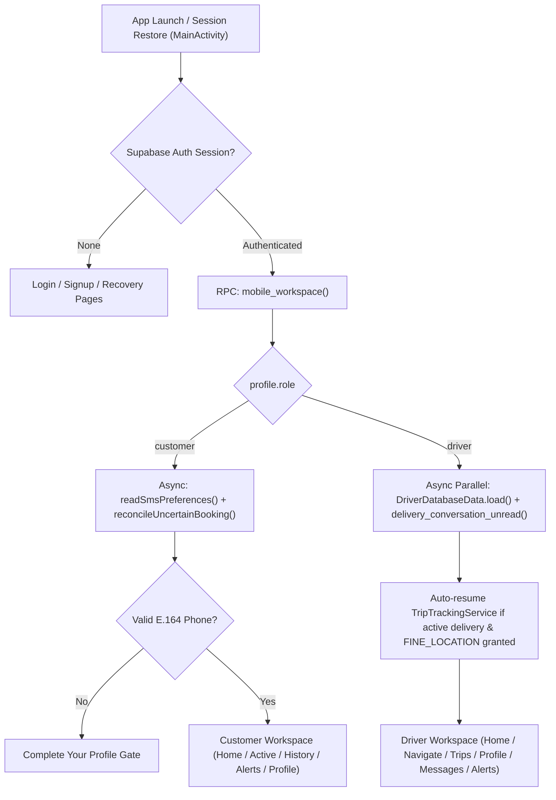
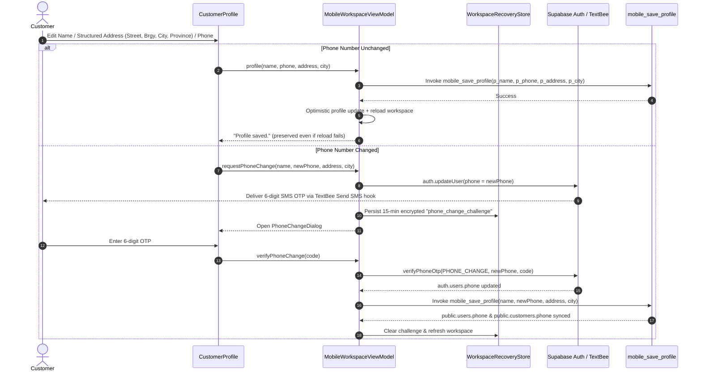
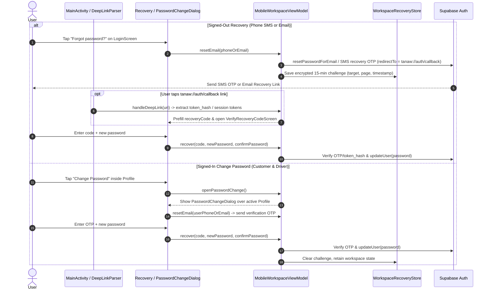

# Tanaw Android App — System Architecture & Progress Reference

## Overview
Tanaw is a native Android logistics, freight booking, and fleet delivery application for **Mabutol Trucking** (Luzon, Philippines), built with Kotlin, Jetpack Compose (Material 3), Dagger Hilt, MapLibre Native, and Supabase (`Auth`, `Postgrest`, `Realtime`, `Storage`, and Edge Functions) over an OkHttp client engine.

The active application runs through a **single state-driven workspace architecture** (`MainActivity` → `MobileWorkspaceApp` → `MobileWorkspaceViewModel`), serving both **Customer** and **Driver** roles from a shared Supabase backend (`mabutol-trucking-react`, Tanaw Dev `wrcrxsvppehuaqennrla.supabase.co`).

> **Note on Legacy Code:** An earlier per-screen `TanawNavHost` + `Repository` implementation (`feature/booking/*`, `feature/history/*`, `feature/tracking/*`, `feature/profile/*`, `feature/notifications/*`, `feature/driver/*Screen`, `data/repository/*Impl`, `data/service/DriverLocationService`) remains compiled in the codebase for reference, but is **never invoked** by `MainActivity.kt`. Only `feature/driver/components/AddTripExpenseSheet.kt` and the active `feature/auth/` UI/rules are reused by `MobileWorkspaceApp`.

---

## 1. System Architecture

The active app uses a **single-ViewModel, state-driven workspace** backed by pure-Kotlin domain rule objects (`*Rules.kt`, `*Policy.kt`), encrypted local recovery/draft stores, a durable SQLite GPS queue, and direct Supabase RPC/Postgrest/Realtime/Storage integration:

```
┌─────────────────────────────────────────────────────────────────────────────┐
│                             PRESENTATION LAYER                              │
│  MainActivity (singleTask + tanaw://auth/callback deep-link handler)        │
│    └─► MobileWorkspaceApp (state.page routing)                              │
│          ├── Auth & Recovery: LoginScreen, CreateAccountScreen,             │
│          │     RecoveryScreens, verify / verify_phone,                      │
│          │     PasswordChangeDialog, PhoneChangeDialog                      │
│          ├── Customer Workspace: CustomerBookingFlow (map picker, details,  │
│          │     summary, submitted), ShipmentList, ShipmentDetails,          │
│          │     CustomerCancellationDialog, CustomerProfile, Alerts          │
│          └── Driver Workspace: DriverWorkspace (Home, Navigate, Trips,      │
│                Profile, Messages, Alerts), DriverNavigateOverview,          │
│                DriverTripActions, DriverFlowDialogs (POD, Incident),        │
│                DriverFuelForm, AddTripExpenseSheet                          │
└──────────────────────────────────▲──────────────────────────────────────────┘
                                   │ StateFlow<MobileState> (JsonObject data)
┌──────────────────────────────────┴──────────────────────────────────────────┐
│                     VIEWMODEL, DOMAIN RULES & LOCAL PERSISTENCE             │
│  MobileWorkspaceViewModel                                                   │
│   ├── Pure-Kotlin Rules & Policies (core/ & feature/workspace/*/rules/):    │
│   │     DeepLinkParser, MobileErrorClassifier, WorkspaceAutoRefreshRules,   │
│   │     WorkspaceSyncRules, MobileValidation, ConfirmedMutation,            │
│   │     CustomerAddressRules, CustomerBookingRules, CustomerPaginationRules,│
│   │     CustomerCancellationRules, CustomerProfileRules, PhoneChangePolicy, │
│   │     PasswordChangePolicy, DriverDatabaseData, DriverGeofenceRules,      │
│   │     DriverDirections, TrackingFreshnessRules, TruckRestrictionRules,    │
│   │     NotificationReadRules                                               │
│   ├── Connectivity & Background Services:                                   │
│   │     WorkspaceNetworkMonitor (ConnectivityManager default callback)      │
│   │     TripTrackingService (ForegroundService, 15s LocationManager +       │
│   │       SQLite TrackingQueue)                                             │
│   └── Encrypted Local Stores (SharedPreferences / Android Keystore):        │
│         WorkspaceRecoveryStore (challenges & driver offline snapshot),      │
│         BookingDraftStore, ProofDraftStore, IncidentDraftStore,             │
│         ExpenseDraftStore                                                   │
└──────────────────────────────────┬──────────────────────────────────────────┘
                                   │ OkHttp + Ktor + Hilt DI
┌──────────────────────────────────▼──────────────────────────────────────────┐
│                        REMOTE / BACKEND LAYER (Supabase)                    │
│  ├── Auth: Phone/Email/Google ID token, SMS/Email OTP, Phone Change OTP     │
│  ├── Postgrest & RPCs: mobile_workspace, mobile_create_request,             │
│  │     mobile_save_profile, mobile_shipment_details, driver_milestone /     │
│  │     mobile_driver_action, driver_arrive_at_pickup, driver_submit_pod,    │
│  │     driver_report_incident_evidence, driver_record_position,             │
│  │     mobile_driver_history, mobile_driver_log_fuel, conversations, etc.   │
│  ├── Realtime: 13-table postgresChangeFlow channel ("mobile-<uid>")         │
│  │     with 350ms event batching & 30s fallback polling                     │
│  ├── Storage: Private "delivery-documents" bucket (POD, receipts, incidents)│
│  └── Edge Functions: mobile-email-login, delivery-routing, calculate-route, │
│        textbee-auth, textbee-worker, create-driver-user                     │
└─────────────────────────────────────────────────────────────────────────────┘
```

### Key Architectural Highlights
- **DI & Session Scoping (`di/`)**: `SupabaseModule` configures `SupabaseClient` with the `OkHttp` engine (for low-latency WebSocket Realtime), `Auth` (`ProjectSessionManager` scoping sessions to the active Supabase host), `Postgrest`, `Storage`, and `Realtime`.
- **Resilient Sync & Error Classification (`core/`)**: `MobileErrorClassifier` isolates network transport failures (`offline = true`) from auth errors (401/403) and server/contract errors (5xx / SQLSTATE). `WorkspaceNetworkMonitor` triggers automatic `backgroundRefresh()` when connectivity returns, and `WorkspaceSyncRules` batches 13-table Realtime events into targeted workspace or detail-only reloads.
- **Map & Geocoding Stack (`ui/components/ShipmentMap.kt`)**: Uses MapLibre Native (`13.7.1`) with OpenFreeMap Liberty tiles, MapTiler forward/reverse geocoding (`MAPTILER_KEY`, falling back to built-in Luzon suggestions and Android `Geocoder`), HGV route GeoJSON polylines, and distinct Pickup (red), Destination (blue), and Vehicle (green truck badge) pins.

---

## 2. Visual Architecture & Flow Diagrams

### Diagram A: Role-Based Workspace & Profile Data Resolution Flow



#### Customer Profile Edit & Verified Phone Change Flow (`C02`, `C03`, `C05`)


---

### Diagram B: Password Recovery, Deep-Link Callback & Signed-In Change Password (`D07`, `C07`)



---

### Diagram C: Driver Delivery Execution, 50m Geofence & Foreground GPS Queue (`D01`, `D05`)

```
[ Assigned Delivery ]
         │
         ▼
  Start Route (mobile_driver_action "start")
         ├─► Starts TripTrackingService (LocationManager 15s + SQLite TrackingQueue)
         ├─► Fetches delivery-routing HGV ETA & GeoJSON + TruckRestrictionRules advisories
         │
         ▼
  Arrive at Pickup (DriverGeofenceRules <= 50m fresh GPS -> driver_arrive_at_pickup RPC)
         │
         ▼
  Wait for Customer (1s tick grace timer gates No-Show Review vs Customer Showed)
         │
         ▼
  Cargo Loaded (mobile_driver_action "loaded")
         │
         ▼
  Deliver at Destination (DriverGeofenceRules <= 50m fresh GPS)
         ├─► DriverProofDialog: Camera Photo + Recipient Name + Digital Signature Pad
         ├─► Off-UI-thread JPEG/PNG encoding + ProofDraftStore encrypted persistence
         └─► Upload to private "delivery-documents" bucket -> driver_submit_pod RPC
```

---

## 3. Project Progress & Feature Roadmap

> Authoritative per-feature status and backend caveats are maintained in [`docs/FEATURES.md`](file:///C:/Users/Soriano/AndroidStudioProjects/Tanaw_Mobile/docs/FEATURES.md) and [`docs/BACKLOG.md`](file:///C:/Users/Soriano/AndroidStudioProjects/Tanaw_Mobile/docs/BACKLOG.md).

### Build & Environment Baseline
- **Toolchain**: AGP `9.4.0`, Kotlin `2.4.10`, Compose BOM `2026.08.00`, Material 3 `1.4.0`, Hilt `2.60.1`, Supabase BOM `3.8.0`, Ktor OkHttp `3.6.0`, MapLibre `13.7.1`, `compileSdk = 37`, `targetSdk = 37`, `minSdk = 24`.
- **Configuration**: `client-config.properties` supplies the public **Tanaw Dev** Supabase URL and publishable key (`verifyPhoneSignup` and `verifyDriverLogin` Gradle tasks validate backend Auth provider configuration). `local.properties` optionally provides `MAPTILER_KEY` and `GOOGLE_WEB_CLIENT_ID`.

### Completed & Implemented Features ✅
- **Authentication & Recovery**:
  - Phone/password and email/password login, plus customer contact-email alias fallback (`mobile-email-login`).
  - Customer signup with SMS OTP verification (`verify_phone`) routed through Supabase Auth + TextBee Send SMS hook (`TEXTBEE_SETUP.md`).
  - Role-based session routing (`customer` vs `driver`) with project-scoped session storage (`ProjectSessionManager`).
  - Signed-out recovery and signed-in Change Password for both drivers and customers (`C07`), with 15-minute encrypted challenge persistence (`WorkspaceRecoveryStore`).
  - Deep-link callback handling (`D07`) via `tanaw://auth/callback` (`DeepLinkParser` + `MainActivity.onNewIntent`).
- **Customer Booking, Profile & Tracking**:
  - Multi-step `CustomerBookingFlow`: MapLibre + OpenFreeMap/MapTiler location picker with target-ring cursor, reverse geocoding, Luzon bounds, pickup schedule bottom sheet (`Now` vs `Schedule`), vehicle capacity selection, road route preview (`calculate-route`), and idempotent `mobile_create_request` RPC submission.
  - Encrypted booking draft persistence and cold-restart reconciliation for uncertain submissions (`C04` / `BookingDraftStore`).
  - Structured Philippine addresses (`C03` / `CustomerAddressRules`: street, barangay, city, province) with backward-compatible RPC formatting and booking quick-chip.
  - Profile synchronization (`C02`) with optimistic confirmation and verified single-tier SMS OTP phone number changes (`C05` / `PhoneChangePolicy`).
  - SMS notification preferences (`shipment_status`, `delay`) stored in `public.notification_preferences`.
  - Paginated shipment history & search beyond 200 rows (`C01`), paginated alerts with auto-mark-as-read while Alerts is open, POD/evidence image viewer (`delivery-documents` bucket), and live tracking with distinct Emerald Green vehicle marker + 15s auto-refreshing GPS freshness badge separating Scheduled Arrival from Live ETA (`C06`).
  - Customer pre-transit self-service cancellation (`C10` / `CustomerCancellationRules` + `CustomerCancellationDialog`) for `pending`, `booked`, and unstarted `assigned` shipments.
- **Driver Operations, Telemetry & Compliance**:
  - Driver Home dashboard (`mobile_workspace` + parallel `DriverDatabaseData` reads) with roster identity, assigned truck, active assignments, and per-section error retries.
  - HGV route overview (`DriverNavigateOverview`), office-confirmed route status & 120s-freshness-gated live ETA (`DriverRouteStatus`), intermediate HGV waypoints for external Google Maps (`DriverDirections`), and truck physical/UVVRP/peak-ban advisories (`D05` / `TruckRestrictionRules`).
  - Delivery milestones with client-side 50m fresh-GPS pickup & destination geofence (`DriverGeofenceRules`), grace timer for no-show review vs customer-showed, and cargo-loaded progression.
  - Foreground GPS `TripTrackingService` with 15s `LocationManager` updates, multi-provider fast fix, durable SQLite `TrackingQueue`, and auto-resume across restarts (`D01`).
  - POD capture (camera photo, recipient name, digital signature pad), incident reporting (up to 3 private photos), trip expense submission (`AddTripExpenseSheet`), and per-trip fuel logging (`DriverFuelForm`), with off-UI-thread bitmap processing (`D04`) and encrypted local drafts (`D02` / `ProofDraftStore`, `IncidentDraftStore`, `ExpenseDraftStore`).
  - Driver-dispatcher in-app conversations (`Messages` tab & per-trip thread with unread counts) and paginated "My Trips" history (`mobile_driver_history`) with recorded event timelines.
  - Driver Profile & compliance status badges driven by `system_settings` warning thresholds (`compliance_thresholds`).
- **Workspace Reliability & UX (`D03`, `C12`)**:
  - Error classification separating transport offline states from auth and backend/contract errors (`MobileErrorClassifier`), plus automatic reconnection refresh (`WorkspaceNetworkMonitor`).
  - Encrypted driver offline workspace cache (`WorkspaceRecoveryStore`).
  - Cross-cutting small-screen layouts, keyboard `ImeAction`/types, 48dp touch targets, and inline field validation (`C12`).

### Partial / External Configuration & Backend Caveats ⚠️
- **External Backend Verification (`⚠ backend unverified`)**: Canonical migrations, RLS policies, and several RPCs/Edge Functions live in the separate `mabutol-trucking-react` repository (`supabase/README.md`). Client calls to `driver_arrive_at_pickup`, `driver_submit_pod`, `driver_report_incident_evidence`, `driver_record_position`, `mobile_driver_history`, `mobile_driver_log_fuel`, `mobile_driver_fuel_history`, `mobile_driver_evidence`, `mobile_delivery_evidence_file`, `delivery_conversation*`, `send_delivery_message`, `read_delivery_messages`, `delivery_expenses`, `mobile-email-login`, `delivery-routing`, and `calculate-route` cannot be verified from this repo alone.
- **Google Sign-In**: Credential Manager flow is implemented (`GoogleSignIn.kt`), but `GOOGLE_WEB_CLIENT_ID` is optional/unconfigured by default and requires external Google Cloud + Supabase OAuth setup (`GOOGLE_AUTH_SETUP.md`).
- **Email OTP Signup Branch**: Active signup routes exclusively to `verify_phone` (TextBee SMS); the `verify` email-signup branch in `MobileWorkspaceApp` is currently unreachable.
- **Dynamic Pricing (`public.pricing_rates`)**: Active bookings submit as `"Awaiting office quotation"` and display office `quoted_amount` / `final_amount`; client-side rate computation exists only in dormant legacy code.
- **Unpublished Legal/Support Content (`D08`) & Offline Scope**: Driver Terms/Privacy/Support links display explicit unpublished notices until configured in `public.system_settings`. Encrypted cold-start offline workspace snapshots currently cover `driver` accounts only.
- **Customer Cancellation Backend Policy (`C10`)**: Client executes pre-transit cancellation directly on `public.shipments`; production deployment of the proposed customer `UPDATE` RLS policy or atomic `mobile_cancel_shipment` RPC is tracked in `docs/BACKEND-REQUESTS.md` §3.

### Pending / Future Roadmap 🔄
1. **Backend Enhancements (`docs/BACKEND-REQUESTS.md`)**:
   - `C03`: Add native `barangay` column to `public.customers` and extend `mobile_workspace()` / `mobile_save_profile()`.
   - `D05`: Add HGV physical dimensions (`height_m`, `width_m`, `length_m`, `tare_weight_kg`, `gross_weight_kg`, `axle_count`) to `public.trucks` / `public.vehicle_types` and `mobile_workspace()`.
   - `C10`: Deploy customer pre-transit cancellation RLS policy / `mobile_cancel_shipment` RPC.
2. **Physical Device Acceptance Testing (`docs/BACKLOG.md`)**:
   - `D06`: End-to-end website-to-driver messaging and unread/read Realtime sync.
   - `C08`: Live TextBee shipment/delay SMS delivery, opt-out, and duplicate prevention.
3. **Optional Wave 3 Additions** (require backend design first):
   - `C09`: Customer-to-office support conversations.
   - `C11`: Customer accept/reject versioned quotations.
4. **Codebase Hygiene**: Eventual removal of dormant `TanawNavHost` legacy screens and consolidation of `app/build.gradle.kts` hardcoded dependency versions into `gradle/libs.versions.toml` (explicit separate tasks).

---

## 4. Database Schema Reference

The canonical PostgreSQL dump (`supabase/migrations/live_schema_dump.sql`) defines **28 base tables** organized into 8 functional domain modules (with additional runtime tables/extensions such as `delivery_expenses`, `shipment_events`, `delivery_messages`, and `incident_attachments` managed in `mabutol-trucking-react`):

1. [User & Identity Management](#1-user--identity-management) (`users`, `customers`, `drivers`, `helpers`)
2. [Fleet & Cargo Management](#2-fleet--cargo-management) (`vehicle_types`, `cargo_categories`, `trucks`, `truck_cargo_categories`, `location_vehicle_types`)
3. [Locations, Tolls & Pricing Rates](#3-locations-tolls--pricing-rates) (`locations`, `pricing_rates`, `toll_gate_rates`)
4. [Shipment & Delivery Operations](#4-shipment--delivery-operations) (`shipments`, `deliveries`, `delivery_helpers`, `shipment_status_history`, `delivery_incidents`)
5. [Tracking & Documents](#5-tracking--documents) (`tracking_logs`, `delivery_documents`)
6. [Financials & Fuel](#6-financials--fuel) (`payments`, `fuel_logs`)
7. [Fleet Maintenance & Compliance](#7-fleet-maintenance--compliance) (`compliance_documents`, `maintenance_records`)
8. [System & Communications](#8-system--communications) (`notifications`, `notification_preferences`, `messages`, `activity_logs`, `system_settings`)

---

### 1. User & Identity Management

#### `public.users`
| Column | Type | Constraints / Default | Description |
| :--- | :--- | :--- | :--- |
| `id` | `uuid` | PK, FK → `auth.users(id)` | Linked to Supabase Auth User ID |
| `email` | `text` | NOT NULL, UNIQUE | User email address |
| `full_name` | `text` | NOT NULL, DEFAULT `''` | User full name |
| `phone` | `text` | NULLABLE | Primary phone contact |
| `role` | `user_role` | NOT NULL, DEFAULT `'customer'` | User role (`customer`, `driver`, `admin`, `staff`) |
| `is_active` | `boolean` | NOT NULL, DEFAULT `true` | Account active flag |
| `avatar_url` | `text` | NULLABLE | URL to user profile image |
| `created_at` | `timestamptz` | NOT NULL, DEFAULT `now()` | Timestamp created |
| `updated_at` | `timestamptz` | NOT NULL, DEFAULT `now()` | Timestamp updated |

#### `public.customers`
| Column | Type | Constraints / Default | Description |
| :--- | :--- | :--- | :--- |
| `id` | `uuid` | PK, DEFAULT `gen_random_uuid()` | Customer record ID |
| `customer_code` | `text` | NOT NULL, UNIQUE, DEFAULT `'CUST-'...` | Auto-generated code (`CUST-0001`) |
| `user_id` | `uuid` | UNIQUE, FK → `public.users(id)` | Foreign key to user account (if registered) |
| `name` | `text` | NOT NULL | Customer/Business name |
| `contact_person` | `text` | NULLABLE | Contact person name |
| `email` | `text` | NULLABLE | Customer email address |
| `phone` | `text` | NULLABLE | Customer phone number |
| `address` | `text` | NULLABLE | Street address (active client formats `"<street>, Brgy. <barangay>"`) |
| `city` | `text` | NULLABLE | City / Municipality (active client formats `"<city>, <province>"`) |
| `province` | `text` | DEFAULT `'Nueva Ecija'` | Province |
| `notes` | `text` | NULLABLE | Administrative notes |
| `is_active` | `boolean` | NOT NULL, DEFAULT `true` | Customer active flag |
| `created_at` | `timestamptz` | NOT NULL, DEFAULT `now()` | Timestamp created |
| `updated_at` | `timestamptz` | NOT NULL, DEFAULT `now()` | Timestamp updated |

#### `public.drivers`
| Column | Type | Constraints / Default | Description |
| :--- | :--- | :--- | :--- |
| `id` | `uuid` | PK, DEFAULT `gen_random_uuid()` | Driver record ID |
| `user_id` | `uuid` | UNIQUE, FK → `public.users(id)` | Foreign key to user account |
| `full_name` | `text` | NOT NULL | Driver full name |
| `contact_number` | `text` | NULLABLE | Driver primary phone |
| `emergency_contact_name` | `text` | NULLABLE | Emergency contact person |
| `emergency_contact_number` | `text` | NULLABLE | Emergency contact phone |
| `license_number` | `text` | NOT NULL, UNIQUE | Driver's license number |
| `date_hired` | `date` | NULLABLE | Hire date |
| `status` | `driver_status` | NOT NULL, DEFAULT `'available'` | Current status (`available`, `on_trip`, etc.) |
| `notes` | `text` | NULLABLE | Driver notes |
| `created_at` | `timestamptz` | NOT NULL, DEFAULT `now()` | Timestamp created |
| `updated_at` | `timestamptz` | NOT NULL, DEFAULT `now()` | Timestamp updated |

#### `public.helpers`
| Column | Type | Constraints / Default | Description |
| :--- | :--- | :--- | :--- |
| `id` | `uuid` | PK, DEFAULT `gen_random_uuid()` | Helper record ID |
| `full_name` | `text` | NOT NULL | Helper full name |
| `contact_number` | `text` | NULLABLE | Helper contact number |
| `is_active` | `boolean` | NOT NULL, DEFAULT `true` | Helper active flag |
| `created_at` | `timestamptz` | NOT NULL, DEFAULT `now()` | Timestamp created |
| `updated_at` | `timestamptz` | NOT NULL, DEFAULT `now()` | Timestamp updated |

---

### 2. Fleet & Cargo Management

#### `public.vehicle_types`
| Column | Type | Constraints / Default | Description |
| :--- | :--- | :--- | :--- |
| `id` | `uuid` | PK, DEFAULT `gen_random_uuid()` | Vehicle type ID |
| `name` | `text` | NOT NULL, UNIQUE | Vehicle category name (e.g. 10-Wheeler, Closed Van) |
| `default_capacity_kg` | `numeric` | CHECK `(> 0)` | Default payload capacity in kg |
| `is_active` | `boolean` | NOT NULL, DEFAULT `true` | Active status flag |

#### `public.cargo_categories`
| Column | Type | Constraints / Default | Description |
| :--- | :--- | :--- | :--- |
| `id` | `uuid` | PK, DEFAULT `gen_random_uuid()` | Cargo category ID |
| `name` | `text` | NOT NULL, UNIQUE | Category name (e.g., Agricultural, Refrigerated) |
| `requires_special_handling` | `boolean` | NOT NULL, DEFAULT `false` | Special handling required flag |
| `is_active` | `boolean` | NOT NULL, DEFAULT `true` | Active status flag |

#### `public.trucks`
| Column | Type | Constraints / Default | Description |
| :--- | :--- | :--- | :--- |
| `id` | `uuid` | PK, DEFAULT `gen_random_uuid()` | Fleet truck ID |
| `fleet_code` | `text` | UNIQUE | Internal fleet identification code |
| `plate_number` | `text` | NOT NULL, UNIQUE | Vehicle license plate number |
| `model` | `text` | NULLABLE | Truck make/model |
| `model_year` | `smallint` | CHECK `(1980..2100)` | Vehicle manufacture year |
| `vehicle_type_id` | `uuid` | FK → `public.vehicle_types(id)` | Vehicle type classification |
| `capacity_kg` | `numeric` | CHECK `(> 0)` | Maximum weight capacity in kg |
| `status` | `truck_status` | NOT NULL, DEFAULT `'available'` | Truck status (`available`, `in_transit`, etc.) |
| `assigned_driver_id` | `uuid` | FK → `public.drivers(id)` | Currently assigned primary driver |
| `odometer_km` | `numeric` | NOT NULL, DEFAULT `0` | Current odometer reading in km |
| `notes` | `text` | NULLABLE | Vehicle notes |
| `created_at` | `timestamptz` | NOT NULL, DEFAULT `now()` | Timestamp created |
| `updated_at` | `timestamptz` | NOT NULL, DEFAULT `now()` | Timestamp updated |

#### `public.truck_cargo_categories`
| Column | Type | Constraints / Default | Description |
| :--- | :--- | :--- | :--- |
| `truck_id` | `uuid` | PK, FK → `public.trucks(id)` | Foreign key to truck |
| `cargo_category_id` | `uuid` | PK, FK → `public.cargo_categories(id)` | Allowed cargo category |

#### `public.location_vehicle_types`
| Column | Type | Constraints / Default | Description |
| :--- | :--- | :--- | :--- |
| `location_id` | `uuid` | PK, FK → `public.locations(id)` | Location ID |
| `vehicle_type_id` | `uuid` | PK, FK → `public.vehicle_types(id)` | Allowed vehicle type at location |

---

### 3. Locations, Tolls & Pricing Rates

#### `public.locations`
| Column | Type | Constraints / Default | Description |
| :--- | :--- | :--- | :--- |
| `id` | `uuid` | PK, DEFAULT `gen_random_uuid()` | Location ID |
| `name` | `text` | NOT NULL | Hub, warehouse, or location name |
| `sublabel` | `text` | NULLABLE | Secondary descriptor or sub-location |
| `address` | `text` | NULLABLE | Detailed street address |
| `city` | `text` | NULLABLE | City / Municipality |
| `province` | `text` | DEFAULT `'Nueva Ecija'` | Province |
| `latitude` | `numeric` | CHECK `(-90..90)` | WGS84 Latitude coordinate |
| `longitude` | `numeric` | CHECK `(-180..180)` | WGS84 Longitude coordinate |
| `kind` | `location_kind` | NOT NULL, DEFAULT `'other'` | Location classification |
| `is_active` | `boolean` | NOT NULL, DEFAULT `true` | Location active flag |
| `created_at` | `timestamptz` | NOT NULL, DEFAULT `now()` | Timestamp created |
| `geog` | `geography` | PostGIS Spatial Point (SRID 4326) | Generated geography point from lat/lng |

#### `public.pricing_rates`
| Column | Type | Constraints / Default | Description |
| :--- | :--- | :--- | :--- |
| `id` | `uuid` | PK, DEFAULT `gen_random_uuid()` | Rate matrix ID |
| `name` | `text` | NOT NULL | Rate name / identifier |
| `vehicle_type_id` | `uuid` | FK → `public.vehicle_types(id)` | Applicable vehicle type |
| `base_rate` | `numeric` | NOT NULL, DEFAULT `0`, CHECK `(>= 0)` | Base booking charge |
| `per_km_rate` | `numeric` | NOT NULL, DEFAULT `0`, CHECK `(>= 0)` | Rate per kilometer |
| `per_kg_rate` | `numeric` | NOT NULL, DEFAULT `0`, CHECK `(>= 0)` | Rate per kilogram |
| `min_charge` | `numeric` | NOT NULL, DEFAULT `0`, CHECK `(>= 0)` | Minimum total charge threshold |
| `is_active` | `boolean` | NOT NULL, DEFAULT `true` | Rate active status |
| `effective_from` | `date` | NOT NULL, DEFAULT `CURRENT_DATE` | Start date of rate validity |
| `effective_to` | `date` | NULLABLE | End date of rate validity |
| `created_by` | `uuid` | FK → `public.users(id)` | User who created the rate |
| `created_at` | `timestamptz` | NOT NULL, DEFAULT `now()` | Timestamp created |
| `updated_at` | `timestamptz` | NOT NULL, DEFAULT `now()` | Timestamp updated |

#### `public.toll_gate_rates`
| Column | Type | Constraints / Default | Description |
| :--- | :--- | :--- | :--- |
| `id` | `uuid` | PK, DEFAULT `gen_random_uuid()` | Toll gate rate ID |
| `gate_name` | `text` | NOT NULL | Toll gate / plaza name |
| `highway` | `text` | NOT NULL | Expressway / highway corridor |
| `vehicle_class` | `text` | NOT NULL, DEFAULT `'Class 2'` | Vehicle toll class |
| `fee` | `numeric(12,2)` | NOT NULL, CHECK `(>= 0)` | Toll fee amount |
| `created_at` | `timestamptz` | NOT NULL, DEFAULT `now()` | Timestamp created |
| `updated_at` | `timestamptz` | NOT NULL, DEFAULT `now()` | Timestamp updated |

---

### 4. Shipment & Delivery Operations

#### `public.shipments`
| Column | Type | Constraints / Default | Description |
| :--- | :--- | :--- | :--- |
| `id` | `uuid` | PK, DEFAULT `gen_random_uuid()` | Shipment record ID |
| `tracking_number` | `text` | NOT NULL, UNIQUE, DEFAULT `'SHP-NE-YY-...'` | Unique shipment tracking number |
| `customer_id` | `uuid` | NOT NULL, FK → `public.customers(id)` | Booking customer ID |
| `billing_customer_id` | `uuid` | FK → `public.customers(id)` | Customer billed for shipment |
| `status` | `shipment_status` | NOT NULL, DEFAULT `'booked'` | Status (`pending`, `booked`, `assigned`, `in_transit`, `delivered`, `cancelled`, etc.) |
| `booking_source` | `text` | NOT NULL, DEFAULT `'web'`, CHECK `web/mobile/phone` | Channel where booking originated |
| `cargo_category_id` | `uuid` | FK → `public.cargo_categories(id)` | Cargo category |
| `cargo_description` | `text` | NULLABLE | Description of cargo |
| `weight_kg` | `numeric` | CHECK `(> 0)` | Cargo weight in kilograms |
| `special_handling` | `text` | NULLABLE | Special handling instructions |
| `requested_vehicle_type_id` | `uuid` | FK → `public.vehicle_types(id)` | Requested vehicle type |
| `pickup_location_id` | `uuid` | FK → `public.locations(id)` | Origin location reference |
| `pickup_address` | `text` | NOT NULL | Pickup address |
| `pickup_lat` / `pickup_lng` | `numeric` | NULLABLE | Pickup coordinates |
| `dropoff_location_id` | `uuid` | FK → `public.locations(id)` | Destination location reference |
| `dropoff_address` | `text` | NOT NULL | Dropoff address |
| `dropoff_lat` / `dropoff_lng` | `numeric` | NULLABLE | Dropoff coordinates |
| `distance_km` | `numeric` | CHECK `(>= 0)` | Distance in kilometers |
| `scheduled_departure` | `timestamptz` | NULLABLE | Planned departure time |
| `estimated_arrival` | `timestamptz` | NULLABLE | Estimated arrival time |
| `actual_delivery_at` | `timestamptz` | NULLABLE | Timestamp delivery completed |
| `pricing_rate_id` | `uuid` | FK → `public.pricing_rates(id)` | Pricing matrix used |
| `quoted_amount` | `numeric` | CHECK `(>= 0)` | Automatically calculated quote |
| `override_amount` | `numeric` | CHECK `(>= 0)` | Manual override quote amount |
| `override_reason` | `text` | NULLABLE | Reason for price override |
| `final_amount` | `numeric` | DEFAULT `COALESCE(override, quoted)` | Final billed shipment cost |
| `driver_notes` | `text` | NULLABLE | Notes from delivery driver |
| `cancelled_reason` / `cancelled_at` | `text` / `timestamptz` | NULLABLE | Cancellation record details |
| `created_by` / `confirmed_by` | `uuid` | FK → `public.users(id)` | Associated staff user IDs |
| `created_at` / `updated_at` | `timestamptz` | NOT NULL, DEFAULT `now()` | Record lifecycle timestamps |

#### `public.deliveries`
| Column | Type | Constraints / Default | Description |
| :--- | :--- | :--- | :--- |
| `id` | `uuid` | PK, DEFAULT `gen_random_uuid()` | Delivery assignment ID |
| `shipment_id` | `uuid` | NOT NULL, FK → `public.shipments(id)` | Related shipment ID |
| `truck_id` | `uuid` | NOT NULL, FK → `public.trucks(id)` | Assigned vehicle ID |
| `driver_id` | `uuid` | NOT NULL, FK → `public.drivers(id)` | Assigned driver ID |
| `status` | `delivery_status` | NOT NULL, DEFAULT `'assigned'` | Status (`assigned`, `loading`, `in_transit`, `delivered`, `cancelled`, etc.) |
| `assigned_by` | `uuid` | FK → `public.users(id)` | Dispatcher user ID |
| `assigned_at` | `timestamptz` | NOT NULL, DEFAULT `now()` | Assignment timestamp |
| `departed_at` / `arrived_at` | `timestamptz` | NULLABLE | Actual trip execution timestamps |
| `odometer_start` / `odometer_end` | `numeric` | NULLABLE | Trip start/end odometer values |
| `recipient_name` | `text` | NULLABLE | Name of person receiving delivery |
| `notes` | `text` | NULLABLE | Dispatcher or driver notes |
| `created_at` / `updated_at` | `timestamptz` | NOT NULL, DEFAULT `now()` | Record lifecycle timestamps |

#### `public.delivery_helpers`
| Column | Type | Constraints / Default | Description |
| :--- | :--- | :--- | :--- |
| `delivery_id` | `uuid` | PK, FK → `public.deliveries(id)` | Delivery ID |
| `helper_id` | `uuid` | PK, FK → `public.helpers(id)` | Helper ID assigned to trip |

#### `public.shipment_status_history`
| Column | Type | Constraints / Default | Description |
| :--- | :--- | :--- | :--- |
| `id` | `bigint` | PK, GENERATED ALWAYS AS IDENTITY | Audit log entry ID |
| `shipment_id` | `uuid` | NOT NULL, FK → `public.shipments(id)` | Shipment ID |
| `from_status` / `to_status` | `USER-DEFINED` | `to_status` NOT NULL | Status transition record |
| `changed_by` | `uuid` | FK → `public.users(id)` | User who changed status |
| `note` | `text` | NULLABLE | Status change note |
| `created_at` | `timestamptz` | NOT NULL, DEFAULT `now()` | Timestamp logged |

#### `public.delivery_incidents`
| Column | Type | Constraints / Default | Description |
| :--- | :--- | :--- | :--- |
| `id` | `uuid` | PK, DEFAULT `gen_random_uuid()` | Incident record ID |
| `delivery_id` | `uuid` | NOT NULL, FK → `public.deliveries(id)` | Associated delivery trip |
| `shipment_id` | `uuid` | NOT NULL, FK → `public.shipments(id)` | Associated shipment |
| `category` | `USER-DEFINED` | NOT NULL | Incident type (breakdown, traffic, accident) |
| `description` | `text` | NULLABLE | Detailed incident description |
| `delay_minutes` | `integer` | CHECK `(>= 0)` | Caused delay duration in minutes |
| `latitude` / `longitude` | `numeric` | NULLABLE | GPS location of incident |
| `reported_by` | `uuid` | FK → `public.users(id)` | User reporting incident |
| `resolved_at` | `timestamptz` | NULLABLE | Timestamp incident was resolved |
| `created_at` | `timestamptz` | NOT NULL, DEFAULT `now()` | Timestamp created |

---

### 5. Tracking & Documents

#### `public.tracking_logs`
| Column | Type | Constraints / Default | Description |
| :--- | :--- | :--- | :--- |
| `id` | `bigint` | PK, GENERATED ALWAYS AS IDENTITY | Telemetry log sequence ID |
| `delivery_id` | `uuid` | NOT NULL, FK → `public.deliveries(id)` | Active delivery ID |
| `truck_id` | `uuid` | FK → `public.trucks(id)` | Assigned vehicle ID |
| `driver_id` | `uuid` | FK → `public.drivers(id)` | Active driver ID |
| `latitude` | `numeric` | NOT NULL, CHECK `(-90..90)` | Current GPS latitude |
| `longitude` | `numeric` | NOT NULL, CHECK `(-180..180)` | Current GPS longitude |
| `speed_kph` | `numeric` | CHECK `(>= 0)` | Vehicle speed in km/h |
| `heading_deg` | `numeric` | CHECK `(0..360)` | Vehicle heading in degrees |
| `accuracy_m` | `numeric` | NULLABLE | Location accuracy radius in meters |
| `signal` | `text` | NOT NULL, DEFAULT `'good'`, CHECK `good/weak/none` | Mobile cellular signal strength |
| `is_buffered` | `boolean` | NOT NULL, DEFAULT `false` | Offline buffer sync flag |
| `recorded_at` | `timestamptz` | NOT NULL | Sensor recording timestamp |
| `created_at` | `timestamptz` | NOT NULL, DEFAULT `now()` | Database insertion timestamp |

#### `public.delivery_documents`
| Column | Type | Constraints / Default | Description |
| :--- | :--- | :--- | :--- |
| `id` | `uuid` | PK, DEFAULT `gen_random_uuid()` | Document ID |
| `shipment_id` | `uuid` | NOT NULL, FK → `public.shipments(id)` | Shipment ID |
| `delivery_id` | `uuid` | FK → `public.deliveries(id)` | Delivery trip ID |
| `kind` | `document_kind` | NOT NULL, DEFAULT `'proof_of_delivery'` | Document type classification |
| `storage_path` | `text` | NOT NULL | Supabase Storage bucket (`delivery-documents`) path |
| `file_name` | `text` | NULLABLE | Original filename |
| `mime_type` | `text` | NULLABLE | Document MIME type (e.g. image/jpeg, image/png) |
| `recipient_name` | `text` | NULLABLE | Recipient signature name |
| `notes` | `text` | NULLABLE | Document remarks |
| `uploaded_by` | `uuid` | FK → `public.users(id)` | Uploader user ID |
| `created_at` | `timestamptz` | NOT NULL, DEFAULT `now()` | Timestamp uploaded |

---

### 6. Financials & Fuel

#### `public.payments`
| Column | Type | Constraints / Default | Description |
| :--- | :--- | :--- | :--- |
| `id` | `uuid` | PK, DEFAULT `gen_random_uuid()` | Payment transaction ID |
| `shipment_id` | `uuid` | NOT NULL, FK → `public.shipments(id)` | Shipment ID |
| `amount` | `numeric` | NOT NULL, CHECK `(> 0)` | Payment amount |
| `method` | `payment_method` | NOT NULL, DEFAULT `'cash'` | Payment method (`cash`, `bank_transfer`, `ewallet`) |
| `reference_number` | `text` | NULLABLE | External transaction reference number |
| `proof_path` | `text` | NULLABLE | Payment receipt storage image path |
| `status` | `payment_status` | NOT NULL, DEFAULT `'pending'` | Payment status (`pending`, `verified`, `rejected`) |
| `paid_at` | `timestamptz` | NULLABLE | Timestamp payment was made |
| `verified_by` / `verified_at` | `uuid` / `timestamptz` | NULLABLE | Verifying finance officer & time |
| `created_by` | `uuid` | FK → `public.users(id)` | User who submitted payment |
| `created_at` / `updated_at` | `timestamptz` | NOT NULL, DEFAULT `now()` | Lifecycle timestamps |

#### `public.fuel_logs`
| Column | Type | Constraints / Default | Description |
| :--- | :--- | :--- | :--- |
| `id` | `uuid` | PK, DEFAULT `gen_random_uuid()` | Fuel record ID |
| `delivery_id` | `uuid` | FK → `public.deliveries(id)` | Optional delivery trip context |
| `truck_id` | `uuid` | NOT NULL, FK → `public.trucks(id)` | Refueled truck |
| `driver_id` | `uuid` | FK → `public.drivers(id)` | Driver who logged fueling |
| `liters` | `numeric` | NOT NULL, CHECK `(> 0)` | Quantity of fuel in liters |
| `price_per_liter` | `numeric` | CHECK `(>= 0)` | Fuel unit cost |
| `total_cost` | `numeric` | CHECK `(>= 0)` | Total refueling cost |
| `odometer_km` | `numeric` | NULLABLE | Vehicle odometer reading at fueling |
| `station` | `text` | NULLABLE | Fuel station name / vendor |
| `receipt_path` | `text` | NULLABLE | Fuel receipt image path |
| `logged_at` | `timestamptz` | NOT NULL, DEFAULT `now()` | Time of fueling |
| `created_at` | `timestamptz` | NOT NULL, DEFAULT `now()` | Record creation time |

---

### 7. Fleet Maintenance & Compliance

#### `public.compliance_documents`
| Column | Type | Constraints / Default | Description |
| :--- | :--- | :--- | :--- |
| `id` | `uuid` | PK, DEFAULT `gen_random_uuid()` | Compliance document ID |
| `driver_id` | `uuid` | FK → `public.drivers(id)` | Driver (for licenses, medical certs) |
| `truck_id` | `uuid` | FK → `public.trucks(id)` | Vehicle (for registration, insurance, OR/CR) |
| `doc_type` | `USER-DEFINED` | NOT NULL | Document category |
| `document_number` | `text` | NULLABLE | Document ID or reference number |
| `issued_date` / `expiry_date` | `date` | NULLABLE | Document validity period |
| `file_path` | `text` | NULLABLE | Document storage file path |
| `review_status` | `review_status` | NOT NULL, DEFAULT `'pending_review'` | Audit review status (`pending_review`, `approved`, `rejected`) |
| `reviewed_by` / `reviewed_at` | `uuid` / `timestamptz` | NULLABLE | Compliance auditor user & timestamp |
| `remarks` | `text` | NULLABLE | Auditor remarks |
| `uploaded_by` | `uuid` | FK → `public.users(id)` | Uploader user ID |
| `created_at` / `updated_at` | `timestamptz` | NOT NULL, DEFAULT `now()` | Lifecycle timestamps |

#### `public.maintenance_records`
| Column | Type | Constraints / Default | Description |
| :--- | :--- | :--- | :--- |
| `id` | `uuid` | PK, DEFAULT `gen_random_uuid()` | Maintenance log ID |
| `truck_id` | `uuid` | NOT NULL, FK → `public.trucks(id)` | Maintained truck ID |
| `kind` | `maintenance_kind` | NOT NULL, DEFAULT `'preventive'` | Maintenance type (`preventive`, `corrective`, `emergency`) |
| `status` | `maintenance_status` | NOT NULL, DEFAULT `'scheduled'` | Work status (`scheduled`, `in_progress`, `completed`, `cancelled`) |
| `description` | `text` | NULLABLE | Work order description |
| `scheduled_date` | `date` | NOT NULL | Scheduled date |
| `completed_date` | `date` | NULLABLE | Completion date |
| `odometer_km` | `numeric` | NULLABLE | Vehicle mileage at service |
| `cost` | `numeric` | CHECK `(>= 0)` | Service cost |
| `vendor` | `text` | NULLABLE | Repair shop / service vendor |
| `next_due_date` / `next_due_km` | `date` / `numeric` | NULLABLE | Next maintenance interval targets |
| `created_by` | `uuid` | FK → `public.users(id)` | User who recorded maintenance |
| `created_at` / `updated_at` | `timestamptz` | NOT NULL, DEFAULT `now()` | Lifecycle timestamps |

---

### 8. System & Communications

#### `public.notifications`
| Column | Type | Constraints / Default | Description |
| :--- | :--- | :--- | :--- |
| `id` | `uuid` | PK, DEFAULT `gen_random_uuid()` | Notification ID |
| `user_id` | `uuid` | NOT NULL, FK → `public.users(id)` | Recipient user ID |
| `type` | `USER-DEFINED` | NOT NULL | Notification type |
| `title` | `text` | NOT NULL | Alert title |
| `body` | `text` | NULLABLE | Alert message body |
| `shipment_id` | `uuid` | FK → `public.shipments(id)` | Associated shipment context |
| `read_at` | `timestamptz` | NULLABLE | Timestamp user read notification |
| `created_at` | `timestamptz` | NOT NULL, DEFAULT `now()` | Creation timestamp |

#### `public.notification_preferences`
| Column | Type | Constraints / Default | Description |
| :--- | :--- | :--- | :--- |
| `user_id` | `uuid` | PK, FK → `public.users(id)` | User ID |
| `type` | `USER-DEFINED` | PK | Notification event type |
| `channel` | `text` | PK, DEFAULT `'in_app'`, CHECK `in_app/email/sms` | Delivery channel |
| `enabled` | `boolean` | NOT NULL, DEFAULT `true` | Preference toggle state |

#### `public.messages`
| Column | Type | Constraints / Default | Description |
| :--- | :--- | :--- | :--- |
| `id` | `uuid` | PK, DEFAULT `gen_random_uuid()` | Message ID |
| `shipment_id` | `uuid` | FK → `public.shipments(id)` | Associated shipment thread |
| `sender_id` | `uuid` | NOT NULL, FK → `public.users(id)` | Sender user ID |
| `recipient_id` | `uuid` | NOT NULL, FK → `public.users(id)` | Recipient user ID |
| `body` | `text` | NOT NULL, CHECK `(length > 0)` | Message text content |
| `read_at` | `timestamptz` | NULLABLE | Timestamp message read |
| `created_at` | `timestamptz` | NOT NULL, DEFAULT `now()` | Message sent timestamp |

#### `public.activity_logs`
| Column | Type | Constraints / Default | Description |
| :--- | :--- | :--- | :--- |
| `id` | `bigint` | PK, GENERATED ALWAYS AS IDENTITY | Audit record ID |
| `user_id` | `uuid` | NULLABLE | Actor user ID |
| `action` | `text` | NOT NULL | System action performed |
| `entity_type` | `text` | NULLABLE | Entity affected (e.g., `shipment`, `truck`) |
| `entity_id` | `text` | NULLABLE | Entity ID affected |
| `details` | `jsonb` | NULLABLE | Structured JSON payload details |
| `created_at` | `timestamptz` | NOT NULL, DEFAULT `now()` | Action timestamp |

#### `public.system_settings`
| Column | Type | Constraints / Default | Description |
| :--- | :--- | :--- | :--- |
| `key` | `text` | PK | Configuration setting key (e.g., `compliance_thresholds`, `driver_app_content`) |
| `value` | `jsonb` | NOT NULL | Setting JSON payload |
| `description` | `text` | NULLABLE | Setting description |
| `updated_by` | `uuid` | FK → `public.users(id)` | Staff user who last updated setting |
| `updated_at` | `timestamptz` | NOT NULL, DEFAULT `now()` | Last modification timestamp |

### Active Mobile Contract Additions (Canonical Repo `mabutol-trucking-react`)
Beyond the historical 28-table dump above, the active Android workspace interacts with shared tables, RPCs, Storage, and Edge Functions managed in `mabutol-trucking-react`:
- **Additional Tables / Realtime Subscriptions**: `delivery_expenses`, `shipment_events`, `delivery_messages`, `incident_attachments`, plus `route_geometry` / `route_duration_minutes` / `client_request_id` on `shipments` and `route_started_at` / `pickup_arrived_at` / `customer_showed_at` on `deliveries`.
- **RPCs Defined in This Repo (`supabase/migrations/`)**: `mobile_workspace`, `mobile_create_request`, `mobile_save_profile`, `mobile_shipment_details`, and early `mobile_driver_action` wrapper.
- **RPCs Defined Externally (`mabutol-trucking-react`)**: `driver_arrive_at_pickup`, `driver_submit_pod`, `driver_report_incident_evidence`, `driver_record_position`, `mobile_driver_history`, `mobile_driver_log_fuel`, `mobile_driver_fuel_history`, `mobile_driver_evidence`, `mobile_delivery_evidence_file`, `delivery_conversation`, `delivery_conversation_unread`, `send_delivery_message`, `read_delivery_messages`.
- **Edge Functions**: `mobile-email-login`, `delivery-routing`, `calculate-route`, `create-driver-user`, `textbee-auth`, `textbee-worker`.
- **Private Storage Bucket**: `delivery-documents` (POD photos, digital signatures, expense receipts, incident attachments).

---

<details>
<summary><b>Click to expand raw PostgreSQL DDL Reference Schema (28 Base Tables)</b></summary>

```sql
CREATE TABLE public.users (
  id uuid NOT NULL,
  email text NOT NULL UNIQUE,
  full_name text NOT NULL DEFAULT ''::text,
  phone text,
  role USER-DEFINED NOT NULL DEFAULT 'customer'::user_role,
  is_active boolean NOT NULL DEFAULT true,
  avatar_url text,
  created_at timestamp with time zone NOT NULL DEFAULT now(),
  updated_at timestamp with time zone NOT NULL DEFAULT now(),
  CONSTRAINT users_pkey PRIMARY KEY (id),
  CONSTRAINT users_id_fkey FOREIGN KEY (id) REFERENCES auth.users(id)
);

CREATE TABLE public.customers (
  id uuid NOT NULL DEFAULT gen_random_uuid(),
  customer_code text NOT NULL DEFAULT ('CUST-'::text || lpad((nextval('customer_no_seq'::regclass))::text, 4, '0'::text)) UNIQUE,
  user_id uuid UNIQUE,
  name text NOT NULL,
  contact_person text,
  email text,
  phone text,
  address text,
  city text,
  province text DEFAULT 'Nueva Ecija'::text,
  notes text,
  is_active boolean NOT NULL DEFAULT true,
  created_at timestamp with time zone NOT NULL DEFAULT now(),
  updated_at timestamp with time zone NOT NULL DEFAULT now(),
  CONSTRAINT customers_pkey PRIMARY KEY (id),
  CONSTRAINT customers_user_id_fkey FOREIGN KEY (user_id) REFERENCES public.users(id)
);

CREATE TABLE public.drivers (
  id uuid NOT NULL DEFAULT gen_random_uuid(),
  user_id uuid UNIQUE,
  full_name text NOT NULL,
  contact_number text,
  emergency_contact_name text,
  emergency_contact_number text,
  license_number text NOT NULL UNIQUE,
  date_hired date,
  status USER-DEFINED NOT NULL DEFAULT 'available'::driver_status,
  notes text,
  created_at timestamp with time zone NOT NULL DEFAULT now(),
  updated_at timestamp with time zone NOT NULL DEFAULT now(),
  CONSTRAINT drivers_pkey PRIMARY KEY (id),
  CONSTRAINT drivers_user_id_fkey FOREIGN KEY (user_id) REFERENCES public.users(id)
);

CREATE TABLE public.helpers (
  id uuid NOT NULL DEFAULT gen_random_uuid(),
  full_name text NOT NULL,
  contact_number text,
  is_active boolean NOT NULL DEFAULT true,
  created_at timestamp with time zone NOT NULL DEFAULT now(),
  updated_at timestamp with time zone NOT NULL DEFAULT now(),
  CONSTRAINT helpers_pkey PRIMARY KEY (id)
);

CREATE TABLE public.vehicle_types (
  id uuid NOT NULL DEFAULT gen_random_uuid(),
  name text NOT NULL UNIQUE,
  default_capacity_kg numeric CHECK (default_capacity_kg > 0::numeric),
  is_active boolean NOT NULL DEFAULT true,
  CONSTRAINT vehicle_types_pkey PRIMARY KEY (id)
);

CREATE TABLE public.cargo_categories (
  id uuid NOT NULL DEFAULT gen_random_uuid(),
  name text NOT NULL UNIQUE,
  requires_special_handling boolean NOT NULL DEFAULT false,
  is_active boolean NOT NULL DEFAULT true,
  CONSTRAINT cargo_categories_pkey PRIMARY KEY (id)
);

CREATE TABLE public.trucks (
  id uuid NOT NULL DEFAULT gen_random_uuid(),
  fleet_code text UNIQUE,
  plate_number text NOT NULL UNIQUE,
  model text,
  model_year smallint CHECK (model_year >= 1980 AND model_year <= 2100),
  vehicle_type_id uuid,
  capacity_kg numeric CHECK (capacity_kg > 0::numeric),
  status USER-DEFINED NOT NULL DEFAULT 'available'::truck_status,
  assigned_driver_id uuid,
  odometer_km numeric NOT NULL DEFAULT 0,
  notes text,
  created_at timestamp with time zone NOT NULL DEFAULT now(),
  updated_at timestamp with time zone NOT NULL DEFAULT now(),
  CONSTRAINT trucks_pkey PRIMARY KEY (id),
  CONSTRAINT trucks_vehicle_type_id_fkey FOREIGN KEY (vehicle_type_id) REFERENCES public.vehicle_types(id),
  CONSTRAINT trucks_assigned_driver_id_fkey FOREIGN KEY (assigned_driver_id) REFERENCES public.drivers(id)
);

CREATE TABLE public.truck_cargo_categories (
  truck_id uuid NOT NULL,
  cargo_category_id uuid NOT NULL,
  CONSTRAINT truck_cargo_categories_pkey PRIMARY KEY (truck_id, cargo_category_id),
  CONSTRAINT truck_cargo_categories_truck_id_fkey FOREIGN KEY (truck_id) REFERENCES public.trucks(id),
  CONSTRAINT truck_cargo_categories_cargo_category_id_fkey FOREIGN KEY (cargo_category_id) REFERENCES public.cargo_categories(id)
);

CREATE TABLE public.locations (
  id uuid NOT NULL DEFAULT gen_random_uuid(),
  name text NOT NULL,
  sublabel text,
  address text,
  city text,
  province text DEFAULT 'Nueva Ecija'::text,
  latitude numeric CHECK (latitude >= '-90'::integer::numeric AND latitude <= 90::numeric),
  longitude numeric CHECK (longitude >= '-180'::integer::numeric AND longitude <= 180::numeric),
  kind USER-DEFINED NOT NULL DEFAULT 'other'::location_kind,
  is_active boolean NOT NULL DEFAULT true,
  created_at timestamp with time zone NOT NULL DEFAULT now(),
  geog USER-DEFINED DEFAULT (st_setsrid(st_makepoint((longitude)::double precision, (latitude)::double precision), 4326))::geography,
  CONSTRAINT locations_pkey PRIMARY KEY (id)
);

CREATE TABLE public.pricing_rates (
  id uuid NOT NULL DEFAULT gen_random_uuid(),
  name text NOT NULL,
  vehicle_type_id uuid,
  base_rate numeric NOT NULL DEFAULT 0 CHECK (base_rate >= 0::numeric),
  per_km_rate numeric NOT NULL DEFAULT 0 CHECK (per_km_rate >= 0::numeric),
  per_kg_rate numeric NOT NULL DEFAULT 0 CHECK (per_kg_rate >= 0::numeric),
  min_charge numeric NOT NULL DEFAULT 0 CHECK (min_charge >= 0::numeric),
  is_active boolean NOT NULL DEFAULT true,
  effective_from date NOT NULL DEFAULT CURRENT_DATE,
  effective_to date,
  created_by uuid,
  created_at timestamp with time zone NOT NULL DEFAULT now(),
  updated_at timestamp with time zone NOT NULL DEFAULT now(),
  CONSTRAINT pricing_rates_pkey PRIMARY KEY (id),
  CONSTRAINT pricing_rates_vehicle_type_id_fkey FOREIGN KEY (vehicle_type_id) REFERENCES public.vehicle_types(id),
  CONSTRAINT pricing_rates_created_by_fkey FOREIGN KEY (created_by) REFERENCES public.users(id)
);

CREATE TABLE public.toll_gate_rates (
  id uuid NOT NULL DEFAULT gen_random_uuid(),
  gate_name text NOT NULL,
  highway text NOT NULL,
  vehicle_class text NOT NULL DEFAULT 'Class 2'::text,
  fee numeric(12,2) NOT NULL CHECK (fee >= 0::numeric),
  created_at timestamp with time zone NOT NULL DEFAULT now(),
  updated_at timestamp with time zone NOT NULL DEFAULT now(),
  CONSTRAINT toll_gate_rates_pkey PRIMARY KEY (id)
);

CREATE TABLE public.shipments (
  id uuid NOT NULL DEFAULT gen_random_uuid(),
  tracking_number text NOT NULL DEFAULT ((('SHP-NE-'::text || to_char((CURRENT_DATE)::timestamp with time zone, 'YY'::text)) || '-'::text) || lpad((nextval('shipment_no_seq'::regclass))::text, 6, '0'::text)) UNIQUE,
  customer_id uuid NOT NULL,
  billing_customer_id uuid,
  status USER-DEFINED NOT NULL DEFAULT 'booked'::shipment_status,
  booking_source text NOT NULL DEFAULT 'web'::text CHECK (booking_source = ANY (ARRAY['web'::text, 'mobile'::text, 'phone'::text])),
  cargo_category_id uuid,
  cargo_description text,
  weight_kg numeric CHECK (weight_kg > 0::numeric),
  special_handling text,
  requested_vehicle_type_id uuid,
  pickup_location_id uuid,
  pickup_address text NOT NULL,
  pickup_lat numeric,
  pickup_lng numeric,
  dropoff_location_id uuid,
  dropoff_address text NOT NULL,
  dropoff_lat numeric,
  dropoff_lng numeric,
  distance_km numeric CHECK (distance_km >= 0::numeric),
  scheduled_departure timestamp with time zone,
  estimated_arrival timestamp with time zone,
  actual_delivery_at timestamp with time zone,
  pricing_rate_id uuid,
  quoted_amount numeric CHECK (quoted_amount >= 0::numeric),
  override_amount numeric CHECK (override_amount >= 0::numeric),
  override_reason text,
  final_amount numeric DEFAULT COALESCE(override_amount, quoted_amount),
  driver_notes text,
  cancelled_reason text,
  cancelled_at timestamp with time zone,
  created_by uuid,
  confirmed_by uuid,
  created_at timestamp with time zone NOT NULL DEFAULT now(),
  updated_at timestamp with time zone NOT NULL DEFAULT now(),
  CONSTRAINT shipments_pkey PRIMARY KEY (id),
  CONSTRAINT shipments_customer_id_fkey FOREIGN KEY (customer_id) REFERENCES public.customers(id),
  CONSTRAINT shipments_billing_customer_id_fkey FOREIGN KEY (billing_customer_id) REFERENCES public.customers(id),
  CONSTRAINT shipments_cargo_category_id_fkey FOREIGN KEY (cargo_category_id) REFERENCES public.cargo_categories(id),
  CONSTRAINT shipments_requested_vehicle_type_id_fkey FOREIGN KEY (requested_vehicle_type_id) REFERENCES public.vehicle_types(id),
  CONSTRAINT shipments_pickup_location_id_fkey FOREIGN KEY (pickup_location_id) REFERENCES public.locations(id),
  CONSTRAINT shipments_dropoff_location_id_fkey FOREIGN KEY (dropoff_location_id) REFERENCES public.locations(id),
  CONSTRAINT shipments_pricing_rate_id_fkey FOREIGN KEY (pricing_rate_id) REFERENCES public.pricing_rates(id),
  CONSTRAINT shipments_created_by_fkey FOREIGN KEY (created_by) REFERENCES public.users(id),
  CONSTRAINT shipments_confirmed_by_fkey FOREIGN KEY (confirmed_by) REFERENCES public.users(id)
);

CREATE TABLE public.deliveries (
  id uuid NOT NULL DEFAULT gen_random_uuid(),
  shipment_id uuid NOT NULL,
  truck_id uuid NOT NULL,
  driver_id uuid NOT NULL,
  status USER-DEFINED NOT NULL DEFAULT 'assigned'::delivery_status,
  assigned_by uuid,
  assigned_at timestamp with time zone NOT NULL DEFAULT now(),
  departed_at timestamp with time zone,
  arrived_at timestamp with time zone,
  odometer_start numeric,
  odometer_end numeric,
  recipient_name text,
  notes text,
  created_at timestamp with time zone NOT NULL DEFAULT now(),
  updated_at timestamp with time zone NOT NULL DEFAULT now(),
  CONSTRAINT deliveries_pkey PRIMARY KEY (id),
  CONSTRAINT deliveries_shipment_id_fkey FOREIGN KEY (shipment_id) REFERENCES public.shipments(id),
  CONSTRAINT deliveries_truck_id_fkey FOREIGN KEY (truck_id) REFERENCES public.trucks(id),
  CONSTRAINT deliveries_driver_id_fkey FOREIGN KEY (driver_id) REFERENCES public.drivers(id),
  CONSTRAINT deliveries_assigned_by_fkey FOREIGN KEY (assigned_by) REFERENCES public.users(id)
);

CREATE TABLE public.delivery_helpers (
  delivery_id uuid NOT NULL,
  helper_id uuid NOT NULL,
  CONSTRAINT delivery_helpers_pkey PRIMARY KEY (delivery_id, helper_id),
  CONSTRAINT delivery_helpers_delivery_id_fkey FOREIGN KEY (delivery_id) REFERENCES public.deliveries(id),
  CONSTRAINT delivery_helpers_helper_id_fkey FOREIGN KEY (helper_id) REFERENCES public.helpers(id)
);

CREATE TABLE public.shipment_status_history (
  id bigint GENERATED ALWAYS AS IDENTITY NOT NULL,
  shipment_id uuid NOT NULL,
  from_status USER-DEFINED,
  to_status USER-DEFINED NOT NULL,
  changed_by uuid,
  note text,
  created_at timestamp with time zone NOT NULL DEFAULT now(),
  CONSTRAINT shipment_status_history_pkey PRIMARY KEY (id),
  CONSTRAINT shipment_status_history_shipment_id_fkey FOREIGN KEY (shipment_id) REFERENCES public.shipments(id),
  CONSTRAINT shipment_status_history_changed_by_fkey FOREIGN KEY (changed_by) REFERENCES public.users(id)
);

CREATE TABLE public.delivery_incidents (
  id uuid NOT NULL DEFAULT gen_random_uuid(),
  delivery_id uuid NOT NULL,
  shipment_id uuid NOT NULL,
  category USER-DEFINED NOT NULL,
  description text,
  delay_minutes integer CHECK (delay_minutes >= 0),
  latitude numeric,
  longitude numeric,
  reported_by uuid,
  resolved_at timestamp with time zone,
  created_at timestamp with time zone NOT NULL DEFAULT now(),
  CONSTRAINT delivery_incidents_pkey PRIMARY KEY (id),
  CONSTRAINT delivery_incidents_delivery_id_fkey FOREIGN KEY (delivery_id) REFERENCES public.deliveries(id),
  CONSTRAINT delivery_incidents_shipment_id_fkey FOREIGN KEY (shipment_id) REFERENCES public.shipments(id),
  CONSTRAINT delivery_incidents_reported_by_fkey FOREIGN KEY (reported_by) REFERENCES public.users(id)
);

CREATE TABLE public.tracking_logs (
  id bigint GENERATED ALWAYS AS IDENTITY NOT NULL,
  delivery_id uuid NOT NULL,
  truck_id uuid,
  driver_id uuid,
  latitude numeric NOT NULL CHECK (latitude >= '-90'::integer::numeric AND latitude <= 90::numeric),
  longitude numeric NOT NULL CHECK (longitude >= '-180'::integer::numeric AND longitude <= 180::numeric),
  speed_kph numeric CHECK (speed_kph >= 0::numeric),
  heading_deg numeric CHECK (heading_deg >= 0::numeric AND heading_deg <= 360::numeric),
  accuracy_m numeric,
  signal text NOT NULL DEFAULT 'good'::text CHECK (signal = ANY (ARRAY['good'::text, 'weak'::text, 'none'::text])),
  is_buffered boolean NOT NULL DEFAULT false,
  recorded_at timestamp with time zone NOT NULL,
  created_at timestamp with time zone NOT NULL DEFAULT now(),
  CONSTRAINT tracking_logs_pkey PRIMARY KEY (id),
  CONSTRAINT tracking_logs_delivery_id_fkey FOREIGN KEY (delivery_id) REFERENCES public.deliveries(id),
  CONSTRAINT tracking_logs_truck_id_fkey FOREIGN KEY (truck_id) REFERENCES public.trucks(id),
  CONSTRAINT tracking_logs_driver_id_fkey FOREIGN KEY (driver_id) REFERENCES public.drivers(id)
);

CREATE TABLE public.delivery_documents (
  id uuid NOT NULL DEFAULT gen_random_uuid(),
  shipment_id uuid NOT NULL,
  delivery_id uuid,
  kind USER-DEFINED NOT NULL DEFAULT 'proof_of_delivery'::document_kind,
  storage_path text NOT NULL,
  file_name text,
  mime_type text,
  recipient_name text,
  notes text,
  uploaded_by uuid,
  created_at timestamp with time zone NOT NULL DEFAULT now(),
  CONSTRAINT delivery_documents_pkey PRIMARY KEY (id),
  CONSTRAINT delivery_documents_shipment_id_fkey FOREIGN KEY (shipment_id) REFERENCES public.shipments(id),
  CONSTRAINT delivery_documents_delivery_id_fkey FOREIGN KEY (delivery_id) REFERENCES public.deliveries(id),
  CONSTRAINT delivery_documents_uploaded_by_fkey FOREIGN KEY (uploaded_by) REFERENCES public.users(id)
);

CREATE TABLE public.payments (
  id uuid NOT NULL DEFAULT gen_random_uuid(),
  shipment_id uuid NOT NULL,
  amount numeric NOT NULL CHECK (amount > 0::numeric),
  method USER-DEFINED NOT NULL DEFAULT 'cash'::payment_method,
  reference_number text,
  proof_path text,
  status USER-DEFINED NOT NULL DEFAULT 'pending'::payment_status,
  paid_at timestamp with time zone,
  verified_by uuid,
  verified_at timestamp with time zone,
  notes text,
  created_by uuid,
  created_at timestamp with time zone NOT NULL DEFAULT now(),
  updated_at timestamp with time zone NOT NULL DEFAULT now(),
  CONSTRAINT payments_pkey PRIMARY KEY (id),
  CONSTRAINT payments_shipment_id_fkey FOREIGN KEY (shipment_id) REFERENCES public.shipments(id),
  CONSTRAINT payments_verified_by_fkey FOREIGN KEY (verified_by) REFERENCES public.users(id),
  CONSTRAINT payments_created_by_fkey FOREIGN KEY (created_by) REFERENCES public.users(id)
);

CREATE TABLE public.compliance_documents (
  id uuid NOT NULL DEFAULT gen_random_uuid(),
  driver_id uuid,
  truck_id uuid,
  doc_type USER-DEFINED NOT NULL,
  document_number text,
  issued_date date,
  expiry_date date,
  file_path text,
  review_status USER-DEFINED NOT NULL DEFAULT 'pending_review'::review_status,
  reviewed_by uuid,
  reviewed_at timestamp with time zone,
  remarks text,
  uploaded_by uuid,
  created_at timestamp with time zone NOT NULL DEFAULT now(),
  updated_at timestamp with time zone NOT NULL DEFAULT now(),
  CONSTRAINT compliance_documents_pkey PRIMARY KEY (id),
  CONSTRAINT compliance_documents_driver_id_fkey FOREIGN KEY (driver_id) REFERENCES public.drivers(id),
  CONSTRAINT compliance_documents_truck_id_fkey FOREIGN KEY (truck_id) REFERENCES public.trucks(id),
  CONSTRAINT compliance_documents_reviewed_by_fkey FOREIGN KEY (reviewed_by) REFERENCES public.users(id),
  CONSTRAINT compliance_documents_uploaded_by_fkey FOREIGN KEY (uploaded_by) REFERENCES public.users(id)
);

CREATE TABLE public.maintenance_records (
  id uuid NOT NULL DEFAULT gen_random_uuid(),
  truck_id uuid NOT NULL,
  kind USER-DEFINED NOT NULL DEFAULT 'preventive'::maintenance_kind,
  status USER-DEFINED NOT NULL DEFAULT 'scheduled'::maintenance_status,
  description text,
  scheduled_date date NOT NULL,
  completed_date date,
  odometer_km numeric,
  cost numeric CHECK (cost >= 0::numeric),
  vendor text,
  next_due_date date,
  next_due_km numeric,
  created_by uuid,
  created_at timestamp with time zone NOT NULL DEFAULT now(),
  updated_at timestamp with time zone NOT NULL DEFAULT now(),
  CONSTRAINT maintenance_records_pkey PRIMARY KEY (id),
  CONSTRAINT maintenance_records_truck_id_fkey FOREIGN KEY (truck_id) REFERENCES public.trucks(id),
  CONSTRAINT maintenance_records_created_by_fkey FOREIGN KEY (created_by) REFERENCES public.users(id)
);

CREATE TABLE public.fuel_logs (
  id uuid NOT NULL DEFAULT gen_random_uuid(),
  delivery_id uuid,
  truck_id uuid NOT NULL,
  driver_id uuid,
  liters numeric NOT NULL CHECK (liters > 0::numeric),
  price_per_liter numeric CHECK (price_per_liter >= 0::numeric),
  total_cost numeric CHECK (total_cost >= 0::numeric),
  odometer_km numeric,
  station text,
  receipt_path text,
  logged_at timestamp with time zone NOT NULL DEFAULT now(),
  created_at timestamp with time zone NOT NULL DEFAULT now(),
  CONSTRAINT fuel_logs_pkey PRIMARY KEY (id),
  CONSTRAINT fuel_logs_delivery_id_fkey FOREIGN KEY (delivery_id) REFERENCES public.deliveries(id),
  CONSTRAINT fuel_logs_truck_id_fkey FOREIGN KEY (truck_id) REFERENCES public.trucks(id),
  CONSTRAINT fuel_logs_driver_id_fkey FOREIGN KEY (driver_id) REFERENCES public.drivers(id)
);

CREATE TABLE public.notifications (
  id uuid NOT NULL DEFAULT gen_random_uuid(),
  user_id uuid NOT NULL,
  type USER-DEFINED NOT NULL,
  title text NOT NULL,
  body text,
  shipment_id uuid,
  read_at timestamp with time zone,
  created_at timestamp with time zone NOT NULL DEFAULT now(),
  CONSTRAINT notifications_pkey PRIMARY KEY (id),
  CONSTRAINT notifications_user_id_fkey FOREIGN KEY (user_id) REFERENCES public.users(id),
  CONSTRAINT notifications_shipment_id_fkey FOREIGN KEY (shipment_id) REFERENCES public.shipments(id)
);

CREATE TABLE public.notification_preferences (
  user_id uuid NOT NULL,
  type USER-DEFINED NOT NULL,
  channel text NOT NULL DEFAULT 'in_app'::text CHECK (channel = ANY (ARRAY['in_app'::text, 'email'::text, 'sms'::text])),
  enabled boolean NOT NULL DEFAULT true,
  CONSTRAINT notification_preferences_pkey PRIMARY KEY (user_id, type, channel),
  CONSTRAINT notification_preferences_user_id_fkey FOREIGN KEY (user_id) REFERENCES public.users(id)
);

CREATE TABLE public.messages (
  id uuid NOT NULL DEFAULT gen_random_uuid(),
  shipment_id uuid,
  sender_id uuid NOT NULL,
  recipient_id uuid NOT NULL,
  body text NOT NULL CHECK (length(body) > 0),
  read_at timestamp with time zone,
  created_at timestamp with time zone NOT NULL DEFAULT now(),
  CONSTRAINT messages_pkey PRIMARY KEY (id),
  CONSTRAINT messages_shipment_id_fkey FOREIGN KEY (shipment_id) REFERENCES public.shipments(id),
  CONSTRAINT messages_sender_id_fkey FOREIGN KEY (sender_id) REFERENCES public.users(id),
  CONSTRAINT messages_recipient_id_fkey FOREIGN KEY (recipient_id) REFERENCES public.users(id)
);

CREATE TABLE public.activity_logs (
  id bigint GENERATED ALWAYS AS IDENTITY NOT NULL,
  user_id uuid,
  action text NOT NULL,
  entity_type text,
  entity_id text,
  details jsonb,
  created_at timestamp with time zone NOT NULL DEFAULT now(),
  CONSTRAINT activity_logs_pkey PRIMARY KEY (id)
);

CREATE TABLE public.system_settings (
  key text NOT NULL,
  value jsonb NOT NULL,
  description text,
  updated_by uuid,
  updated_at timestamp with time zone NOT NULL DEFAULT now(),
  CONSTRAINT system_settings_pkey PRIMARY KEY (key),
  CONSTRAINT system_settings_updated_by_fkey FOREIGN KEY (updated_by) REFERENCES public.users(id)
);

CREATE TABLE public.location_vehicle_types (
  location_id uuid NOT NULL,
  vehicle_type_id uuid NOT NULL,
  CONSTRAINT location_vehicle_types_pkey PRIMARY KEY (location_id, vehicle_type_id),
  CONSTRAINT location_vehicle_types_location_id_fkey FOREIGN KEY (location_id) REFERENCES public.locations(id),
  CONSTRAINT location_vehicle_types_vehicle_type_id_fkey FOREIGN KEY (vehicle_type_id) REFERENCES public.vehicle_types(id)
);
```
</details>

---

## 5. Key Active File Locations

### Entry Point, DI & Core Infrastructure
- **Entry & Deep-Link Host**: [`MainActivity.kt`](file:///C:/Users/Soriano/AndroidStudioProjects/Tanaw_Mobile/app/src/main/java/com/tanaw/app/MainActivity.kt)
- **Supabase & Session DI**: [`SupabaseModule.kt`](file:///C:/Users/Soriano/AndroidStudioProjects/Tanaw_Mobile/app/src/main/java/com/tanaw/app/di/SupabaseModule.kt), [`ProjectSessionManager.kt`](file:///C:/Users/Soriano/AndroidStudioProjects/Tanaw_Mobile/app/src/main/java/com/tanaw/app/di/ProjectSessionManager.kt)
- **Deep-Link Parser**: [`DeepLinkParser.kt`](file:///C:/Users/Soriano/AndroidStudioProjects/Tanaw_Mobile/app/src/main/java/com/tanaw/app/core/deeplink/DeepLinkParser.kt)
- **Error Classification & Sync**: [`MobileErrorClassifier.kt`](file:///C:/Users/Soriano/AndroidStudioProjects/Tanaw_Mobile/app/src/main/java/com/tanaw/app/core/error/MobileErrorClassifier.kt), [`WorkspaceNetworkMonitor.kt`](file:///C:/Users/Soriano/AndroidStudioProjects/Tanaw_Mobile/app/src/main/java/com/tanaw/app/core/network/WorkspaceNetworkMonitor.kt), [`WorkspaceAutoRefreshRules.kt`](file:///C:/Users/Soriano/AndroidStudioProjects/Tanaw_Mobile/app/src/main/java/com/tanaw/app/core/network/WorkspaceAutoRefreshRules.kt), [`WorkspaceSyncRules.kt`](file:///C:/Users/Soriano/AndroidStudioProjects/Tanaw_Mobile/app/src/main/java/com/tanaw/app/core/sync/WorkspaceSyncRules.kt)
- **Map & Geocoding**: [`ShipmentMap.kt`](file:///C:/Users/Soriano/AndroidStudioProjects/Tanaw_Mobile/app/src/main/java/com/tanaw/app/ui/components/ShipmentMap.kt)

### Active Workspace (`feature/workspace/`)
- **Shell & State**: [`MobileWorkspaceApp.kt`](file:///C:/Users/Soriano/AndroidStudioProjects/Tanaw_Mobile/app/src/main/java/com/tanaw/app/feature/workspace/screens/MobileWorkspaceApp.kt), [`MobileWorkspaceViewModel.kt`](file:///C:/Users/Soriano/AndroidStudioProjects/Tanaw_Mobile/app/src/main/java/com/tanaw/app/feature/workspace/viewmodel/MobileWorkspaceViewModel.kt), [`MobileState.kt`](file:///C:/Users/Soriano/AndroidStudioProjects/Tanaw_Mobile/app/src/main/java/com/tanaw/app/feature/workspace/state/MobileState.kt), [`WorkspaceRecoveryStore.kt`](file:///C:/Users/Soriano/AndroidStudioProjects/Tanaw_Mobile/app/src/main/java/com/tanaw/app/feature/workspace/store/WorkspaceRecoveryStore.kt)
- **Customer Flow**: [`CustomerBookingFlow.kt`](file:///C:/Users/Soriano/AndroidStudioProjects/Tanaw_Mobile/app/src/main/java/com/tanaw/app/feature/workspace/customer/screens/CustomerBookingFlow.kt), [`FullScreenLocationPicker.kt`](file:///C:/Users/Soriano/AndroidStudioProjects/Tanaw_Mobile/app/src/main/java/com/tanaw/app/feature/workspace/customer/screens/FullScreenLocationPicker.kt), [`CustomerProfileScreen.kt`](file:///C:/Users/Soriano/AndroidStudioProjects/Tanaw_Mobile/app/src/main/java/com/tanaw/app/feature/workspace/customer/screens/CustomerProfileScreen.kt), [`BookingDraftStore.kt`](file:///C:/Users/Soriano/AndroidStudioProjects/Tanaw_Mobile/app/src/main/java/com/tanaw/app/feature/workspace/customer/store/BookingDraftStore.kt), [`CustomerAddressRules.kt`](file:///C:/Users/Soriano/AndroidStudioProjects/Tanaw_Mobile/app/src/main/java/com/tanaw/app/feature/workspace/customer/rules/CustomerAddressRules.kt), [`CustomerCancellationRules.kt`](file:///C:/Users/Soriano/AndroidStudioProjects/Tanaw_Mobile/app/src/main/java/com/tanaw/app/feature/workspace/customer/rules/CustomerCancellationRules.kt), [`CustomerPaginationRules.kt`](file:///C:/Users/Soriano/AndroidStudioProjects/Tanaw_Mobile/app/src/main/java/com/tanaw/app/feature/workspace/customer/rules/CustomerPaginationRules.kt)
- **Driver Flow**: [`DriverWorkspace.kt`](file:///C:/Users/Soriano/AndroidStudioProjects/Tanaw_Mobile/app/src/main/java/com/tanaw/app/feature/workspace/driver/screens/DriverWorkspace.kt), [`DriverNavigateOverview.kt`](file:///C:/Users/Soriano/AndroidStudioProjects/Tanaw_Mobile/app/src/main/java/com/tanaw/app/feature/workspace/driver/screens/DriverNavigateOverview.kt), [`DriverProfile.kt`](file:///C:/Users/Soriano/AndroidStudioProjects/Tanaw_Mobile/app/src/main/java/com/tanaw/app/feature/workspace/driver/screens/DriverProfile.kt), [`DriverTripActions.kt`](file:///C:/Users/Soriano/AndroidStudioProjects/Tanaw_Mobile/app/src/main/java/com/tanaw/app/feature/workspace/driver/components/DriverTripActions.kt), [`DriverRouteStatus.kt`](file:///C:/Users/Soriano/AndroidStudioProjects/Tanaw_Mobile/app/src/main/java/com/tanaw/app/feature/workspace/driver/components/DriverRouteStatus.kt), [`DriverFlowDialogs.kt`](file:///C:/Users/Soriano/AndroidStudioProjects/Tanaw_Mobile/app/src/main/java/com/tanaw/app/feature/workspace/driver/dialogs/DriverFlowDialogs.kt), [`DriverGeofenceRules.kt`](file:///C:/Users/Soriano/AndroidStudioProjects/Tanaw_Mobile/app/src/main/java/com/tanaw/app/feature/workspace/driver/rules/DriverGeofenceRules.kt), [`TruckRestrictionRules.kt`](file:///C:/Users/Soriano/AndroidStudioProjects/Tanaw_Mobile/app/src/main/java/com/tanaw/app/feature/workspace/rules/TruckRestrictionRules.kt), [`ProofDraftStore.kt`](file:///C:/Users/Soriano/AndroidStudioProjects/Tanaw_Mobile/app/src/main/java/com/tanaw/app/feature/workspace/driver/store/ProofDraftStore.kt), [`DriverDraftStore.kt`](file:///C:/Users/Soriano/AndroidStudioProjects/Tanaw_Mobile/app/src/main/java/com/tanaw/app/feature/workspace/driver/store/DriverDraftStore.kt)
- **Tracking & Freshness**: [`TripTrackingService.kt`](file:///C:/Users/Soriano/AndroidStudioProjects/Tanaw_Mobile/app/src/main/java/com/tanaw/app/feature/workspace/tracking/TripTrackingService.kt), [`TrackingFreshnessRules.kt`](file:///C:/Users/Soriano/AndroidStudioProjects/Tanaw_Mobile/app/src/main/java/com/tanaw/app/feature/workspace/tracking/TrackingFreshnessRules.kt)

### Shared Auth UI & Policies (`feature/auth/`)
- **Screens & Dialogs**: [`LoginScreen.kt`](file:///C:/Users/Soriano/AndroidStudioProjects/Tanaw_Mobile/app/src/main/java/com/tanaw/app/feature/auth/screens/LoginScreen.kt), [`CreateAccountScreen.kt`](file:///C:/Users/Soriano/AndroidStudioProjects/Tanaw_Mobile/app/src/main/java/com/tanaw/app/feature/auth/screens/CreateAccountScreen.kt), [`RecoveryScreens.kt`](file:///C:/Users/Soriano/AndroidStudioProjects/Tanaw_Mobile/app/src/main/java/com/tanaw/app/feature/auth/screens/RecoveryScreens.kt), [`PasswordChangeDialog.kt`](file:///C:/Users/Soriano/AndroidStudioProjects/Tanaw_Mobile/app/src/main/java/com/tanaw/app/feature/auth/dialogs/PasswordChangeDialog.kt), [`PhoneChangeDialog.kt`](file:///C:/Users/Soriano/AndroidStudioProjects/Tanaw_Mobile/app/src/main/java/com/tanaw/app/feature/auth/dialogs/PhoneChangeDialog.kt)
- **Policies**: [`PasswordChangePolicy.kt`](file:///C:/Users/Soriano/AndroidStudioProjects/Tanaw_Mobile/app/src/main/java/com/tanaw/app/feature/auth/rules/PasswordChangePolicy.kt), [`PhoneChangePolicy.kt`](file:///C:/Users/Soriano/AndroidStudioProjects/Tanaw_Mobile/app/src/main/java/com/tanaw/app/feature/auth/rules/PhoneChangePolicy.kt), [`GoogleSignIn.kt`](file:///C:/Users/Soriano/AndroidStudioProjects/Tanaw_Mobile/app/src/main/java/com/tanaw/app/feature/auth/components/GoogleSignIn.kt)
