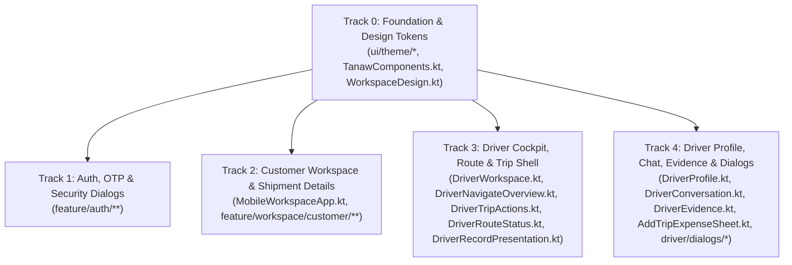

# Tanaw Mobile UI & HCI Refactoring Implementation Plan (Multi-Agent Parallel Execution)

This document is the operational blueprint for refactoring the Tanaw Android UI (`:app`) to comply with [DESIGN.md](file:///C:/Users/Soriano/AndroidStudioProjects/Tanaw_Mobile/DESIGN.md) and Human-Computer Interaction (HCI) principles while preserving 100% of existing business logic, ViewModel state flows, and automated test contracts.

It is structured so **multiple AI agents in separate sessions can work concurrently without file collisions or merge conflicts**.

---

## 1. Multi-Agent Parallel Execution Topology

To prevent merge conflicts, file ownership is partitioned into **1 Foundation Track** followed by **4 Strictly Isolated Parallel Tracks**:



### Global Rules for All Agent Sessions
1. **Read First:** Every agent session must read [AGENTS.md](file:///C:/Users/Soriano/AndroidStudioProjects/Tanaw_Mobile/AGENTS.md) and [DESIGN.md](file:///C:/Users/Soriano/AndroidStudioProjects/Tanaw_Mobile/DESIGN.md) before making edits.
2. **Strict File Boundaries:** An agent working on Track `N` must **only** modify the files listed in Track `N`'s **Owned Files** list. Never edit files owned by another track or legacy unreachable files.
3. **Preserve Existing Signatures:** Do not rename existing public composable functions or alter their required parameter lists unless specified in Track 0's additive defaults.
4. **Preserve All Automated Test Contracts:** Every `testTag(...)`, `contentDescription`, and asserted UI string literal listed in each track's **Test Preservation Checklist** must remain intact so `./gradlew testDebugUnitTest` and `./gradlew connectedDebugAndroidTest` pass without regression.
5. **No Backend / ViewModel Contract Changes:** Do not alter RPC names, JSON field keys, or `MobileWorkspaceViewModel` business logic.

---

## 2. Track 0: Foundation, Theme Unification & Shared HCI Primitives

> **Execution Order:** Run **Track 0 first** (or merge it before starting Tracks 1 to 4). If you want to start Tracks 1 to 4 immediately in parallel with Track 0, Tracks 1 to 4 only rely on existing component names plus optional default parameters, so they will compile cleanly.

### Owned Files (Exclusive to Track 0)
- [app/src/main/java/com/tanaw/app/ui/theme/Color.kt](file:///C:/Users/Soriano/AndroidStudioProjects/Tanaw_Mobile/app/src/main/java/com/tanaw/app/ui/theme/Color.kt)
- [app/src/main/java/com/tanaw/app/ui/theme/Type.kt](file:///C:/Users/Soriano/AndroidStudioProjects/Tanaw_Mobile/app/src/main/java/com/tanaw/app/ui/theme/Type.kt)
- [app/src/main/java/com/tanaw/app/ui/theme/Theme.kt](file:///C:/Users/Soriano/AndroidStudioProjects/Tanaw_Mobile/app/src/main/java/com/tanaw/app/ui/theme/Theme.kt)
- [app/src/main/java/com/tanaw/app/ui/components/TanawComponents.kt](file:///C:/Users/Soriano/AndroidStudioProjects/Tanaw_Mobile/app/src/main/java/com/tanaw/app/ui/components/TanawComponents.kt)
- [app/src/main/java/com/tanaw/app/ui/components/WorkspaceDesign.kt](file:///C:/Users/Soriano/AndroidStudioProjects/Tanaw_Mobile/app/src/main/java/com/tanaw/app/ui/components/WorkspaceDesign.kt)

### HCI & Design System Tasks
1. **WCAG 2.2 AA Color Tokens (`Color.kt` & `Theme.kt`):**
   - Add accessible safety orange `OrangeAccessible = Color(0xFFC2410C)` (5.18:1 on `#FFFFFF`) for `LightColorScheme.secondary` text, links, and white-text badges, while keeping `OrangeAccent = Color(0xFFE87722)` for decorative card strips and map rings.
   - Update `HintGray` / `onSurfaceVariant` in light mode to `Color(0xFF475569)` (6.75:1 on `#F1F5F9` inputs) and `outline` to `Color(0xFF64748B)` (4.76:1 on `#FFFFFF`, meeting WCAG 1.4.11 3:1 input border contrast).
   - Keep `BorderGray = Color(0xFFE2E8F0)` mapped to `outlineVariant` for subtle card borders and dividers.
2. **Unified `Manrope` Typography (`Type.kt`):**
   - Load `FontFamily(Font(R.font.manrope, FontWeight.Normal), Font(R.font.manrope, FontWeight.Medium), Font(R.font.manrope, FontWeight.SemiBold), Font(R.font.manrope, FontWeight.Bold), Font(R.font.manrope, FontWeight.ExtraBold))` as the single `Typography` family across both Customer and Driver roles, implementing the full scale (`headlineLarge` down to `labelSmall`) defined in `DESIGN.md` Section C.
3. **Touch Target & Ergonomic Fixes (`TanawComponents.kt`):**
   - **`SuccessBanner`:** Expand the `'×'` dismiss target from `16.dp` to a `48.dp x 48.dp` `IconButton` with `contentDescription = "Dismiss"`.
   - **`TanawTextLink`:** Add `Modifier.minimumInteractiveComponentSize()` and vertical padding so text links ("Forgot Password?", "Use email address instead", "Resend code") meet the `48.dp` height requirement (Fitts's Law).
   - **`TanawPrimaryButton`:** Keep `52.dp` height and `10.dp` corner radius; remove any decorative trailing arrow glyphs.
4. **Shared HCI Layout Primitives (`WorkspaceDesign.kt`):**
   - Keep existing `WorkspaceCard`, `SectionHeader`, `StatusBadge`, `GpsFreshnessBadge`, `TimelineRow`, `Notices`, and `FormPage` signatures backward-compatible.
   - Standardize `WorkspaceCard` to `16.dp` radius (`RoundedCornerShape(16.dp)`), `1.dp` `MaterialTheme.colorScheme.outlineVariant` border, and `16.dp` internal padding.
   - Add reusable HCI primitives for Tracks 1 to 4:
     - `TanawSubScreenTopBar(title: String, onBack: () -> Unit, trailing: @Composable RowScope.() -> Unit = {}, busy: Boolean = false)` for pinned sub-screen headers (`ShipmentDetails`, onboarding gates, policy sub-panels).
     - `KeyValueRow(label: String, value: String, modifier: Modifier = Modifier, valueColor: Color = MaterialTheme.colorScheme.onSurface, boldValue: Boolean = false)` to replace raw `Text("$label: $value")` dumps.

### Copy-Paste Prompt for Track 0 Session
```text
Read AGENTS.md, DESIGN.md, and ui-refactor-implementation-plan.md.
Execute ONLY Track 0 (Foundation, Theme Unification & Shared HCI Primitives).
Modify ONLY:
- app/src/main/java/com/tanaw/app/ui/theme/Color.kt
- app/src/main/java/com/tanaw/app/ui/theme/Type.kt
- app/src/main/java/com/tanaw/app/ui/theme/Theme.kt
- app/src/main/java/com/tanaw/app/ui/components/TanawComponents.kt
- app/src/main/java/com/tanaw/app/ui/components/WorkspaceDesign.kt
Do not touch any other files. Keep all existing public function names and parameter defaults backward-compatible. Run ./gradlew testDebugUnitTest and ./gradlew assembleDebug to verify compilation.
```

---

## 3. Track 1: Auth, OTP, Recovery & Security Dialogs

### Owned Files (Exclusive to Track 1)
- [app/src/main/java/com/tanaw/app/feature/auth/screens/LoginScreen.kt](file:///C:/Users/Soriano/AndroidStudioProjects/Tanaw_Mobile/app/src/main/java/com/tanaw/app/feature/auth/screens/LoginScreen.kt)
- [app/src/main/java/com/tanaw/app/feature/auth/screens/CreateAccountScreen.kt](file:///C:/Users/Soriano/AndroidStudioProjects/Tanaw_Mobile/app/src/main/java/com/tanaw/app/feature/auth/screens/CreateAccountScreen.kt)
- [app/src/main/java/com/tanaw/app/feature/auth/screens/RecoveryScreens.kt](file:///C:/Users/Soriano/AndroidStudioProjects/Tanaw_Mobile/app/src/main/java/com/tanaw/app/feature/auth/screens/RecoveryScreens.kt)
- [app/src/main/java/com/tanaw/app/feature/auth/components/GoogleSignInButton.kt](file:///C:/Users/Soriano/AndroidStudioProjects/Tanaw_Mobile/app/src/main/java/com/tanaw/app/feature/auth/components/GoogleSignInButton.kt)
- [app/src/main/java/com/tanaw/app/feature/auth/dialogs/PasswordChangeDialog.kt](file:///C:/Users/Soriano/AndroidStudioProjects/Tanaw_Mobile/app/src/main/java/com/tanaw/app/feature/auth/dialogs/PasswordChangeDialog.kt)
- [app/src/main/java/com/tanaw/app/feature/auth/dialogs/PhoneChangeDialog.kt](file:///C:/Users/Soriano/AndroidStudioProjects/Tanaw_Mobile/app/src/main/java/com/tanaw/app/feature/auth/dialogs/PhoneChangeDialog.kt)

### HCI Defects to Fix & Target Redesign
1. **Hardcoded Light-Mode Colors Breaking Dark Mode in Security Dialogs (`PasswordChangeDialog.kt` & `PhoneChangeDialog.kt`):**
   - Currently, both dialogs hardcode `InputGray`, `BorderGray`, `NavyPrimary`, `DriverNavy`, `DriverMuted`, and `Color.White` directly inside `OutlinedTextFieldDefaults.colors(...)`, cards, and buttons.
   - **Fix:** Replace all hardcoded light-mode colors with `MaterialTheme.colorScheme` tokens (`surface`, `surfaceContainerHigh`, `onSurface`, `onSurfaceVariant`, `primary`, `outline`, `errorContainer`, `onErrorContainer`) so the multi-step password and phone OTP dialogs are legible in both Light and Dark themes.
2. **Auth Form Ergonomics & Visual Hierarchy (`LoginScreen.kt`, `CreateAccountScreen.kt`, `RecoveryScreens.kt`):**
   - Apply consistent `24.dp` horizontal padding, `statusBarsPadding()`, `navigationBarsPadding()`, and `imePadding()` so the soft keyboard never obscures the bottom submit button or fields on compact phones.
   - Ensure the phone/email login toggle (`"Use email address instead"` / `"Use phone number instead"`) and `"Forgot Password?"` links have `48.dp` minimum touch height and clear visual affordance as interactive links.
   - In `VerifyRecoveryCodeScreen` (`RecoveryScreens.kt`), ensure the 6-digit OTP box row uses responsive `weight(1f)` cells (`height = 54.dp`, `12.dp` radius) so it never clips horizontally on `320.dp` width screens.
   - Add a reusable `VerificationCodeScreen` composable inside `RecoveryScreens.kt` (supporting both 6-digit OTP entry and token paste, plus `"Resend code"` and `"Back to sign in"`) so Track 2 can use it if desired, while keeping `ForgotPasswordCardScreen` and `VerifyRecoveryCodeScreen` signatures unchanged.

### Test Preservation Checklist (Track 1)
- `PublicNavigationTest`:
  - `"Create Account"`, `"FIRST NAME"`, `"Forgot Password?"`, `"Reset password"`, `"Request recovery code"`, `"Back to sign in"`, `"Recovery link opened"`, `"Verify Code"`, `"Update password"`.
- `PhoneSignupUiTest`:
  - `"EMAIL ADDRESS"`, `"STREET / BUILDING ADDRESS"`, `"BARANGAY"`, `"CITY / MUNICIPALITY"`, `"PROVINCE"`, `"CONTACT NUMBER"`, `"We will text a verification code to your contact number."`, `"PHONE NUMBER"`, `"Use email address instead"`, `"Use phone number instead"`.
- `DriverLoginFormTest` & `DriverLoginAcceptanceTest`:
  - `"Login"` button text, password visibility toggle `contentDescription` (`"Show password"` / `"Hide password"`), and inline error text rendering.
- `PasswordChangeNavigationTest` & `DevPasswordNavigationTest`:
  - All step headings, OTP input labels, and button labels inside `PasswordChangeDialog` and `PhoneChangeDialog`.

### Copy-Paste Prompt for Track 1 Session
```text
Read AGENTS.md, DESIGN.md, and ui-refactor-implementation-plan.md.
Execute ONLY Track 1 (Auth, OTP, Recovery & Security Dialogs).
Modify ONLY files under:
- app/src/main/java/com/tanaw/app/feature/auth/screens/
- app/src/main/java/com/tanaw/app/feature/auth/components/GoogleSignInButton.kt
- app/src/main/java/com/tanaw/app/feature/auth/dialogs/
Do not touch any other files. Preserve all existing composable signatures and all strings/tags required by PublicNavigationTest, PhoneSignupUiTest, DriverLoginFormTest, and PasswordChangeNavigationTest. Run ./gradlew testDebugUnitTest and ./gradlew assembleDebug to verify.
```

---

## 4. Track 2: Customer Workspace, Booking Flow & `ShipmentDetails` HCI Redesign

### Owned Files (Exclusive to Track 2)
- [app/src/main/java/com/tanaw/app/feature/workspace/screens/MobileWorkspaceApp.kt](file:///C:/Users/Soriano/AndroidStudioProjects/Tanaw_Mobile/app/src/main/java/com/tanaw/app/feature/workspace/screens/MobileWorkspaceApp.kt)
- [app/src/main/java/com/tanaw/app/feature/workspace/customer/screens/CustomerBookingFlow.kt](file:///C:/Users/Soriano/AndroidStudioProjects/Tanaw_Mobile/app/src/main/java/com/tanaw/app/feature/workspace/customer/screens/CustomerBookingFlow.kt)
- [app/src/main/java/com/tanaw/app/feature/workspace/customer/screens/CustomerBookingHomeScreen.kt](file:///C:/Users/Soriano/AndroidStudioProjects/Tanaw_Mobile/app/src/main/java/com/tanaw/app/feature/workspace/customer/screens/CustomerBookingHomeScreen.kt)
- [app/src/main/java/com/tanaw/app/feature/workspace/customer/screens/FullScreenLocationPicker.kt](file:///C:/Users/Soriano/AndroidStudioProjects/Tanaw_Mobile/app/src/main/java/com/tanaw/app/feature/workspace/customer/screens/FullScreenLocationPicker.kt)
- [app/src/main/java/com/tanaw/app/feature/workspace/customer/screens/AddMoreDetailsScreen.kt](file:///C:/Users/Soriano/AndroidStudioProjects/Tanaw_Mobile/app/src/main/java/com/tanaw/app/feature/workspace/customer/screens/AddMoreDetailsScreen.kt)
- [app/src/main/java/com/tanaw/app/feature/workspace/customer/screens/BookingSummaryScreen.kt](file:///C:/Users/Soriano/AndroidStudioProjects/Tanaw_Mobile/app/src/main/java/com/tanaw/app/feature/workspace/customer/screens/BookingSummaryScreen.kt)
- [app/src/main/java/com/tanaw/app/feature/workspace/customer/screens/BookingSubmittedScreen.kt](file:///C:/Users/Soriano/AndroidStudioProjects/Tanaw_Mobile/app/src/main/java/com/tanaw/app/feature/workspace/customer/screens/BookingSubmittedScreen.kt)
- [app/src/main/java/com/tanaw/app/feature/workspace/customer/screens/CustomerProfileScreen.kt](file:///C:/Users/Soriano/AndroidStudioProjects/Tanaw_Mobile/app/src/main/java/com/tanaw/app/feature/workspace/customer/screens/CustomerProfileScreen.kt)
- [app/src/main/java/com/tanaw/app/feature/workspace/customer/components/CustomerBookingComponents.kt](file:///C:/Users/Soriano/AndroidStudioProjects/Tanaw_Mobile/app/src/main/java/com/tanaw/app/feature/workspace/customer/components/CustomerBookingComponents.kt)
- [app/src/main/java/com/tanaw/app/feature/workspace/customer/components/PickupTimeBottomSheet.kt](file:///C:/Users/Soriano/AndroidStudioProjects/Tanaw_Mobile/app/src/main/java/com/tanaw/app/feature/workspace/customer/components/PickupTimeBottomSheet.kt)
- [app/src/main/java/com/tanaw/app/feature/workspace/customer/dialogs/CustomerCancellationDialog.kt](file:///C:/Users/Soriano/AndroidStudioProjects/Tanaw_Mobile/app/src/main/java/com/tanaw/app/feature/workspace/customer/dialogs/CustomerCancellationDialog.kt)
- [app/src/main/java/com/tanaw/app/feature/workspace/customer/dialogs/CustomerSubPanels.kt](file:///C:/Users/Soriano/AndroidStudioProjects/Tanaw_Mobile/app/src/main/java/com/tanaw/app/feature/workspace/customer/dialogs/CustomerSubPanels.kt)

### HCI Defects to Fix & Target Redesign
1. **Redesign Customer `ShipmentDetails` Using Progressive Disclosure (`MobileWorkspaceApp.kt` L438-547):**
   - **Defect:** Currently dumps 19+ raw fields, raw GPS `latitude, longitude`, cancellation button, map, delivery timestamps, timeline strings, and POD links inside **one giant `WorkspaceCard`** with an inline scrolling `"← Back"` button.
   - **Redesign (`DESIGN.md` Blueprint 1):**
     - Render a pinned top bar (`← Back`, tracking number `TNW-...`, and trailing `StatusBadge`).
     - **Card 1 (Live Tracking & ETA):** `ShipmentMap`, `GpsFreshnessBadge`, last telemetry timestamp in PHT, and Scheduled vs. Live ETA rows.
     - **Card 2 (Route & Cargo):** Visual two-stop connector (`PICKUP` → `DESTINATION` with full wrapped addresses), cargo description, formatted weight (`kg`), and driver/cancellation notes when non-blank.
     - **Card 3 (Quotation & Pricing):** Clear `Quoted` and `Final` amounts formatted in PHP (or `"Awaiting office quotation"` badge when not yet priced).
     - **Card 4 (Delivery Progress & Timeline):** Structured milestone rows with PHT timestamps (replacing raw `Field("Assigned", ...)` text dumps) and an expandable/clean timeline section.
     - **Card 5 (Proof of Delivery & Actions):** Recorded POD items with `"View / download"` actions, plus the outlined destructive `"Cancel shipment"` button when `CustomerCancellationRules.canCancelShipment(shipment)` is true.
2. **Pin `CustomerTopBar` Outside the Scroll Container (`MobileWorkspaceApp.kt` & `CustomerBookingHomeScreen.kt`):**
   - **Defect:** `CustomerTopBar` is currently inside the `verticalScroll` column on `Home`, `Active`, `History`, and `Alerts` (so it scrolls off-screen), while `CustomerProfileScreen` pins it at the top.
   - **Redesign:** Hoist `CustomerTopBar` into `Scaffold(topBar = ...)` (or keep it pinned above the scrollable `Column`) consistently across all 5 Customer tabs (`Home`, `Active`, `History`, `Alerts`, `Profile`), and remove the duplicate `CustomerTopBar` inside `CustomerBookingHomeScreen` and `CustomerProfileScreen` (or let `CustomerWorkspace` own the top bar once for all root tabs).
3. **Replace Raw Developer Scaffolds on `loading`, `verify`, `verify_phone`, and `"Complete your profile"` (`MobileWorkspaceApp.kt` L98-165 & L549-575):**
   - **Defect:** `verify` and `verify_phone` use bare `FormPage` columns without a back button; `"Complete your profile"` uses `ProfileForm` which renders `"Enable shipment SMS"` and `"Disable shipment SMS"` as two separate full-width primary buttons (violating Norman's natural mapping).
   - **Redesign (`DESIGN.md` Blueprint 3):**
     - Style `loading` as a clean centered brand card with a `CircularProgressIndicator` and contextual status message (`"Checking your session…"`).
     - Upgrade `verify` and `verify_phone` to structured verification cards with clear target masking, OTP input field, primary `"Verify code"` / `"Verify phone"` CTA, secondary `"Resend verification"` / `"Resend SMS"` button, and `"Back to sign in"` action.
     - Replace the two competing SMS buttons in `ProfileForm` with a single Material 3 `Switch` row (`"Shipment SMS updates"`) and a clean onboarding card layout.
4. **Standardize Customer Spacing & Touch Targets (`CustomerProfileScreen.kt`, `CustomerBookingComponents.kt`):**
   - Standardize horizontal padding to `16.dp` across all Customer workspace tabs.
   - Ensure the profile photo camera button in `CustomerProfileHeader` has a `48.dp x 48.dp` touch target (`Modifier.minimumInteractiveComponentSize()`).

### Test Preservation Checklist (Track 2)
- `DevCustomerWorkflowTest` & `HomeMapFlowTest`:
  - All `testTag` values: `"PickupLocationField"`, `"DestinationLocationField"`, `"TopFloatingAddressCard"`, `"LocationSearchInput"`, `"ConfirmLocationButton"`, `"BookingContinueButton"`, `"OrderContactInput"`, `"CargoDescriptionInput"`, `"EstWeightInput"`, `"NotesToDriverInput"`, `"ConfirmDetailsButton"`, `"ConfirmBookingButton"`, `"TrackShipmentButton"`.
  - Strings: `"Booking Submitted!"`, `"Closed Van"`, `"Home"`.
- `DevTabsTest`:
  - Bottom nav labels: `"Home"`, `"Active"`, `"History"`, `"Alerts"`, `"Profile"`.
  - Section headers/strings: `"Where are you shipping?"`, `"Available Vehicles"`, `"Active shipments"`, `"Search reference or address"`, `"Shipment history"`, `"Completed"`, `"Notifications"`, `"Your profile"`.

### Copy-Paste Prompt for Track 2 Session
```text
Read AGENTS.md, DESIGN.md, and ui-refactor-implementation-plan.md.
Execute ONLY Track 2 (Customer Workspace, Booking Flow & ShipmentDetails HCI Redesign).
Modify ONLY:
- app/src/main/java/com/tanaw/app/feature/workspace/screens/MobileWorkspaceApp.kt
- app/src/main/java/com/tanaw/app/feature/workspace/customer/**
Do not touch any other files. Implement Blueprint 1 (multi-card ShipmentDetails with progressive disclosure), Blueprint 3 (upgraded loading, verify, verify_phone, and single-Switch ProfileForm), and pin CustomerTopBar so it does not scroll off-screen. Preserve all testTags and strings listed in Track 2's Test Preservation Checklist. Run ./gradlew testDebugUnitTest and ./gradlew assembleDebug to verify.
```

---

## 5. Track 3: Driver Workspace Shell, `Navigate` Cockpit, Route & Trip Actions

### Owned Files (Exclusive to Track 3)
- [app/src/main/java/com/tanaw/app/feature/workspace/driver/screens/DriverWorkspace.kt](file:///C:/Users/Soriano/AndroidStudioProjects/Tanaw_Mobile/app/src/main/java/com/tanaw/app/feature/workspace/driver/screens/DriverWorkspace.kt)
- [app/src/main/java/com/tanaw/app/feature/workspace/driver/screens/DriverNavigateOverview.kt](file:///C:/Users/Soriano/AndroidStudioProjects/Tanaw_Mobile/app/src/main/java/com/tanaw/app/feature/workspace/driver/screens/DriverNavigateOverview.kt)
- [app/src/main/java/com/tanaw/app/feature/workspace/driver/components/DriverTripActions.kt](file:///C:/Users/Soriano/AndroidStudioProjects/Tanaw_Mobile/app/src/main/java/com/tanaw/app/feature/workspace/driver/components/DriverTripActions.kt)
- [app/src/main/java/com/tanaw/app/feature/workspace/driver/components/DriverRouteStatus.kt](file:///C:/Users/Soriano/AndroidStudioProjects/Tanaw_Mobile/app/src/main/java/com/tanaw/app/feature/workspace/driver/components/DriverRouteStatus.kt)
- [app/src/main/java/com/tanaw/app/feature/workspace/driver/components/DriverRecordPresentation.kt](file:///C:/Users/Soriano/AndroidStudioProjects/Tanaw_Mobile/app/src/main/java/com/tanaw/app/feature/workspace/driver/components/DriverRecordPresentation.kt)

### HCI Defects to Fix & Target Redesign
1. **Unify `DriverTheme` & Shape Tokens (`DriverWorkspace.kt` L92-123):**
   - **Defect:** `DriverTheme` currently uses sharp `2.dp` and `4.dp` corners (`RoundedCornerShape(2.dp)`, `RoundedCornerShape(4.dp)`) and `#002D54`, clashing with `TanawTheme` (`10.dp`-`16.dp` corners and `#0B2A4A`) and having no dark mode adaptation.
   - **Redesign:** Align `DriverTheme` and driver components (`DriverCard`, `DriverButton`, `DriverOutlineButton`, `DriverField`, `DriverBadge`, `DriverTripSection`) with `DESIGN.md` radii (`6.dp` badges, `10.dp` buttons, `12.dp` fields, `16.dp` cards) and `MaterialTheme.colorScheme` / unified Navy `#0B2A4A` tokens.
2. **Fix Disappearing Top Bar on Driver `Navigate` (`DriverWorkspace.kt` L140-174):**
   - **Defect:** `if (!(tab == "Navigate" && shipment != null))` completely hides the top bar (and therefore hides `Messages` and `Alerts`) whenever the driver is navigating a selected trip!
   - **Redesign:** Keep a compact pinned header visible even when `tab == "Navigate" && shipment != null` so the driver always has top-level access to `Messages` (`"Messages"` / `"Messages ($unread)"`), `Notifications` (`contentDescription = "Notifications"`), and a `"Switch trip"` / back action without having to leave `Navigate`.
3. **Refactor `DriverOverview` / `DriverNavigateOverview` into a Structured Driver Cockpit (`DriverNavigateOverview.kt`, `DriverTripActions.kt`, `DriverRouteStatus.kt`):**
   - **Defect:** Stacks 9 dense blocks without clear visual hierarchy.
   - **Redesign (`DESIGN.md` Blueprint 2):**
     - **Primary Stage Cockpit Card (Top of screen):**
       - Stage banner (`"Ready to start route"`, `"Heading to Pick-up"`, `"At Pick-up Location"`, `"Loading Cargo"`, `"In Transit"`, `"Delivered"`) + `"Stage X of 4"` badge + `"Next step"` section.
       - Active milestone CTA from `DriverTripActions` (`"START ROUTE AND SHARE LOCATION"`, `"I'VE ARRIVED AT PICK-UP"`, `"CARGO LOADED - START TRANSIT"`, `"MARK AS DELIVERED"`) with prominent `52.dp` height, clear 50m geofence notice (`"Must be within 50m of the pick-up location to confirm arrival."` / `"Must be within 50m of the delivery location to complete delivery."`), and GPS tracking status pill.
       - Quick operational action row for `"Record Fuel"`, `"Add Trip Expense"`, and `"Report Issue / Delay"` grouped cleanly as secondary outlined/tonal action buttons below the primary milestone button so they never visually compete with the primary milestone CTA (Hick's Law).
     - **Route, Directions & Map Card:**
       - Keep `"Directions to pickup"`, `"Directions to destination"`, and `"View pickup-to-destination route"` accessible in the scrollable `DriverDirectionsButtons` card, Visually elevate the direction button matching the current stage while styling the other two as compact secondary actions so the driver immediately sees which stop is next.
       - Keep `DriverRouteStatusCard`, `DriverTruckRestrictionCard`, and the collapsible `"Show route map"` / `"Hide route map"` preview cleanly grouped inside the Route & Advisory card.
     - **Collapsible Delivery Steps & Saved Trip Records:**
       - Keep `"Show delivery steps"` / `"Hide delivery steps"` collapsible by default (progressive disclosure).
       - Keep `DriverRecords` (expenses, incidents, fuel records, `"Show timeline (X updates)"`, POD files) cleanly structured in cards with `KeyValueRow` formatting.
4. **Upgrade `DriverTrips` Filter Strip (`DriverWorkspace.kt` L404-465):**
   - Replace the custom 2-tab underlined text strip with clear Material 3 `FilterChip` or pill tabs while keeping `contentDescription = "Filter trips"` on the filter icon button and keeping `"This month"`, `"Last month"`, `"All records"`, `"Load more trips"`, and `"Refresh trip history"`.

### Test Preservation Checklist (Track 3)
> **CRITICAL:** All of these exact strings and tags are asserted by `DriverFigmaUiTest`, `DriverNavigateUiTest`, `DriverOperationalUiTest`, `DriverGeofenceUiTest`, `DriverRouteStatusUiTest`, and `DriverRecordPresentationUiTest`. Do not rename or hide them behind unclicked tabs:
- Bottom Nav labels: `"HOME"`, `"NAVIGATE"`, `"TRIPS"`, `"PROFILE"`.
- Top bar actions: `"Messages"` / `"Messages ($unreadMessages)"`, `IconButton` with `contentDescription = "Notifications"`.
- Home & Selection states: `"New Trip Assigned!"`, `"No trips assigned"`, `"You are available for assignments"`, `"Choose a trip to navigate"` (when `tab == "Navigate"` and `selected == null`), `"Selected trip unavailable"`, `"Selected trip details unavailable"`, `"Choose another trip"`, `"Refresh selected trip"`, `"Retry assignments"`, `"Assigned vehicle unavailable"`, `"Trip vehicle unavailable"`, `"UNAVAILABLE"`, `"Driver roster unavailable."`, `"No driver roster link was returned"`.
- Navigate & Geofence strings: `"Ready to start route"`, `"Heading to Pick-up"`, `"Next step"`, `"Record Fuel"`, `"Add Trip Expense"`, `"Report Issue / Delay"`, `"I'VE ARRIVED AT PICK-UP"`, `"Checking pick-up location…"`, `"Must be within 50m of the pick-up location to confirm arrival."`, `"Show delivery steps"`, `"Hide delivery steps"`, `"3. Arrived at pickup"`, `"Show route map"`, `"Hide route map"`, `"Retry road preview"`, `"Unverified road preview"`, `"Preview road distance: "`, `"Road preview unavailable offline. Reconnect and retry."`.
- Directions & Route Status strings: `"Directions to pickup"`, `"Directions to destination"`, `"View pickup-to-destination route"`, `"This assignment has no saved map pins"`, `"Truck route awaiting office confirmation"`, `"ETA unavailable: office-confirmed truck route required"`, `"ETA to pickup:"`, `"ETA to destination:"`, `"ETA expired"`, `"OpenRouteService HGV"`, `"Calculated"`, `"Google Maps may recalculate"`.
- Trips & Records strings: `"My Trips"`, `"Load more trips"`, `"Filter trips"` (`contentDescription`), `"This month"`, `"Last month"`, `"All records"`, `"Refresh trip history"`, `"Other expenses submitted: Unavailable"`, `"Show timeline ("`, `"Purchased:"`, `"Odometer:"`.

### Copy-Paste Prompt for Track 3 Session
```text
Read AGENTS.md, DESIGN.md, and ui-refactor-implementation-plan.md.
Execute ONLY Track 3 (Driver Workspace Shell, Navigate Cockpit, Route & Trip Actions).
Modify ONLY:
- app/src/main/java/com/tanaw/app/feature/workspace/driver/screens/DriverWorkspace.kt
- app/src/main/java/com/tanaw/app/feature/workspace/driver/screens/DriverNavigateOverview.kt
- app/src/main/java/com/tanaw/app/feature/workspace/driver/components/DriverTripActions.kt
- app/src/main/java/com/tanaw/app/feature/workspace/driver/components/DriverRouteStatus.kt
- app/src/main/java/com/tanaw/app/feature/workspace/driver/components/DriverRecordPresentation.kt
Do not touch any other files. Unify DriverTheme with DESIGN.md radii and tokens, keep the top bar (Messages & Notifications) visible on Navigate, and refactor the Navigate Cockpit layout while preserving every single string and testTag in Track 3's Test Preservation Checklist. Run ./gradlew testDebugUnitTest and ./gradlew assembleDebug to verify.
```

---

## 6. Track 4: Driver Profile, Office Chat, Evidence & Operational Dialogs/Sheets

### Owned Files (Exclusive to Track 4)
- [app/src/main/java/com/tanaw/app/feature/workspace/driver/screens/DriverProfile.kt](file:///C:/Users/Soriano/AndroidStudioProjects/Tanaw_Mobile/app/src/main/java/com/tanaw/app/feature/workspace/driver/screens/DriverProfile.kt)
- [app/src/main/java/com/tanaw/app/feature/workspace/driver/components/DriverConversation.kt](file:///C:/Users/Soriano/AndroidStudioProjects/Tanaw_Mobile/app/src/main/java/com/tanaw/app/feature/workspace/driver/components/DriverConversation.kt)
- [app/src/main/java/com/tanaw/app/feature/workspace/driver/components/DriverEvidence.kt](file:///C:/Users/Soriano/AndroidStudioProjects/Tanaw_Mobile/app/src/main/java/com/tanaw/app/feature/workspace/driver/components/DriverEvidence.kt)
- [app/src/main/java/com/tanaw/app/feature/workspace/driver/components/AddTripExpenseSheet.kt](file:///C:/Users/Soriano/AndroidStudioProjects/Tanaw_Mobile/app/src/main/java/com/tanaw/app/feature/workspace/driver/components/AddTripExpenseSheet.kt)
- [app/src/main/java/com/tanaw/app/feature/workspace/driver/dialogs/DriverFlowDialogs.kt](file:///C:/Users/Soriano/AndroidStudioProjects/Tanaw_Mobile/app/src/main/java/com/tanaw/app/feature/workspace/driver/dialogs/DriverFlowDialogs.kt)
- [app/src/main/java/com/tanaw/app/feature/workspace/driver/dialogs/DriverFuelForm.kt](file:///C:/Users/Soriano/AndroidStudioProjects/Tanaw_Mobile/app/src/main/java/com/tanaw/app/feature/workspace/driver/dialogs/DriverFuelForm.kt)

### HCI Defects to Fix & Target Redesign
1. **Driver Profile & Sub-Panel Hierarchy (`DriverProfile.kt`):**
   - Replace sharp `2.dp`-`4.dp` corners and dense unpadded blocks with `16.dp` `DriverCard` containers, structured `DriverFact` key-value rows, high-contrast compliance badges (`CRITICAL`, `EXPIRING`, `EXPIRED`, `VALID`), and a pinned sub-screen header (`← Back to profile`) when viewing `Terms of Service`, `Privacy`, or `Help & Support`.
   - Separate the destructive `"Log Out"` button at the bottom of the profile with a `1.5.dp` `error` outline border and `48.dp+` touch height.
2. **Office Conversation Chat Ergonomics (`DriverConversation.kt`):**
   - Style message bubbles with clear sender differentiation (Office staff left-aligned on `surfaceContainerHigh` with `16.dp` rounded corners; Driver `"You"` right-aligned on `primaryContainer` with `onPrimaryContainer` text).
   - Ensure the compose input row (`"Message to office"` + `"Send message"`) applies `imePadding()` and remains anchored and accessible below the bounded message list (`heightIn(max = 320.dp)`).
3. **Operational Capture Forms (`DriverFlowDialogs.kt`, `DriverFuelForm.kt`, `AddTripExpenseSheet.kt`, `DriverEvidence.kt`):**
   - **POD Capture (`DriverProofForm`):** Clearly separate Step 1 (Delivery Photos), Step 2 (Recipient Name + bordered Signature Canvas with `"Clear"` action), and Step 3 (Optional Notes), with an anchored bottom `"COMPLETE DELIVERY"` CTA.
   - **Incident Report (`DriverIncidentForm`):** Use `FlowRow` with `FilterChip` items (`10.dp` radius, `48.dp` min touch target) for the 5 incident categories (`Traffic/Delay`, `Vehicle Issue`, `Safety Concern`, `Weather`, `Other`).
   - **Fuel Form (`DriverFuelForm`):** Highlight the live calculated `Total cost` in a prominent `primaryContainer` summary banner above the `"Save Fuel Record"` button.
   - **Expense Sheet (`AddTripExpenseSheet`):** Replace hardcoded light-mode colors (`Color.White`, `Color(0xFFF8FAFC)`) with `MaterialTheme.colorScheme` tokens so the sheet supports Dark Mode.

### Test Preservation Checklist (Track 4)
- `DriverProfileUiTest` & `DriverRecordPresentationUiTest`:
  - `"Retry driver profile"`, `"Retry assigned vehicle"`, `"Retry compliance records"`, `"Retry warning settings"`, `"Refresh driver profile"`, `"No assigned vehicle"`, `"No compliance documents were returned for your account."`, `"Contact your administrator to update compliance documents."`, `"Help & Support"`, `"Open office messages"`, `"The office has not published a support phone"`, `"Terms of Service"`, `"Open terms of service"`, `"The office has not published an approved terms"`, `"← Back to profile"`, `"Privacy"`, `"The office has not published an approved privacy"`, `"CRITICAL"`, `"Drivers license"`.
- `DriverConversationUiTest`:
  - `"Open office conversation"`, `"Close office conversation"`, `"Message to office"`, `"Send message"`, `"You"`, `"Send unconfirmed."`, `"Retry send"`, `"Message sent."`, `"Mark displayed messages read"`, `"Older messages"`, `"Latest messages"`, `"Offline · reconnect"`, `"This delivery conversation is read-only."`, `"Messages unavailable."`, `"No messages yet."`, `"Retry / refresh messages"`.
- `DriverFigmaUiTest`, `DriverOperationalUiTest`, `ExpenseFormUiTest`, `IncidentSubmissionUiTest`, `DriverEvidenceUiTest`:
  - POD: `"COMPLETE DELIVERY"`, `"Enter full name"`, `"Discard proof draft?"`.
  - Incident: `"Submit Report"`, `"Describe the issue in detail…"`.
  - Fuel: `"Save Fuel Record"`, `"Retry Fuel Record"`, `"Liters"`, `"Price per liter (PHP)"`, `"Odometer (km)"`, `"Station (optional)"`, `"Close unconfirmed fuel record?"`, `"Keep retrying"`, `contentDescription = "Back"`.
  - Expense: `"Submit Expense"`, `testTag("add_trip_expense_sheet")`, `testTag("expense_category_input")`, `testTag("expense_amount_input")`.

### Copy-Paste Prompt for Track 4 Session
```text
Read AGENTS.md, DESIGN.md, and ui-refactor-implementation-plan.md.
Execute ONLY Track 4 (Driver Profile, Office Chat, Evidence & Operational Dialogs/Sheets).
Modify ONLY:
- app/src/main/java/com/tanaw/app/feature/workspace/driver/screens/DriverProfile.kt
- app/src/main/java/com/tanaw/app/feature/workspace/driver/components/DriverConversation.kt
- app/src/main/java/com/tanaw/app/feature/workspace/driver/components/DriverEvidence.kt
- app/src/main/java/com/tanaw/app/feature/workspace/driver/components/AddTripExpenseSheet.kt
- app/src/main/java/com/tanaw/app/feature/workspace/driver/dialogs/DriverFlowDialogs.kt
- app/src/main/java/com/tanaw/app/feature/workspace/driver/dialogs/DriverFuelForm.kt
Do not touch any other files. Refactor the visual hierarchy, dark mode support, and touch targets per DESIGN.md while preserving every string, contentDescription, and testTag in Track 4's Test Preservation Checklist. Run ./gradlew testDebugUnitTest and ./gradlew assembleDebug to verify.
```

---

## 7. File Ownership Matrix (Zero-Conflict Guarantee)

| File Path | Track 0 | Track 1 | Track 2 | Track 3 | Track 4 |
|-----------|---------|---------|---------|---------|---------|
| `ui/theme/Color.kt`, `Type.kt`, `Theme.kt` | **WRITE** | Read-only | Read-only | Read-only | Read-only |
| `ui/components/TanawComponents.kt`, `WorkspaceDesign.kt` | **WRITE** | Read-only | Read-only | Read-only | Read-only |
| `feature/auth/screens/*`, `feature/auth/components/*`, `feature/auth/dialogs/*` | - | **WRITE** | - | - | - |
| `feature/workspace/screens/MobileWorkspaceApp.kt` | - | - | **WRITE** | - | - |
| `feature/workspace/customer/**` | - | - | **WRITE** | - | - |
| `feature/workspace/driver/screens/DriverWorkspace.kt`, `DriverNavigateOverview.kt` | - | - | - | **WRITE** | - |
| `feature/workspace/driver/components/DriverTripActions.kt`, `DriverRouteStatus.kt`, `DriverRecordPresentation.kt` | - | - | - | **WRITE** | - |
| `feature/workspace/driver/screens/DriverProfile.kt` | - | - | - | - | **WRITE** |
| `feature/workspace/driver/components/DriverConversation.kt`, `DriverEvidence.kt`, `AddTripExpenseSheet.kt` | - | - | - | - | **WRITE** |
| `feature/workspace/driver/dialogs/DriverFlowDialogs.kt`, `DriverFuelForm.kt` | - | - | - | - | **WRITE** |

---

## 8. Final Integration & Verification Gate

Once Tracks 0 through 4 are completed and merged:
1. **Unit Tests:** `./gradlew testDebugUnitTest`
2. **Debug APK Build:** `./gradlew assembleDebug`
3. **Android Lint Check:** `./gradlew lintDebug`
4. **Instrumented UI Suite (when emulator/device is connected):** `./gradlew connectedDebugAndroidTest`
