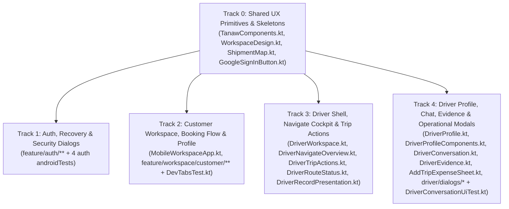

# Tanaw Mobile — Laws of UX Refactor Implementation Plan (Multi-Agent Execution Blueprint)

This document is the actionable engineering blueprint to execute every finding from the **30 Laws of UX Audit** across the active Tanaw Android app (`:app`). It is structured so **up to 4 AI agents in parallel sessions** can implement the UX improvements concurrently after a shared Foundation pass, with **zero file collisions** and explicit automated test contracts.

---

## 1. Scope & Non-Negotiable Guardrails (`AGENTS.md`)

1. **Active Code Only:** [MainActivity.kt](file:///C:/Users/Soriano/AndroidStudioProjects/Tanaw_Mobile/app/src/main/java/com/tanaw/app/MainActivity.kt) launches only `MobileWorkspaceApp`. **Never** edit legacy unreachable screens (`TanawNavHost`, `feature/booking/`, `feature/history/`, `feature/notifications/`, `feature/profile/`, `feature/tracking/`, `feature/driver/`, `VerifyEmailScreen`, `VerifyPhoneScreen`, `OtpVerifyContent`).
2. **No Backend / ViewModel Contract Changes:** Do not rename or alter Supabase RPC calls, JSON keys, or `MobileWorkspaceViewModel` state mutations. If any UX fix reveals a missing server field, document it in `docs/BACKEND-REQUESTS.md` and stop on that item.
3. **Product Rules:** Drivers never accept or decline assignments. Staff/admin assign them. Keep all geofence (50m), idempotent request UUID, and offline/draft protections intact.
4. **No New Dependencies:** Use existing Material 3, Foundation (`FlowRow`, `IntrinsicSize`, `onFocusChanged`), and `TanawTheme` / `DriverTheme` tokens.
5. **Strict File Ownership:** An agent assigned to Track `N` may **only** modify files listed in Track `N`'s **Owned Files** table (including its owned `androidTest` files when an intentional UX change updates asserted labels/flows).
6. **Mandatory Verification Before Finishing Any Track:**
   - `./gradlew assembleDebug`
   - `./gradlew testDebugUnitTest`
   - `./gradlew lintDebug` (when touching layout/resources/Compose modifiers)

---

## 2. Multi-Agent Parallel Execution Topology



> **Execution Strategy:** Merge **Track 0** first so Tracks 1–4 can use the shared `SkeletonBlock` / `TanawBanner` / `StepProgressHeader` primitives. Tracks 1, 2, 3, and 4 touch completely disjoint file sets and can run concurrently on separate feature branches (`ux/track-1-auth`, `ux/track-2-customer`, `ux/track-3-driver-cockpit`, `ux/track-4-driver-modals`).

---

## 3. Track 0: Shared UX Primitives, Skeletons & Map Loading Overlay

### Owned Files (Exclusive to Track 0)
- [app/src/main/java/com/tanaw/app/ui/components/TanawComponents.kt](file:///C:/Users/Soriano/AndroidStudioProjects/Tanaw_Mobile/app/src/main/java/com/tanaw/app/ui/components/TanawComponents.kt)
- [app/src/main/java/com/tanaw/app/ui/components/WorkspaceDesign.kt](file:///C:/Users/Soriano/AndroidStudioProjects/Tanaw_Mobile/app/src/main/java/com/tanaw/app/ui/components/WorkspaceDesign.kt)
- [app/src/main/java/com/tanaw/app/ui/components/ShipmentMap.kt](file:///C:/Users/Soriano/AndroidStudioProjects/Tanaw_Mobile/app/src/main/java/com/tanaw/app/ui/components/ShipmentMap.kt)
- [app/src/main/java/com/tanaw/app/feature/auth/components/GoogleSignInButton.kt](file:///C:/Users/Soriano/AndroidStudioProjects/Tanaw_Mobile/app/src/main/java/com/tanaw/app/feature/auth/components/GoogleSignInButton.kt)

### Implementation Tasks
1. **Add Reusable Skeleton Primitives (`WorkspaceDesign.kt`) — *Doherty Threshold*:**
   - Add `SkeletonBox(modifier: Modifier)` and `SkeletonCardPlaceholder(lines: Int = 3, modifier: Modifier = Modifier)` using subtle animated alpha (`rememberInfiniteTransition` between `0.35f` and `0.7f` on `MaterialTheme.colorScheme.surfaceVariant`).
   - Add `BookingStepHeader(currentStep: Int, totalSteps: Int, title: String, modifier: Modifier = Modifier)` rendering a `Step X of Y` label + smooth `LinearProgressIndicator` (*Goal-Gradient Effect*).
2. **Add Blur-Validated Field Support & Responsive Form Wrapper (`TanawComponents.kt`) — *Working Memory & Parkinson's Law*:**
   - Add `onFocusLost: (() -> Unit)? = null` optional parameter (default `null`, 100% backward-compatible) to `TanawTextField` using `Modifier.onFocusChanged` so callers can defer inline error flags until blur or submit.
   - Add `TanawFormContainer(modifier: Modifier = Modifier, content: @Composable ColumnScope.() -> Unit)` constraining max width to `480.dp` (`Modifier.widthIn(max = 480.dp).fillMaxWidth()`) for tablets and foldables.
3. **Overlay Map Loading State Inside Map Container (`ShipmentMap.kt` L183–191) — *Doherty Threshold & Aesthetic-Usability*:**
   - Wrap the `AndroidView` (`height(300.dp)`) in a `Box` and render a centered `Surface` pill (`"Loading street map…"`) with a `16.dp` `CircularProgressIndicator` inside the map frame when `!ready && !failed`, preventing layout jump when tiles finish loading.
   - Keep `"Loading street map…"`, `"Interactive shipment map"`, and `testTag("Shipment map")` intact.
4. **Update Google Divider Copy (`GoogleSignInButton.kt` L74) — *Postel's Law & Mental Model*:**
   - Change `"  or continue with email  "` to `"  or continue with email or phone  "` (additive/configurable via `dividerText: String = "or continue with email or phone"`).

### Test Preservation Checklist (Track 0)
- Preserve `testTag("Shipment map")`, `"Loading street map…"`, `"Continue with Google"`, `"Forgot Password?"`, `"Dismiss"`.
- Keep all existing signatures in `TanawComponents.kt` and `WorkspaceDesign.kt` backward-compatible via default parameter values.

### Copy-Paste Prompt for Track 0 Agent
```text
Read AGENTS.md and ux-refactor-implementation-plan.md.
Execute ONLY Track 0 (Shared UX Primitives, Skeletons & Map Loading Overlay).
Modify ONLY:
- app/src/main/java/com/tanaw/app/ui/components/TanawComponents.kt
- app/src/main/java/com/tanaw/app/ui/components/WorkspaceDesign.kt
- app/src/main/java/com/tanaw/app/ui/components/ShipmentMap.kt
- app/src/main/java/com/tanaw/app/feature/auth/components/GoogleSignInButton.kt
Do not touch any other files. Keep all existing function signatures backward-compatible via optional parameters. Verify with ./gradlew assembleDebug and ./gradlew testDebugUnitTest.
```

---

## 4. Track 1: Auth, Recovery & Security Dialogs

### Owned Files (Exclusive to Track 1)
- **Production:**
  - [app/src/main/java/com/tanaw/app/feature/auth/screens/LoginScreen.kt](file:///C:/Users/Soriano/AndroidStudioProjects/Tanaw_Mobile/app/src/main/java/com/tanaw/app/feature/auth/screens/LoginScreen.kt)
  - [app/src/main/java/com/tanaw/app/feature/auth/screens/CreateAccountScreen.kt](file:///C:/Users/Soriano/AndroidStudioProjects/Tanaw_Mobile/app/src/main/java/com/tanaw/app/feature/auth/screens/CreateAccountScreen.kt)
  - [app/src/main/java/com/tanaw/app/feature/auth/screens/RecoveryScreens.kt](file:///C:/Users/Soriano/AndroidStudioProjects/Tanaw_Mobile/app/src/main/java/com/tanaw/app/feature/auth/screens/RecoveryScreens.kt)
  - [app/src/main/java/com/tanaw/app/feature/auth/dialogs/PasswordChangeDialog.kt](file:///C:/Users/Soriano/AndroidStudioProjects/Tanaw_Mobile/app/src/main/java/com/tanaw/app/feature/auth/dialogs/PasswordChangeDialog.kt)
  - [app/src/main/java/com/tanaw/app/feature/auth/dialogs/PhoneChangeDialog.kt](file:///C:/Users/Soriano/AndroidStudioProjects/Tanaw_Mobile/app/src/main/java/com/tanaw/app/feature/auth/dialogs/PhoneChangeDialog.kt)
- **Coupled UI Tests (update only assertions listed below):**
  - [app/src/androidTest/java/com/tanaw/app/feature/auth/screens/PhoneSignupUiTest.kt](file:///C:/Users/Soriano/AndroidStudioProjects/Tanaw_Mobile/app/src/androidTest/java/com/tanaw/app/feature/auth/screens/PhoneSignupUiTest.kt)
  - [app/src/androidTest/java/com/tanaw/app/feature/auth/screens/DriverLoginFormTest.kt](file:///C:/Users/Soriano/AndroidStudioProjects/Tanaw_Mobile/app/src/androidTest/java/com/tanaw/app/feature/auth/screens/DriverLoginFormTest.kt)
  - [app/src/androidTest/java/com/tanaw/app/feature/auth/dialogs/PasswordChangeNavigationTest.kt](file:///C:/Users/Soriano/AndroidStudioProjects/Tanaw_Mobile/app/src/androidTest/java/com/tanaw/app/feature/auth/dialogs/PasswordChangeNavigationTest.kt)
  - [app/src/androidTest/java/com/tanaw/app/feature/auth/dialogs/DevPasswordNavigationTest.kt](file:///C:/Users/Soriano/AndroidStudioProjects/Tanaw_Mobile/app/src/androidTest/java/com/tanaw/app/feature/auth/dialogs/DevPasswordNavigationTest.kt)

### Implementation Tasks
1. **Unify Login Identifier & Fix Premature Errors (`LoginScreen.kt` L73–195) — *Postel's Law, Jakob's Law, Working Memory, Parkinson's Law*:**
   - When `allowPhone == true`, replace the manual `"Use email address instead"` / `"Use phone number instead"` toggle (which wiped `email = ""`) with a single `"EMAIL OR PHONE NUMBER"` field (keep `EMAIL ADDRESS` when `allowPhone == false`). Auto-detect phone vs email via regex (`^(\\+?63|0?9)\\d*$` or digits-only) and switch the leading icon dynamically (`Phone` vs `Email`).
   - Stop setting `emailTouched = true` on character 1; validate on blur (`hasFocused && !isFocused`) or submit attempt (`submitAttempted`).
   - Constrain form container width with `widthIn(max = 480.dp)`.
   - *Test Update:* Update `PhoneSignupUiTest.existingEmailAndNewPhoneAccountsShareLogin` and `DriverLoginFormTest.phoneAndEmailFormsSubmitTheirCurrentIdentifierAndPassword` to test submitting both phone and email in the unified `"EMAIL OR PHONE NUMBER"` field without toggling. Keep `"Login  →"` or update `DriverLoginFormTest` if removing `"→"`.
2. **Chunk Create Account & Fix Terms Tap Target (`CreateAccountScreen.kt` L175–536) — *Miller's Law, Goal-Gradient, Fitts's Law, Working Memory*:**
   - Group the 10-field wall into **3 clear `WorkspaceCard` chunks** (or a 2-step form with `Step 1 of 2` / `Step 2 of 2` progress bar):
     1. *Personal & Contact* (`FIRST NAME`, `LAST NAME`, `CONTACT NUMBER`, `EMAIL ADDRESS`)
     2. *Default Address* (`STREET / BUILDING ADDRESS`, `BARANGAY`, `CITY / MUNICIPALITY`, `PROVINCE`)
     3. *Account Security* (`PASSWORD`, `CONFIRM PASSWORD` + proactive helper `"8+ chars, uppercase, number, symbol"` visible before error + strength bar)
   - Defer `isError` on all fields until blur or submit attempt (clear immediately once valid).
   - Replace deprecated `ClickableText` (`L519`) inside the `toggleable` `Row` with `Text` + `LinkAnnotation.Clickable` (so tapping Terms/Privacy opens the dialog without ambiguously toggling the checkbox, and checkbox row has `48.dp` minimum target).
   - *Preserve:* All uppercase field labels (`FIRST NAME`, `EMAIL ADDRESS`, `STREET / BUILDING ADDRESS`, `BARANGAY`, `CITY / MUNICIPALITY`, `PROVINCE`, `CONTACT NUMBER`) and `"We will text a verification code to your contact number."` required by `PhoneSignupUiTest` & `PublicNavigationTest`.
3. **Fix Recovery Screens & OTP Slots (`RecoveryScreens.kt` L117–1068) — *Hick's Law, Occam's Razor, Postel's Law, Mental Model, Jakob's Law*:**
   - **`OtpCodeInputRow` (L152–185):** Track actual focus index via `Modifier.onFocusChanged` instead of the heuristic `digit.isEmpty() && previous filled`; add `Modifier.semantics { contentType = ContentType.SmsOtpCode }`; invoke `onComplete()` callback automatically when the 6th digit is entered.
   - **`ForgotPasswordCardScreen` (L566–727):** Use `KeyboardType.Text` and dynamic icon (`Phone` / `Email` / `PersonOutline`) matching the single email-or-phone input; defer `isRecoveryError` until blur/submit; add `widthIn(max = 480.dp)`.
   - **`VerifyRecoveryCodeScreen` (L734–1068):**
     - Remove the duplicate stacked `"Request recovery code"` / `"Resend"` button (`L887–930`) and keep a single resend button with `testTag("request_recovery_code")`.
     - Fix headline (`L828`): show `"Verify your number"` only when identifier is a phone number, and `"Check your email"` when identifier is an email.
     - Visually separate `"Step 1: Recovery Code"` and `"Step 2: New Password"` cards and include the password strength meter from `CreateAccountScreen`.
   - **`VerificationCodeScreen` (L522–540):** Demote `"Back to sign in"` from `OutlinedButton` to a subtle `TextButton` (top-left Back arrow already exists) so it does not compete with `"Verify"`.
   - *Preserve:* `"Forgot Password?"`, `"Reset password"`, `"Request recovery code"`, `"Back to sign in"`, `"Recovery link opened"`, `"Verify Code"`, `"Update password"` for `PublicNavigationTest`.
4. **Standardize Security Dialogs (`PasswordChangeDialog.kt` & `PhoneChangeDialog.kt`) — *Law of Similarity, Occam's Razor, Fitts's Law*:**
   - **`PasswordChangeDialog.kt`:** Replace ALL-CAPS button labels (`"REQUEST VERIFICATION CODE"`, `"UPDATE PASSWORD"`) with Sentence case (`"Request Verification Code"`, `"Update Password"`), remove the redundant bottom `"Back to Profile"` button (`L341–352`, keeping top-bar `contentDescription = "Back"`), and use `OtpCodeInputRow` for 6-digit SMS verification (falling back to text input when `token_hash` link mode is active).
   - *Test Update:* Update `PasswordChangeNavigationTest.kt` and `DevPasswordNavigationTest.kt` to match `"Request Verification Code"`, `"Update Password"`, and use `onNodeWithContentDescription("Back")` for the top-bar close action.
   - **`PhoneChangeDialog.kt` (L200–247):** Replace raw `OutlinedTextField` OTP entry with `OtpCodeInputRow`, keep a fixed-height `TextButton` for `"Resend (${cooldown}s)"` / `"Resend code"` to prevent height jump at 0s, and rename `"Verify & Save Number"` to `"Verify & Save"` with `heightIn(min = 48.dp)` on dialog actions.

### Copy-Paste Prompt for Track 1 Agent
```text
Read AGENTS.md and ux-refactor-implementation-plan.md.
Execute ONLY Track 1 (Auth, Recovery & Security Dialogs).
Modify ONLY:
- app/src/main/java/com/tanaw/app/feature/auth/screens/LoginScreen.kt
- app/src/main/java/com/tanaw/app/feature/auth/screens/CreateAccountScreen.kt
- app/src/main/java/com/tanaw/app/feature/auth/screens/RecoveryScreens.kt
- app/src/main/java/com/tanaw/app/feature/auth/dialogs/PasswordChangeDialog.kt
- app/src/main/java/com/tanaw/app/feature/auth/dialogs/PhoneChangeDialog.kt
- app/src/androidTest/java/com/tanaw/app/feature/auth/screens/PhoneSignupUiTest.kt
- app/src/androidTest/java/com/tanaw/app/feature/auth/screens/DriverLoginFormTest.kt
- app/src/androidTest/java/com/tanaw/app/feature/auth/dialogs/PasswordChangeNavigationTest.kt
- app/src/androidTest/java/com/tanaw/app/feature/auth/dialogs/DevPasswordNavigationTest.kt
Do not touch any other files. Preserve all PublicNavigationTest assertions. Verify with ./gradlew assembleDebug and ./gradlew testDebugUnitTest.
```

---

## 5. Track 2: Customer Workspace, Booking Flow, Shipments & Profile

### Owned Files (Exclusive to Track 2)
- **Production:**
  - [app/src/main/java/com/tanaw/app/feature/workspace/screens/MobileWorkspaceApp.kt](file:///C:/Users/Soriano/AndroidStudioProjects/Tanaw_Mobile/app/src/main/java/com/tanaw/app/feature/workspace/screens/MobileWorkspaceApp.kt)
  - [app/src/main/java/com/tanaw/app/feature/workspace/customer/screens/CustomerBookingFlow.kt](file:///C:/Users/Soriano/AndroidStudioProjects/Tanaw_Mobile/app/src/main/java/com/tanaw/app/feature/workspace/customer/screens/CustomerBookingFlow.kt)
  - [app/src/main/java/com/tanaw/app/feature/workspace/customer/screens/CustomerBookingHomeScreen.kt](file:///C:/Users/Soriano/AndroidStudioProjects/Tanaw_Mobile/app/src/main/java/com/tanaw/app/feature/workspace/customer/screens/CustomerBookingHomeScreen.kt)
  - [app/src/main/java/com/tanaw/app/feature/workspace/customer/screens/FullScreenLocationPicker.kt](file:///C:/Users/Soriano/AndroidStudioProjects/Tanaw_Mobile/app/src/main/java/com/tanaw/app/feature/workspace/customer/screens/FullScreenLocationPicker.kt)
  - [app/src/main/java/com/tanaw/app/feature/workspace/customer/screens/AddMoreDetailsScreen.kt](file:///C:/Users/Soriano/AndroidStudioProjects/Tanaw_Mobile/app/src/main/java/com/tanaw/app/feature/workspace/customer/screens/AddMoreDetailsScreen.kt)
  - [app/src/main/java/com/tanaw/app/feature/workspace/customer/screens/BookingSummaryScreen.kt](file:///C:/Users/Soriano/AndroidStudioProjects/Tanaw_Mobile/app/src/main/java/com/tanaw/app/feature/workspace/customer/screens/BookingSummaryScreen.kt)
  - [app/src/main/java/com/tanaw/app/feature/workspace/customer/screens/BookingSubmittedScreen.kt](file:///C:/Users/Soriano/AndroidStudioProjects/Tanaw_Mobile/app/src/main/java/com/tanaw/app/feature/workspace/customer/screens/BookingSubmittedScreen.kt)
  - [app/src/main/java/com/tanaw/app/feature/workspace/customer/screens/CustomerProfileScreen.kt](file:///C:/Users/Soriano/AndroidStudioProjects/Tanaw_Mobile/app/src/main/java/com/tanaw/app/feature/workspace/customer/screens/CustomerProfileScreen.kt)
  - [app/src/main/java/com/tanaw/app/feature/workspace/customer/components/CustomerBookingComponents.kt](file:///C:/Users/Soriano/AndroidStudioProjects/Tanaw_Mobile/app/src/main/java/com/tanaw/app/feature/workspace/customer/components/CustomerBookingComponents.kt)
  - [app/src/main/java/com/tanaw/app/feature/workspace/customer/components/CustomerProfileComponents.kt](file:///C:/Users/Soriano/AndroidStudioProjects/Tanaw_Mobile/app/src/main/java/com/tanaw/app/feature/workspace/customer/components/CustomerProfileComponents.kt)
  - [app/src/main/java/com/tanaw/app/feature/workspace/customer/components/CustomerTopBar.kt](file:///C:/Users/Soriano/AndroidStudioProjects/Tanaw_Mobile/app/src/main/java/com/tanaw/app/feature/workspace/customer/components/CustomerTopBar.kt)
  - [app/src/main/java/com/tanaw/app/feature/workspace/customer/components/PickupTimeBottomSheet.kt](file:///C:/Users/Soriano/AndroidStudioProjects/Tanaw_Mobile/app/src/main/java/com/tanaw/app/feature/workspace/customer/components/PickupTimeBottomSheet.kt)
  - [app/src/main/java/com/tanaw/app/feature/workspace/customer/dialogs/CustomerCancellationDialog.kt](file:///C:/Users/Soriano/AndroidStudioProjects/Tanaw_Mobile/app/src/main/java/com/tanaw/app/feature/workspace/customer/dialogs/CustomerCancellationDialog.kt)
  - [app/src/main/java/com/tanaw/app/feature/workspace/customer/dialogs/CustomerFieldEditDialog.kt](file:///C:/Users/Soriano/AndroidStudioProjects/Tanaw_Mobile/app/src/main/java/com/tanaw/app/feature/workspace/customer/dialogs/CustomerFieldEditDialog.kt)
- **Coupled UI Test:**
  - [app/src/androidTest/java/com/tanaw/app/feature/workspace/customer/screens/DevTabsTest.kt](file:///C:/Users/Soriano/AndroidStudioProjects/Tanaw_Mobile/app/src/androidTest/java/com/tanaw/app/feature/workspace/customer/screens/DevTabsTest.kt)

### Implementation Tasks
1. **Unfreeze Customer Navigation, Deduplicate Alerts & Improve System Gates (`MobileWorkspaceApp.kt`) — *Doherty Threshold, Occam's Razor, Jakob's Law, Peak-End Rule*:**
   - **Navigation (`L475–522`):** Remove `enabled = !state.busy` from `NavigationBarItem` so users are never locked out of switching tabs during background syncs. Keep Alerts in `CustomerTopBar` (bell `IconButton` with `contentDescription = "Notifications"`) and trim the bottom bar to 4 focused items: `Home`, `Active`, `History`, `Profile`. (*Test Update:* Update `DevTabsTest.kt` to tap `contentDescription = "Notifications"` instead of bottom nav `"Alerts"`.)
   - **Loading & Access Gates (`L260–383`):** Replace `LoadingSessionScreen` bare spinner with `SkeletonCardPlaceholder` rows; add explicit fallback copy on `AccessAttentionScreen` when `state.error == null`.
   - **Onboarding Gate (`L386–434`, `L1435–1580`):** Remove the silent-logout Back arrow from `OnboardingProfileGate` (`onBack = null` / non-back root header), add a logout confirmation `AlertDialog` on `"Sign out"`, and add inline `isError` + `supportingText` to Full Name, Phone, and Address fields in `ProfileForm`.
   - **Policies InfoDialog (`L114–119`):** Replace alarming `"The office has not published..."` disclaimer with neutral company-policy guidance.
   - **Active/History/Details Skeletons & Stepper (`L678–685`, `L1086–1089`, `L1381–1445`):** Use `SkeletonCardPlaceholder` during search/detail loading (`detailLoading`), and wrap `MilestoneStepper` rows in `Modifier.height(IntrinsicSize.Min)` with `Modifier.weight(1f).width(2.dp)` stems so lines never detach at large `fontScale`.
   - **Customer Alerts Tab (`L772–865`):** Make the entire notification card clickable when linked to a shipment, add a trailing chevron, and distinguish unread items with `primaryContainer.copy(alpha = 0.25f)` + unread indicator dot (*Von Restorff & Fitts's Law*).
2. **Wire Saved Address, Touch Targets & Step Progress on Booking Home (`CustomerBookingFlow.kt` L73, L259–299; `CustomerBookingHomeScreen.kt` L345–510; `CustomerBookingComponents.kt`) — *Tesler's Law, Fitts's Law, Goal-Gradient, Occam's Razor*:**
   - Pass `savedDefaultAddress = fullSavedProfileAddress` and implement `onUseSavedAddress` in `CustomerBookingFlow` so 1-tap saved pickup address actually works.
   - Enforce `Modifier.heightIn(min = 48.dp)` on `SchedulePillButton` (`L402–425`).
   - Remove repeated `"Awaiting office quotation"` text from every vehicle card (show vehicle specs/payload instead) and display one clear quotation note in the bottom footer.
   - Render `BookingStepHeader(currentStep = 1, totalSteps = 3, ...)` on Step 1 so the progress bar is consistent across Steps 1 → 2 → 3.
3. **Fix Schedule Sheet Symmetry & Nested Scroll (`PickupTimeBottomSheet.kt` L133–271) — *Jakob's Law, Fitts's Law, Choice Overload*:**
   - Make `"Now"` and `"Scheduled"` radio selections symmetric (neither auto-dismisses; both confirm via a single sticky `"Confirm Pickup Time"` button).
   - Step minute picker in 15-minute increments (`00`, `15`, `30`, `45`) and isolate/prevent outer column scroll conflict with the wheel (`userScrollEnabled = false` on outer wrapper or non-conflicting selector).
4. **Harden Location Picker Targets & Search Chunking (`FullScreenLocationPicker.kt` L407–773) — *Doherty Threshold, Fitts's Law, Chunking*:**
   - Show an inline `18.dp` `CircularProgressIndicator` + `"Locating address…"` inside `ConfirmLocationButton` while `reverseBusy`.
   - Scope `TopFloatingAddressCard`'s click area strictly to the address/search box (not wrapping the Back `IconButton`), preserving `testTag("TopFloatingAddressCard")`.
   - Add `"Saved Address"`, `"Popular Locations"`, and `"Search Results"` section headers inside the search `LazyColumn`.
5. **Improve Step 2, Step 3 & Booking Submitted Screens (`AddMoreDetailsScreen.kt`, `BookingSummaryScreen.kt`, `BookingSubmittedScreen.kt`) — *Proximity, Choice Overload, Tesler's Law, Uniform Connectedness, Peak-End*:**
   - **`AddMoreDetailsScreen.kt`:** Split into 2 cards (*Cargo & Weight* and *Contact & Special Handling*), mark optional fields explicitly, convert horizontal-scroll `FilterChip`s (`L378–395`) into a `FlowRow` so all 6 options are visible without horizontal discovery, and keep `"Confirm"` clickable to reveal inline missing-field errors & scroll to the first invalid field.
   - **`BookingSummaryScreen.kt`:** Add an `"Edit"` `TextButton` to the Shipment Details card (`onBack`) matching the Route Card's `"Edit"`, and rename `"Total Fee"` / `"Price Breakdown"` to `"Quotation Status"`.
   - **`BookingSubmittedScreen.kt`:** Connect the 3 timeline dots (`TimelineRow`) with `2.dp` vertical stems, and add a `48.dp` `"Copy"` reference button using `LocalClipboardManager`.
6. **Clean Up Cancellation Dialog & Customer Profile (`CustomerCancellationDialog.kt`, `CustomerProfileScreen.kt`, `CustomerProfileComponents.kt`, `CustomerFieldEditDialog.kt`) — *Fitts's Law, Jakob's Law, Occam's Razor*:**
   - **`CustomerCancellationDialog.kt`:** Increase `FlowRow` vertical chip spacing from `4.dp` to `8.dp` with `48.dp` chip min height; stack `"Keep Shipment"` (safe) separately from destructive `"Confirm Cancellation"` (or enforce `12.dp` spacing + `48.dp` min height).
   - **`CustomerProfileComponents.kt` / `CustomerProfileScreen.kt`:** Remove the fake non-functional camera overlay on the avatar (`L103–129`), remove redundant `"My Bookings"` and `"Saved Addresses"` menu rows (`L328–370`), and make locked Email non-clickable with muted explanatory subtitle.
   - **`CustomerFieldEditDialog.kt`:** Wrap dialog body in `verticalScroll(rememberScrollState())` + `imePadding()` safety and enforce `heightIn(min = 48.dp)` on dialog buttons.

### Test Preservation Checklist (Track 2)
- Preserve all `testTag`s: `"PickupLocationField"`, `"DestinationLocationField"`, `"TopFloatingAddressCard"`, `"LocationSearchInput"`, `"ConfirmLocationButton"`, `"BookingContinueButton"`, `"OrderContactInput"`, `"CargoDescriptionInput"`, `"EstWeightInput"`, `"NotesToDriverInput"`, `"ConfirmDetailsButton"`, `"ConfirmBookingButton"`, `"TrackShipmentButton"`.
- Preserve all `DevCustomerWorkflowTest` & `DevTabsTest` strings: `"Where are you shipping?"`, `"Available Vehicles"`, `"Closed Van"`, `"Booking Submitted!"`, `"Active shipments"`, `"Search reference or address"`, `"Shipment history"`, `"Completed"`, `"Notifications"`, `"Your profile"`.

### Copy-Paste Prompt for Track 2 Agent
```text
Read AGENTS.md and ux-refactor-implementation-plan.md.
Execute ONLY Track 2 (Customer Workspace, Booking Flow, Shipments & Profile).
Modify ONLY:
- app/src/main/java/com/tanaw/app/feature/workspace/screens/MobileWorkspaceApp.kt
- app/src/main/java/com/tanaw/app/feature/workspace/customer/**
- app/src/androidTest/java/com/tanaw/app/feature/workspace/customer/screens/DevTabsTest.kt
Do not touch any other files. Preserve all DevCustomerWorkflowTest testTags and strings. Verify with ./gradlew assembleDebug and ./gradlew testDebugUnitTest.
```

---

## 6. Track 3: Driver Shell, Navigate Cockpit, Trip Actions & Route Status

### Owned Files (Exclusive to Track 3)
- [app/src/main/java/com/tanaw/app/feature/workspace/driver/screens/DriverWorkspace.kt](file:///C:/Users/Soriano/AndroidStudioProjects/Tanaw_Mobile/app/src/main/java/com/tanaw/app/feature/workspace/driver/screens/DriverWorkspace.kt)
- [app/src/main/java/com/tanaw/app/feature/workspace/driver/screens/DriverNavigateOverview.kt](file:///C:/Users/Soriano/AndroidStudioProjects/Tanaw_Mobile/app/src/main/java/com/tanaw/app/feature/workspace/driver/screens/DriverNavigateOverview.kt)
- [app/src/main/java/com/tanaw/app/feature/workspace/driver/components/DriverTripActions.kt](file:///C:/Users/Soriano/AndroidStudioProjects/Tanaw_Mobile/app/src/main/java/com/tanaw/app/feature/workspace/driver/components/DriverTripActions.kt)
- [app/src/main/java/com/tanaw/app/feature/workspace/driver/components/DriverRouteStatus.kt](file:///C:/Users/Soriano/AndroidStudioProjects/Tanaw_Mobile/app/src/main/java/com/tanaw/app/feature/workspace/driver/components/DriverRouteStatus.kt)
- [app/src/main/java/com/tanaw/app/feature/workspace/driver/components/DriverRecordPresentation.kt](file:///C:/Users/Soriano/AndroidStudioProjects/Tanaw_Mobile/app/src/main/java/com/tanaw/app/feature/workspace/driver/components/DriverRecordPresentation.kt)

### Implementation Tasks
1. **Upgrade Driver Bottom Bar, Top Bar, Alerts & Trips Filter (`DriverWorkspace.kt`) — *Fitts's Law, Hick's Law, Doherty Threshold, Serial Position, Law of Similarity*:**
   - **`DriverBottomBar` (`L428–453`):** Replace custom `10.sp` `softWrap = false` row with Material 3 `NavigationBar` / `NavigationBarItem` keeping exact labels (`"HOME"`, `"NAVIGATE"`, `"TRIPS"`, `"PROFILE"`), and stop locking tabs on `state.busy`.
   - **`DriverTopAppBar` (`L969–1047`):** Convert wide `"Messages ($unread)"` text button into a compact `48.dp` chat `IconButton` with M3 `BadgedBox` (or keep `semantics { contentDescription = "Messages ($unread)" }` + short `"Messages"` label if needed, see Test Preservation Checklist below—note `DriverConversationUiTest` clicks `"Messages (3)"` so preserve `text = if (unread > 0) "Messages ($unread)" else "Messages"` or compact chip with `48.dp` height!).
   - **`DriverAlerts` (`L375–380`):** Wrap empty state `"No notifications yet."` inside a `WorkspaceCard`, tint unread alert cards (`primaryContainer.copy(alpha = 0.25f)`), and make card body tappable to open linked trips alongside `"Mark read"` / `"Open trip"`.
   - **`DriverTrips` (`L655–741`):** Surface the active period (`This month`, `Last month`, `All records`) as a visible tappable `FilterChip` beside `"Trip Summary"` (while keeping the `"Filter trips"` `contentDescription` on the filter icon button so `DriverOperationalUiTest` stays green), and render `SkeletonBox` placeholders on KPI totals when reloading.
2. **Reduce Cognitive Load in Navigate Cockpit (`DriverNavigateOverview.kt` & `DriverRouteStatus.kt`) — *Cognitive Load, Occam's Razor*:**
   - **Deduplicate Google Maps disclaimer:** Keep the single `"Google Maps may recalculate…"` note inside `DriverRouteStatusCard` (`DriverRouteStatus.kt` L131–135) and remove the redundant stacked disclaimers under `DriverDirectionsButtons` (`DriverNavigateOverview.kt` L595–611).
   - **Progressive Disclosure:** Keep `"Show route map"` collapsed by default (required by `DriverNavigateUiTest`), but move secondary vehicle-spec details (`Vehicle & Route Restrictions`) into an expandable row unless `spec.isOverCapacity || ban.warnings.isNotEmpty()`—in which case render the warning prominently at top.
3. **Harden Trip Action Feedback & Safety Confirmations (`DriverTripActions.kt`) — *Doherty Threshold, Fitts's Law, Goal-Gradient*:**
   - **GPS Spinner (`L294–298`, `L339–344`):** Display an inline `18.dp` `CircularProgressIndicator` inside `DriverButton` whenever `locating` is true (`"Checking pick-up location…"`, `"Checking destination location…"`).
   - **Irreversible Action Guardrails (`L270–274`, `L302–312`):** Add confirmation `AlertDialog`s before executing `"Stop location sharing"` and `"Report no-show for office review"` to prevent accidental pocket/road-bump taps.
   - **Live Grace Countdown (`L300–308`):** Compute remaining `Duration.between(now, autoCancelAt)` from the existing 1-second `LaunchedEffect` ticker and show `"No-show review available in MM:SS"` before `noShowDue` flips true.

### Test Preservation Checklist (Track 3)
- **CRITICAL (`DriverConversationUiTest` & `DriverOperationalUiTest` & `DriverFigmaUiTest`):**
  - Keep `"HOME"`, `"NAVIGATE"`, `"TRIPS"`, `"PROFILE"`, `"Messages (3)"` / `"Messages"` (keep full text or `testTag`/merged semantics matching `onNodeWithText("Messages (3)")`), `contentDescription = "Notifications"`, `contentDescription = "Filter trips"`.
- **CRITICAL (`DriverNavigateUiTest`):**
  - Map MUST stay hidden by default (`"Shipment map"` `assertDoesNotExist()` initially) behind `"Show route map"`.
  - Keep `"Heading to Pick-up"`, `"Next step"`, `"Record Fuel"`, `"Checkpoints"`, `"3. Arrived at pickup"`, `"Route & Advisory"`, `"Directions to pickup"`, `"More route options"`, `"Directions to destination"`, `"Truck route awaiting office confirmation"`, `"Google Maps may recalculate"`.
- **CRITICAL (`DriverGeofenceUiTest`):**
  - Keep `"Must be within 50m of the pick-up location to confirm arrival."`, `"I'VE ARRIVED AT PICK-UP"`, `"Checking pick-up location…"`, `"Refresh trip coordinates"`, `"Must be within 50m of the destination to mark as delivered."`, `"MARK AS DELIVERED"`.

### Copy-Paste Prompt for Track 3 Agent
```text
Read AGENTS.md and ux-refactor-implementation-plan.md.
Execute ONLY Track 3 (Driver Shell, Navigate Cockpit, Trip Actions & Route Status).
Modify ONLY:
- app/src/main/java/com/tanaw/app/feature/workspace/driver/screens/DriverWorkspace.kt
- app/src/main/java/com/tanaw/app/feature/workspace/driver/screens/DriverNavigateOverview.kt
- app/src/main/java/com/tanaw/app/feature/workspace/driver/components/DriverTripActions.kt
- app/src/main/java/com/tanaw/app/feature/workspace/driver/components/DriverRouteStatus.kt
- app/src/main/java/com/tanaw/app/feature/workspace/driver/components/DriverRecordPresentation.kt
Do not touch any other files. Preserve every string and behavior in Track 3's Test Preservation Checklist (including keeping the route map collapsed behind "Show route map" initially). Verify with ./gradlew assembleDebug and ./gradlew testDebugUnitTest.
```

---

## 7. Track 4: Driver Profile, Office Chat, Evidence & Operational Modals

### Owned Files (Exclusive to Track 4)
- **Production:**
  - [app/src/main/java/com/tanaw/app/feature/workspace/driver/screens/DriverProfile.kt](file:///C:/Users/Soriano/AndroidStudioProjects/Tanaw_Mobile/app/src/main/java/com/tanaw/app/feature/workspace/driver/screens/DriverProfile.kt)
  - [app/src/main/java/com/tanaw/app/feature/workspace/driver/components/DriverProfileComponents.kt](file:///C:/Users/Soriano/AndroidStudioProjects/Tanaw_Mobile/app/src/main/java/com/tanaw/app/feature/workspace/driver/components/DriverProfileComponents.kt)
  - [app/src/main/java/com/tanaw/app/feature/workspace/driver/components/DriverConversation.kt](file:///C:/Users/Soriano/AndroidStudioProjects/Tanaw_Mobile/app/src/main/java/com/tanaw/app/feature/workspace/driver/components/DriverConversation.kt)
  - [app/src/main/java/com/tanaw/app/feature/workspace/driver/components/DriverEvidence.kt](file:///C:/Users/Soriano/AndroidStudioProjects/Tanaw_Mobile/app/src/main/java/com/tanaw/app/feature/workspace/driver/components/DriverEvidence.kt)
  - [app/src/main/java/com/tanaw/app/feature/workspace/driver/components/AddTripExpenseSheet.kt](file:///C:/Users/Soriano/AndroidStudioProjects/Tanaw_Mobile/app/src/main/java/com/tanaw/app/feature/workspace/driver/components/AddTripExpenseSheet.kt)
  - [app/src/main/java/com/tanaw/app/feature/workspace/driver/dialogs/DriverFlowDialogs.kt](file:///C:/Users/Soriano/AndroidStudioProjects/Tanaw_Mobile/app/src/main/java/com/tanaw/app/feature/workspace/driver/dialogs/DriverFlowDialogs.kt)
  - [app/src/main/java/com/tanaw/app/feature/workspace/driver/dialogs/DriverFuelForm.kt](file:///C:/Users/Soriano/AndroidStudioProjects/Tanaw_Mobile/app/src/main/java/com/tanaw/app/feature/workspace/driver/dialogs/DriverFuelForm.kt)
- **Coupled UI Test:**
  - [app/src/androidTest/java/com/tanaw/app/feature/workspace/driver/components/DriverConversationUiTest.kt](file:///C:/Users/Soriano/AndroidStudioProjects/Tanaw_Mobile/app/src/androidTest/java/com/tanaw/app/feature/workspace/driver/components/DriverConversationUiTest.kt)

### Implementation Tasks
1. **Driver Profile Safety & Loading States (`DriverProfile.kt` L182–207, `DriverProfileComponents.kt` L156, L213, L325) — *Law of Similarity, Doherty Threshold*:**
   - Add a `"Log Out?"` confirmation `AlertDialog` to `DriverProfile` (warning if live tracking/active session will end), matching `CustomerProfileScreen` and `"Clear Saved Offline Workspace?"`.
   - Replace `"loading"` plain text in `DriverPersonalInfoCard`, `DriverVehicleCard`, and `DriverComplianceCard` with `SkeletonCardPlaceholder` rows.
2. **Modernize Office Chat (`DriverConversation.kt` L261–436) — *Jakob's Law, Occam's Razor, Fitts's Law, Doherty Threshold*:**
   - Replace `"Loading messages…"` with 3 alternating left/right chat bubble skeletons.
   - Auto-mark displayed unread incoming messages read via `LaunchedEffect(open, messages)` when `!offline && page != null` (instead of requiring a manual `"Mark displayed messages read"` tap).
   - Compact the composer: put `OutlinedTextField(weight(1f))` + `"Send message"` button on a single bottom row, hide `"0/2000 characters"` until `draft.length >= 1500`, and move the emergency disclaimer to a slim top thread note.
   - *Test Update:* Update `DriverConversationUiTest.unreadOnlyClearsExplicitDisplayedIdsAndOlderPageHasCursor` to verify automatic `read(...)` invocation upon opening/loading messages instead of clicking `"Mark displayed messages read"`. Keep `"Send message"`, `"Message to office"`, `"You"`, `"Older messages"`, `"Latest messages"`, `"Retry"`, `"Retry send"` intact.
3. **Humanize Incident Categories & Add Direct Camera Capture (`DriverEvidence.kt` L247–343, `DriverFlowDialogs.kt` L163–407) — *Aesthetic-Usability, Occam's Razor, Working Memory, Tesler's Law*:**
   - Map raw incident category keys (`"traffic"`, `"breakdown"`, `"accident"`, `"weather"`, `"other"`) to human labels (`"Traffic/Delay"`, `"Vehicle Issue"`, `"Safety Concern"`, `"Weather"`, `"Other"`) in `DriverEvidenceRecords` (`L247`).
   - Add a `"Take photo"` (`ActivityResultContracts.TakePicture()` with `FileProvider`) button alongside `"Add incident photo"` in `IncidentPhotoPicker`.
   - In `DriverIncidentForm`: remove the redundant bottom red `"Cancel"` `TextButton` (`L383–394`), and defer `isDescError` / `isMinutesError` until blur or submit attempt.
4. **Prevent Signature Scroll Conflict & Improve Proof UX (`DriverFlowDialogs.kt` L121, L417–962) — *Fitts's Law, Law of Similarity, Working Memory*:**
   - Add `scrollEnabled: Boolean = true` parameter to `DriverTransaction` (`verticalScroll(rememberScrollState(), enabled = scrollEnabled)`).
   - In `DriverProofForm`, track `isSigning` from `detectDragGestures` (`onDragStart`/`onDragEnd`/`onDragCancel`) and pass `scrollEnabled = !isSigning` so drawing vertical signature strokes never scrolls the modal.
   - Add a matching `REQUIRED` / `ADDED` status pill to Step 2 (`2. RECIPIENT NAME`), defer `isRecipientError` until blur, and show a 1-line missing-step hint above `"COMPLETE DELIVERY"` when incomplete.
5. **Fix Fuel & Expense Capture Friction (`DriverFuelForm.kt`, `AddTripExpenseSheet.kt`) — *Hick's Law, Tesler's Law, Working Memory, Occam's Razor*:**
   - **`DriverFuelForm.kt`:** Defer `isLitersError` / `isPriceError` / `isOdoError` until blur or submit attempt; simplify banner from `"TOTAL COST"` + `"Total: ₱..."` to `"ESTIMATED TOTAL"` + `"₱..."`.
   - **`AddTripExpenseSheet.kt`:** Add a `FlowRow` of 1-tap category `FilterChip`s (`Toll`, `Parking`, `Loading/Unloading`, `Meal`, `Repair`, `Other`) above `expense_category_input` that pre-fill `category` (keeping `expense_category_input` visible and editable so `ExpenseFormUiTest` & `DriverFigmaUiTest` continue working seamlessly); add `"Take receipt photo"` (`TakePicture` + `FileProvider`) beside `"Upload receipt photo"`; defer `isCategoryError` / `isAmountError` until blur or submit attempt.

### Test Preservation Checklist (Track 4)
- Preserve all `DriverProfileUiTest` assertions (`"Retry driver profile"`, `"Help & Support"`, `"← Back to profile"`, `"Terms of Service"`, `"Privacy"`, `"CRITICAL"`, `"Drivers license"`).
- Preserve all `DriverEvidenceUiTest` & `IncidentSubmissionUiTest` assertions (`"Pending office review"`, `"Approved"`, `"Rejected"`, `"View receipt · parking"`, `"Add incident photo"`, `"Remove incident photo 1"`, `"Submit Report"`, `"Describe the issue in detail…"`).
- Preserve all `DriverOperationalUiTest`, `ExpenseFormUiTest`, and `DriverFigmaUiTest` assertions (`"Save Fuel Record"`, `"Retry Fuel Record"`, `"Liters"`, `"Price per liter (PHP)"`, `"Odometer (km)"`, `"Station (optional)"`, `"Close unconfirmed fuel record?"`, `"Keep retrying"`, `contentDescription = "Back"`, `"Submit Expense"`, `testTag("expense_category_input")`, `testTag("expense_amount_input")`, `"Upload receipt photo"`, `"Remove receipt"`, `"COMPLETE DELIVERY"`, `"Enter full name"`).

### Copy-Paste Prompt for Track 4 Agent
```text
Read AGENTS.md and ux-refactor-implementation-plan.md.
Execute ONLY Track 4 (Driver Profile, Office Chat, Evidence & Operational Modals).
Modify ONLY:
- app/src/main/java/com/tanaw/app/feature/workspace/driver/screens/DriverProfile.kt
- app/src/main/java/com/tanaw/app/feature/workspace/driver/components/DriverProfileComponents.kt
- app/src/main/java/com/tanaw/app/feature/workspace/driver/components/DriverConversation.kt
- app/src/main/java/com/tanaw/app/feature/workspace/driver/components/DriverEvidence.kt
- app/src/main/java/com/tanaw/app/feature/workspace/driver/components/AddTripExpenseSheet.kt
- app/src/main/java/com/tanaw/app/feature/workspace/driver/dialogs/DriverFlowDialogs.kt
- app/src/main/java/com/tanaw/app/feature/workspace/driver/dialogs/DriverFuelForm.kt
- app/src/androidTest/java/com/tanaw/app/feature/workspace/driver/components/DriverConversationUiTest.kt
Do not touch any other files. Preserve all DriverProfileUiTest, DriverEvidenceUiTest, IncidentSubmissionUiTest, ExpenseFormUiTest, DriverOperationalUiTest, and DriverFigmaUiTest contracts. Verify with ./gradlew assembleDebug and ./gradlew testDebugUnitTest.
```

---

## 8. File Ownership Matrix (Zero-Conflict Guarantee)

| File / Directory | Track 0 | Track 1 | Track 2 | Track 3 | Track 4 |
|---|---|---|---|---|---|
| `ui/components/{TanawComponents,WorkspaceDesign,ShipmentMap}.kt` | **WRITE** | Read | Read | Read | Read |
| `feature/auth/components/GoogleSignInButton.kt` | **WRITE** | Read | - | - | - |
| `feature/auth/screens/{LoginScreen,CreateAccountScreen,RecoveryScreens}.kt` | - | **WRITE** | - | - | - |
| `feature/auth/dialogs/{PasswordChangeDialog,PhoneChangeDialog}.kt` | - | **WRITE** | - | - | - |
| `androidTest/.../auth/{PhoneSignupUiTest,DriverLoginFormTest,PasswordChangeNavigationTest,DevPasswordNavigationTest}.kt` | - | **WRITE** | - | - | - |
| `feature/workspace/screens/MobileWorkspaceApp.kt` | - | - | **WRITE** | - | - |
| `feature/workspace/customer/**` | - | - | **WRITE** | - | - |
| `androidTest/.../customer/screens/DevTabsTest.kt` | - | - | **WRITE** | - | - |
| `feature/workspace/driver/screens/{DriverWorkspace,DriverNavigateOverview}.kt` | - | - | - | **WRITE** | - |
| `feature/workspace/driver/components/{DriverTripActions,DriverRouteStatus,DriverRecordPresentation}.kt` | - | - | - | **WRITE** | - |
| `feature/workspace/driver/screens/DriverProfile.kt` | - | - | - | - | **WRITE** |
| `feature/workspace/driver/components/{DriverProfileComponents,DriverConversation,DriverEvidence,AddTripExpenseSheet}.kt` | - | - | - | - | **WRITE** |
| `feature/workspace/driver/dialogs/{DriverFlowDialogs,DriverFuelForm}.kt` | - | - | - | - | **WRITE** |
| `androidTest/.../driver/components/DriverConversationUiTest.kt` | - | - | - | - | **WRITE** |

---

## 9. Final Integration & Verification Gate

After merging Tracks 0 → 4:
1. **Build:** `./gradlew assembleDebug`
2. **Unit Tests:** `./gradlew testDebugUnitTest`
3. **Android Lint:** `./gradlew lintDebug`
4. **Instrumented Compose Tests (emulator/device):** `./gradlew connectedDebugAndroidTest`
